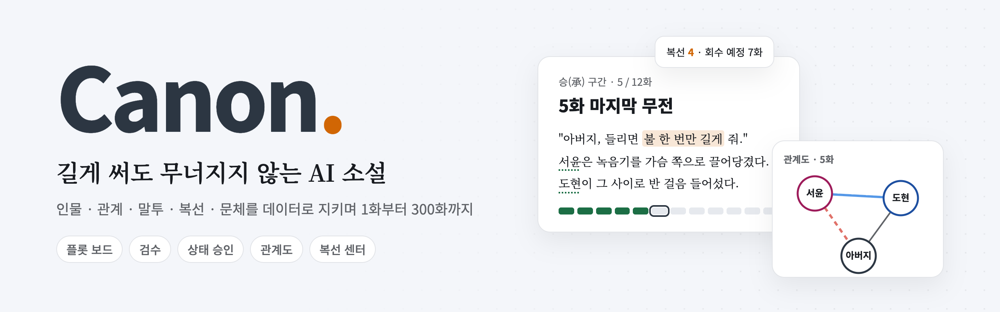
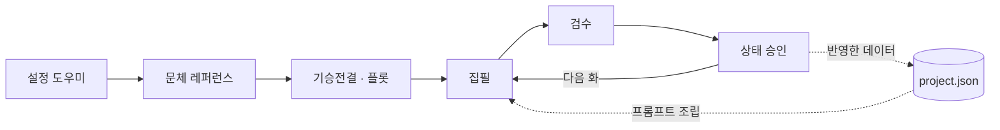
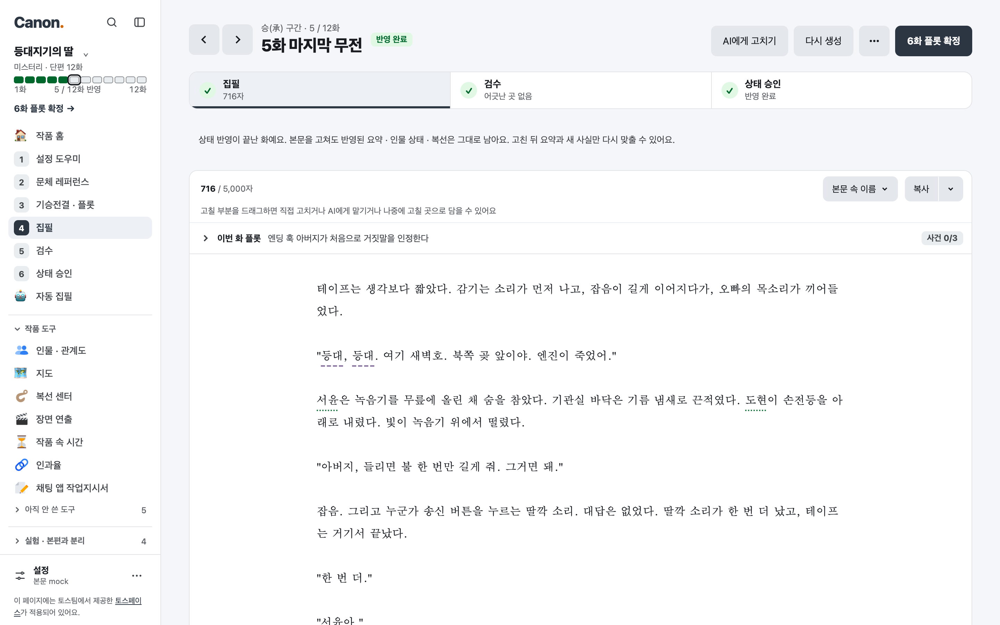
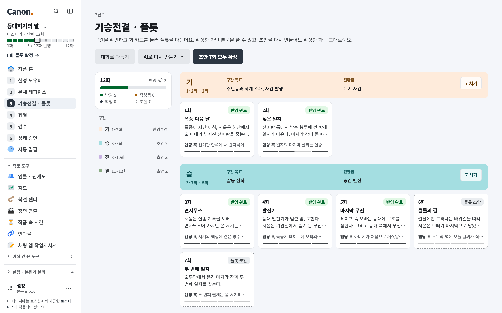
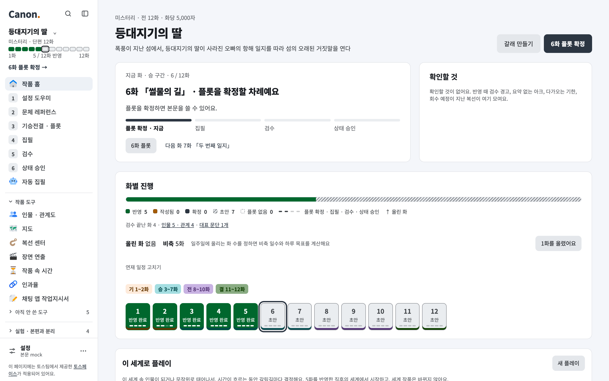
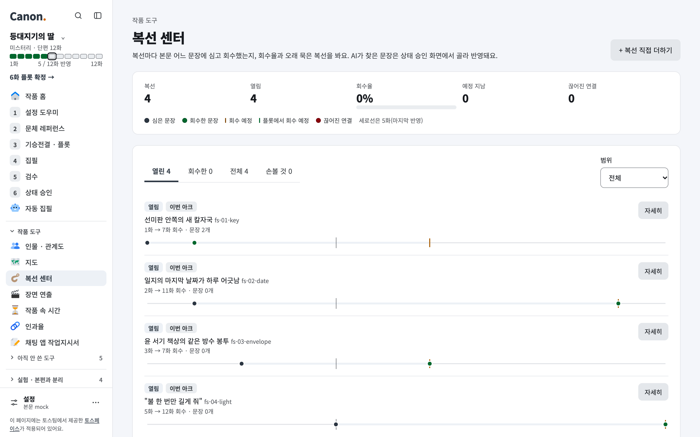

<p align="center">
  <picture>
    <source media="(prefers-color-scheme: dark)" srcset=".github/assets/banner-dark.png">
    
  </picture>
</p>

<p align="center">
  <a href="LICENSE"></a>
  
  
  
</p>

<p align="center">
  <a href="#설치">설치</a> ·
  <a href="#웹-ui">웹 UI</a> ·
  <a href="#cli-사용-순서">CLI</a> ·
  <a href="#목차">목차</a> ·
  <a href="DESIGN.md">설계 문서</a>
</p>

# Canon

AI 로 소설을 길게 쓸수록 인물 관계, 심리, 말투, 복선, 문체가 무너진다. Canon 은 이것들을 **구조화된 데이터**로 관리하고, 매 화마다 그 데이터로 프롬프트를 조립한다. 본문을 쓴 뒤 AI 가 상태 변경안을 내고, **작가가 승인해야** 데이터에 반영된다. 10\~20화 단편부터 부 → 아크 → 화로 나눠 쓰는 200\~300화 장편 연재까지 다룬다. 웹 UI 와 CLI 가 같은 작품 파일을 쓴다. 설계는 [DESIGN.md](DESIGN.md).

| 기둥 | Canon 이 하는 일 |
|---|---|
| **데이터로 지키는 설정** | 인물은 바뀌지 않는 설정(성격 · 말투)과 화마다 바뀌는 상태(감정 · 목표 · 아는 정보 · 차림)로 나눈다. 관계 수치는 AI 가 적지 않고, AI 가 뽑은 사건으로 Canon 이 계산한다. |
| **AI 는 제안만** | 설정, 플롯, 상태 변경은 모두 제안 카드로 온다. 지금 값과 바꿀 값을 칸별로 비교하고, 고른 것만 반영한다. 반영 취소와 이전 판 복원이 있다. |
| **길어져도 같은 크기의 프롬프트** | 이전 본문 전체가 아니라 화별 요약, 직전 화 끝부분, 지금 데이터만 넣는다. 장편은 끝난 부 · 아크를 접고, 사실 · 떡밥 · 비밀을 예산 안에서 고른다. |
| **검수와 경고** | 검수는 앞선 본문과 데이터에 비춰 모순을 찾는다. 상태창 수치, 작품 속 날짜, 이동 거리가 어긋나면 상태 승인 화면에 경고가 뜬다. 회수 예정이 지난 복선은 작품 홈에 모인다. |
| **모델은 골라 쓴다** | 기본은 Gemini 다. Claude(구독 로그인 또는 API 키)와 OpenAI 호환 로컬 서버(Ollama, llama.cpp, vLLM, LM Studio)도 쓴다. 단계마다 다른 모델을 고를 수 있다. |



## 화면

<table>
  <tr>
    <td width="50%"></td>
    <td width="50%"></td>
  </tr>
  <tr>
    <td align="center"><b>집필</b>: 본문 속 인물 · 장소 이름에 밑줄, 고칠 부분을 골라 AI 에게 맡기기</td>
    <td align="center"><b>기승전결 · 플롯</b>: 구간별 화 카드와 단계 막대</td>
  </tr>
  <tr>
    <td></td>
    <td></td>
  </tr>
  <tr>
    <td align="center"><b>작품 홈</b>: 지금 할 일, 화별 진행, 연재 비축</td>
    <td align="center"><b>복선 센터</b>: 심은 문장, 회수 예정, 오래 묵은 복선</td>
  </tr>
</table>

<sub>화면 속 작품은 mock 모드로 만든 예시다. 운영체제가 다크 모드면 화면도 어둡게 바뀐다(<a href=".github/assets/screen-plot-dark.png">다크 모드 보기</a>).</sub>

## 빨리 둘러보기

API 키 없이 화면만 보려면 mock 모드로 띄운다.

```bash
python3 -m venv .venv && source .venv/bin/activate
python -m pip install -r requirements.txt
CANON_LLM=mock python -m canon serve   # http://127.0.0.1:8000
```

## 목차

<details>
<summary>모든 항목 펼치기</summary>

- **시작하기**: [설치](#설치) · [웹 UI](#웹-ui) · [CLI 사용 순서](#cli-사용-순서) · [채팅 앱(구독형)으로 쓰기](#채팅-앱구독형으로-쓰기)
- **기획과 집필**: [이름과 지명](#이름과-지명) · [원형 도감 (인물 만들 때 고르는 유형 카드)](#원형-도감-인물-만들-때-고르는-유형-카드) · [장편 연재 (200\~300화)](#장편-연재-200300화) · [이야기 줄기 (서브플롯 · 과거 회상 · 외전)](#이야기-줄기-서브플롯--과거-회상--외전) · [중간에 화 끼워 넣기 · 빼기 (외전, 추가 이야기)](#중간에-화-끼워-넣기--빼기-외전-추가-이야기) · [갈래 (n화부터 다른 전개 써 보기)](#갈래-n화부터-다른-전개-써-보기) · [서술 시점 바꾸기 (남주 → 여주 시점 등)](#서술-시점-바꾸기-남주--여주-시점-등) · [초반 1\~3화 (흡입력)](#초반-13화-흡입력) · [자동 집필 (목표 화까지)](#자동-집필-목표-화까지) · [검수 세션](#검수-세션) · [고칠 곳 (나중에 고칠 문장 담아 두기)](#고칠-곳-나중에-고칠-문장-담아-두기)
- **일관성 데이터**: [관계 역학](#관계-역학) · [복선 센터](#복선-센터) · [작품 속 시간 (며칠째 · 시간대 · 기한)](#작품-속-시간-며칠째--시간대--기한) · [지금 차림 (옷 · 상처 · 지닌 물건)](#지금-차림-옷--상처--지닌-물건) · [감정의 두 층 (겉과 속 · 머리와 몸)](#감정의-두-층-겉과-속--머리와-몸) · [인물 설정 바꾸기 (외모 · 성격 · 말투)](#인물-설정-바꾸기-외모--성격--말투) · [아는 정보 (알게 된 화와 접기)](#아는-정보-알게-된-화와-접기) · [두 사람 사이에 있었던 일 (장편)](#두-사람-사이에-있었던-일-장편) · [호칭 · 말씨 (누가 누구를 무엇이라 부르고 어떤 말씨를 쓰나)](#호칭--말씨-누가-누구를-무엇이라-부르고-어떤-말씨를-쓰나) · [상태창 수치 (게임 판타지 · 헌터물)](#상태창-수치-게임-판타지--헌터물) · [장면 연출 (방 안 자리 · 자세 · 접촉)](#장면-연출-방-안-자리--자세--접촉)
- **문체**: [AI 글티('쇠맛') 줄이기](#ai-글티쇠맛-줄이기) · [문체가 얼마나 반영됐나](#문체가-얼마나-반영됐나)
- **모델과 비용**: [로컬 모델 (Ollama, llama.cpp, vLLM, LM Studio)](#로컬-모델-ollama-llamacpp-vllm-lm-studio) · [Gemini 를 Google Cloud 서비스 계정(Vertex AI)으로](#gemini-를-google-cloud-서비스-계정vertex-ai으로) · [Claude (구독 로그인 또는 API 키)](#claude-구독-로그인-또는-api-키) · [사용량과 비용](#사용량과-비용)
- **실험실**: [연구 화면 (모델 실험)](#연구-화면-모델-실험) · [플레이 모드 (작업 중)](#플레이-모드-작업-중) · [화별 스토리보드 (쓰기 직전 장면 순서와 확정 값)](#화별-스토리보드-쓰기-직전-장면-순서와-확정-값) · [화별 큐 시트 (쓰기 전 연출 메모)](#화별-큐-시트-쓰기-전-연출-메모) · [큐 시트 집필 실험 (악보처럼 나눠 쓰기)](#큐-시트-집필-실험-악보처럼-나눠-쓰기) · [역설계 실험 (사람 글을 거꾸로 풀기)](#역설계-실험-사람-글을-거꾸로-풀기)
- **그 밖**: [Swift 앱 (개발 멈춤)](#swift-앱-개발-멈춤) · [파일 구조](#파일-구조)

</details>


## 설치

```bash
python3 -m venv .venv && source .venv/bin/activate   # macOS Homebrew Python 은 가상환경 필요
python -m pip install -r requirements.txt
export GEMINI_API_KEY=...            # https://aistudio.google.com/apikey
export CANON_MODEL=gemini-4-argon # 선택, 사용할 Gemini 모델 (기본값)
```

API 키 없이 흐름만 보려면 `export CANON_LLM=mock`.

## 웹 UI

```bash
python -m canon serve            # http://127.0.0.1:8000 을 띄우고 브라우저를 연다
python -m canon serve --no-browser     # 브라우저는 열지 않기
CANON_LLM=mock python -m canon serve   # API 키 없이 화면만 둘러보기
```

`serve` 는 시작할 때와 실행 중 10분마다 GitHub `main` 의 새 코드를 확인해 받는다(`git pull` 과 같다). 실행 중에 받으면 진행 중인 요청과 백그라운드 AI 작업(Gemini 호출 등)이 끝난 뒤 스스로 다시 시작하고, `requirements.txt` 가 바뀌었으면 의존성도 설치한다. `main` 브랜치가 아니거나, 고친 파일이나 올리지 않은 커밋이 있으면 받지 않고 이유만 출력한다. 작품(`projects/`)과 설정(`~/.canon/config.json`)은 git 이 다루지 않으므로 그대로다. 끄려면 `--no-update`, 간격은 `--update-interval 30`(분). 손으로 받으려면 `python -m canon upgrade`. `POST /api/update/check` 를 부르면 간격을 기다리지 않고 바로 확인한다(아래 '머지하면 바로 받기').

macOS 에서는 Finder 로 `scripts/canon-mac.command` 를 더블클릭해도 된다. 저장소의 `.venv` 를 켜고 서버를 띄운 뒤 브라우저를 연다(이미 켜져 있으면 브라우저만 연다). 처음 한 번은 우클릭 → 열기로 실행 허용이 필요할 수 있다. Dock 에 끌어 두면 앱처럼 쓸 수 있다.

Gemini API 키와 모델은 **설정**에서 넣는다. 설정은 화면이 아니라 지금 화면 위에 뜨는 대화상자다(사이드바 아래 **설정**, 작품 목록 같은 작품 밖 화면도 작품 밖 사이드바 아래 **설정**, Ctrl+K 명령 팔레트, 주소 `#/settings` · `#/settings/ai`). 왼쪽은 찾기와 갈래, 오른쪽은 줄마다 이름 · 설명 · 칸이다. 갈래는 셋으로 묶는다: **이 컴퓨터**(AI 연결 · 단계별 모델 · 고급), **이 작품**(작품을 연 채로 열 때만: AI 프리셋 · 집필 · 검수), **이 브라우저**(화면). 고르거나 칸을 떠나면 바로 저장하고 그 줄에 '저장했어요'를 보인다. 저장 버튼이나 저장 띠는 없다. API 키 칸만 줄 안의 **키 저장**(또는 Enter)으로 저장하고, 저장하면 바로 연결을 확인한다. **AI 연결**은 기본 AI 하나와 Gemini · Claude · 로컬 서버 구역이다. 기본 AI와 단계에서 쓰는 연결만 펼쳐 두고, 쓰지 않는 연결은 한 줄로 접어 **펼치기**로 연다. **연결 확인**은 저장된 설정으로 쓰는 AI마다 연결을 확인한다(본문을 만들지 않는다). **고급**은 환경 변수가 정한 값, 로컬 샘플링, 설정 파일 경로를 보기만 한다. 환경 변수가 정한 칸은 읽기 전용으로 보이고 그 변수 이름을 적는다(`CANON_LLM` 이 mock 이면 단계 AI도). **찾기**는 줄 이름 · 묶음 · 갈래 이름 · 찾을 말에서 낱말을 모두 찾고, 찾은 줄을 갈래별로 모아 그 자리에서 고치게 한다(Esc 로 지운다). 명령 팔레트도 같은 줄을 찾아 그 갈래를 연다. 640px 이하에서는 대화상자가 화면 전체를 채우고 갈래 목록 → 상세(맨 위 '‹ 설정')로 넘어간다. 키 없이 AI 동작을 누르면 설정을 열지 묻는다. 값은 `~/.canon/config.json` 에만 저장되고(권한 600), 환경 변수 `GEMINI_API_KEY`, `CANON_MODEL`, `CANON_LLM` 이 있으면 그 값이 우선한다. CLI 도 같은 설정을 쓴다. AI 요금 가격표는 **사용량 · 비용** 화면에서 고친다. **이 작품 › 집필 · 검수**는 작품 설정 켜기 · 끄기를 모은다: 화별 스토리보드, 작품 속 시간 기록, 이동 시간 검사, 상태창 수치 넣기(상태창 수치가 있는 작품만: 인물 상태에 그대로 · 이번 화 인물만 줄로 · 넣지 않음), 넓혀 찾기(장편), 관계를 숫자로 보기, 스냅샷 모두 남기기(장편). 같은 값은 원래 화면(집필 · 작품 속 시간 · 지도 · 상태 승인 · 작품 홈)에서도 바꿀 수 있다. 작품 정보 · 연재 일정 · 자동 집필 멈춤 조건은 그 화면으로 가는 링크만 둔다. **이 브라우저 › 화면**은 집필 생성 방식, 문체 밑줄, 이름 표시, 복사 줄바꿈 형식과 제목 줄이다(이 브라우저에만 기억).

작품 목록 · 사용량 · 문체 라이브러리 · 역설계 실험 같은 작품 밖 화면에도 사이드바가 있다(**작품 밖 사이드바**). 맨 위 줄(Canon · 알림 · **찾기** · 접기)과 아래 **설정**은 작품 사이드바와 같고, 가운데에 **작품 목록**(모든 작품의 확인할 것 수 배지) · **새 작품** · **새 플레이**, 접는 **최근 작품**(고친 때 순서로 셋, 멈춘 작업이나 결과 배지), 접는 **작품 밖 도구**(문체 라이브러리 · 역설계 실험 · 쇠맛 실험실(준비 중) · 사용량 · 비용)가 있다. 레일 접기와 900px 이하 띠 · 서랍도 작품 사이드바와 같다. 작품 목록은 머리 → 새 작품 칸 → **이어 쓰기** → **모든 작품** 순서다. 머리에는 **새 플레이**와 **+ 새 작품**이 있다. **이어 쓰기**는 가장 최근에 고친, 끝나지 않은 작품 하나를 크게 보인다: 형식 · 장르 · 갈래 칩, 장편은 지금 부 · 아크, 화 칸 띠(사이드바 작품 칸과 같은 색), 확인할 것(멈춘 AI 작업 · 검토를 기다리는 결과와 **가서 보기**), 그리고 주 버튼이 다음 단계 화면으로 바로 간다('38화 검수하기 →'). **모든 작품**은 작품마다 한 줄(제목 · 형식 · 장르 · 진행 막대 · 다음 할 일 링크 · 확인할 것 칩 · 고친 때 · ⋯)이다. 다음 할 일은 사이드바와 같은 차례로, 본문을 쓴 화는 검수가 끝나기 전에는 '3화 검수하기', 끝난 뒤에는 '3화 상태 승인'이고, 누르면 그 단계 화면으로 간다. 갈래와 플레이 사본은 본편 줄 아래에 들여 쓴다. 고친 때는 '오늘 14:11' · '어제 18:11' · '10.28 11:11'처럼 적는다. 위의 찾기 칸은 제목 · 폴더 · 장르와 갈래 · 플레이 이름에서 낱말을 찾고, **전체 · 확인할 것(있을 때만) · 쓰는 중 · 시작 전(반영한 화 없음) · 완결**로 거르고, 고친 때 · 제목 · 진행으로 정렬한다. 고친 때 순서로 모두 볼 때는 이번 주 · 이번 달 · 더 오래 전으로 묶고, 20묶음을 넘으면 **n개 더 보기**로 접는다. 목록 칸이 760px 보다 좁으면 줄이 위아래로 쌓인다. 새 작품 칸은 **+ 새 작품**(또는 사이드바 **새 작품**, 주소 `#/new`)으로 머리 바로 아래에서 펴고 닫는다(작품이 없거나 적던 내용 · 오류가 있으면 펴 둔다). 작품이 하나도 없으면 머리가 '첫 작품을 만들어요'이고 새 작품 칸 옆에 단계 1~6 안내가 있다. 새 작품 칸은 제목이 첫 칸이고 폴더 이름(주소)은 제목으로 만들어 접어 둔다. 폴더 이름에는 `/ \ : * ? " < > |` 를 쓸 수 없다. Enter 로 만들 수 있고, 다른 화면에 다녀와도 적던 칸이 함께 남는다(**비우기**로 지운다). 작품 줄의 **⋯**에서 폴더 이름을 보고, 작품을 복제하거나 폴더 이름(주소)을 바꾸거나 지운다(복제는 따로 선 사본이라 갈래 정보를 옮기지 않는다. 아래 '갈래'). 지운 작품은 서버의 `projects/.trash/` 로 옮겨 둔다(지울 때 제목을 다시 적는다). 사이드바 5단계 **검수** 화면에서 그 화만 일관성 점검을 돌리고, 본문을 고친 뒤 **다시 검수**한다(아래 '검수 세션'). 본문을 쓴 화의 집필 화면 머리는 검수 전에는 **검수하기**(검수한 뒤 열린 지적이 있으면 **검수 이어 하기**), 끝난 뒤에는 **상태 승인으로**가 주 버튼이고(열린 지적 수는 단계 띠에), 반영이 끝난 화의 집필 · 상태 승인 화면 머리에는 다음 할 일('6화 쓰기')이 있다. 장편의 부 · 아크 · 플롯 화면 머리는 지금 할 일 하나(끝난 아크 · 부 요약 → 다음 아크 기획 → 초안 확정)를 주 버튼으로 둔다. 모든 화를 반영한 단편은 기승전결 · 플롯 화면에서 전체 .txt 내려받기와 장편으로 늘리기를 권한다. 인물 · 관계도의 두 사람 상세에서 **수치 직접 보정**으로 온기 · 신뢰를 고치면 수동보정 사건으로 남는다. 작품 홈의 확정 사실은 **전체 보기**로 모두 펼친다. 작품 목록, 사이드바, 작품 홈, 설정 도우미는 AI 를 쓸 수 없는 이유(키 없음, 로컬 서버 응답 없음, mock 모드)를 알린다.

AI 작업과 알림은 **알림** 버튼 하나에 모인다. 버튼은 사이드바 맨 위 Canon 이름과 **찾기** 사이(위쪽 한 줄 막대에서도 **찾기** 앞, 레일에서는 **찾기** 위, 작품 목록 같은 작품 밖 화면에서도 작품 밖 사이드바의 같은 자리)에 있고, 보일 것이 없으면 사라진다. 버튼은 상태를 모양으로 알린다: 작업이 돌면 돌아가는 표시와 수('AI 2'), 실패나 멈춘 자동 집필이 있으면 '확인 n'(작업이 도는 중이면 빨간 수 배지), 반영 · 적용하지 않은 AI 결과만 있으면 주황 '결과 n', 끝난 작업을 아직 안 봤으면 '끝남 n', 새 알림만 있으면 점 하나, 서버 연결이 끊기면 '끊김'. 넓은 폭 사이드바 · 레일 · 휴대폰 폭에서는 'Canon' 이름과 작품 제목 자리를 남기게 글자를 빼고 기호와 수 배지(빨강 확인 · 주황 결과 · 초록 끝남)만 보인다. 글은 마우스를 올리거나 낭독으로 듣는다. 누르면 버튼 아래에 알림 창이 열린다: **확인할 것**(실패한 작업과 **다시 시도** · 설정, 사람을 기다리는 자동 집필, 지난 시도 실패, 아직 반영하지 않은 상태 변경안 · 아직 적용하지 않은 제안과 **가서 보기**), **진행 중**(걸린 시간, 단계 진행 막대, **멈추기**, 다른 작품이면 그 작품 이름, 지금 보는 화면이면 '이 화면'), **최근 알림** 다섯 개, 접힌 **끝난 작업 · 지난 알림**. 여러 단계로 도는 작업은 한 단계라도 끝나면 지금까지의 단계 평균으로 '약 n분 남음'을 붙인다(1분보다 적으면 '곧 끝나요'). Esc · 창 밖 누르기 · 화면 이동으로 닫고, 닫으면 버튼으로 포커스가 돌아온다. 명령 팔레트의 **알림 · AI 작업**으로도 연다. 알림(저장했어요 · 작업 시작 · 끝 · 실패 등)은 버튼 바로 아래 말풍선으로 뜨고 창의 최근 알림에 남는다(브라우저를 새로 고치면 지운다). 보통 알림은 3.5초 뒤 사라지고 오류 알림은 저절로 사라지지 않고 닫기 버튼으로 지운다. 작업 실패 알림에는 **다시 시도**(와 API 키 · 연결 오류면 **설정**) 버튼이 붙는다. 새 실패가 생겨도 창을 저절로 열지 않는다. 창이 열린 동안 말풍선은 숨긴다. 멈춘 작업은 이미 보낸 AI 호출의 응답을 버린다(그 호출 비용은 들 수 있다). 실패한 작업은 **다시 시도**로 같은 작업을 다시 시작한다. 화면 전체를 기다리게 하는 AI 호출(이름 추천, 삽화 등)은 5초가 지나면 **기다리지 않기**로 화면을 풀 수 있다. 서버와 연결이 끊기면 알림 버튼 · 창과 자동 집필 카드가 그 사실을 보이고, 다시 연결되면 서버 재시작으로 끝나지 못한 작업을 알린다. 배치 결과를 묻다 연결이 잠깐 끊겨도 기다리던 배치를 버리지 않고 다시 묻는다.

넓은 화면에서는 사이드바가 화면 왼쪽에 붙어 있어 긴 화면을 내려도 메뉴가 보인다. 사이드바 아이콘은 [토스페이스](https://toss.im/tossface) 이모지(토스팀 제공, 원본 그대로)로 그리고, 단계 1\~6은 번호로 둔다. 글꼴은 jsDelivr CDN에서 받고, 받지 못하면 시스템 이모지로 보인다. 사이드바 아래에 토스페이스 출처를 밝힌다. 사이드바는 위에서부터 맨 위 줄(Canon · 알림 · **찾기** · 사이드바 접기), 작품 칸, 단계, 접는 묶음, 아래 고정 줄 순서다. 작품 칸에는 작품 제목(한 줄, 길면 줄임표. 누르면 작품 홈, 옆 ⌄ 는 작품 목록), 장르 · 단편/장편 · 총 화수, 갈래 표시, 플레이 사본 표시(🎲, 다음 할 일은 '플레이로 돌아가기'), 화마다 한 칸인 띠(초록 반영 완료 · 주황 본문 작성됨 · 먹색 플롯 확정 · 회색 플롯 초안 · 빈 칸 플롯 없음, 테두리는 지금 화), 반영한 화 수, 다음 할 일 링크('8화 쓰기')가 있다. 장편은 지금 부 · 아크 이름을 적고 띠는 지금 아크의 화만 그린다(아크가 없거나 화가 40개를 넘으면 막대로 그린다). 단계 1\~6 바로 아래에 **자동 집필**을 둔다. 4 집필 · 5 검수 · 6 상태 승인 줄은 한 화 흐름 화면(과 작업지시서)에서는 보고 있는 화로, 그 밖에서는 지금 작업할 화로 간다. 줄 끝에는 작은 배지가 붙는다: **검수**는 그 화의 열린 지적 수(빨강), **상태 승인**은 그 화의 반영하지 않은 상태 변경안이 있으면 '결과'(주황), **자동 집필**은 쓰는 화, **고칠 곳**은 남은 수. 도구는 ▸ 삼각형으로 접는 묶음 **작품 도구**에 두고, 아직 데이터가 없는 도구(상태창 수치 항목 없음, 지도 장소 없음, 이야기 줄기 없음 등)는 그 안의 **아직 안 쓴 도구**로 한 번 더 접는다. 연구 · 큐 시트 실험 · 역설계 실험 · 사용량은 **실험 · 본편과 분리** 묶음이고 처음에는 접혀 있다. 지금 보는 화면이 든 묶음은 펼쳐 두고, 펼침은 브라우저에 기억한다. 맨 아래 줄은 사이드바를 굴려도 바닥에 붙어 있다: **설정**(대화상자, 아래에 본문 모델)과 ⋯ 메뉴(작품 목록 · 문체 라이브러리 · 역설계 실험 · 모든 작품 사용량 · 비용). 줄은 마우스로 쓸 때 32px, 손가락으로 쓰는 기기에서는 44px이다. 맨 위 줄의 접기 버튼을 누르면 사이드바가 기호만 남은 64px 레일로 접힌다(단계 번호 · 도구 이모지 · 찾기 · 알림 · 설정, 배지는 점, 이름은 마우스를 올리면 보인다). 다시 누르면 펼치고, 접은 상태는 브라우저에 기억한다. 901\~1599px 에서 대화 패널이나 다시 생성 열을 열면 사이드바가 저절로 레일로 접혀 단계로 한 번에 갈 수 있다. 좁은 화면(900px 이하)에서는 사이드바가 '메뉴 · 작품 제목 · 반영한 화 수(7/16 반영) · 알림 · 찾기' 한 줄 막대로 줄고 화면 위에 붙어 있어, 내려도 메뉴 · 알림 · 찾기가 보인다(집필 머리 · 목차처럼 위에 붙는 칸은 막대 아래에 붙는다). **메뉴**(☰)를 누르면 왼쪽에서 서랍이 나온다(뒤는 어둡게 덮고, 덮개 · 닫기 · Esc · 화면 이동으로 닫힌다. 연 동안 Tab 은 서랍 안에서만 돈다). 서랍에는 작품 칸 전체와 사이드바 메뉴가 44px 줄로 들어 있다. **Ctrl+K**(macOS 는 ⌘K, 입력칸 안에서도) 또는 사이드바의 **찾기**로 명령 팔레트를 연다. 작품 안에서는 사이드바의 화면 이름, 화 번호('12화' → 그 화 집필, 본문을 쓰고 승인을 기다리는 화는 검수 · 상태 승인도, 지금 차례가 먼저), 인물 이름(→ 인물 · 관계도, 초성 'ㅅㅇ' 도), 설정 칸(칸 이름 '주제' · '로그라인 누가' · '서윤 원하는 것' 이나 칸에 적은 값으로), 다음 할 일, 저장(고친 것이 있을 때), 알림 창을 찾는다. 설정 칸을 고르면 설정 도우미 기획서의 그 칸으로 가서 커서를 둔다(인물 칸이면 그 인물 카드를 편다). 작품 밖에서는 작품 목록 · 설정 · 알림 창만 찾는다. 위아래 화살표로 고르고 Enter 로 가며, Esc 로 닫으면 연 자리로 포커스가 돌아간다. 한글 조합을 끝내는 Enter 는 고르지 않는다. 휴대폰 폭에서는 작은 링크 · 화 슬라이더 · 지도 인물 칩을 44px 높이로 넓히고, 작품 속 시간의 화별 시점 표는 화마다 카드로 쌓고, 탭이 많으면 다음 줄로 넘긴다. 3단계 화면은 설정 도우미 · 문체 레퍼런스와 같은 틀이다: 왼쪽 220px 목차와 오른쪽 넓은 보드. 목차 맨 위는 진행 막대(반영 · 작성됨 · 확정 · 초안 수)이고, 그 아래 구간 줄(누르면 그 구간으로 내려간다, 오른쪽에 반영 수 · 초안 수), **확인할 것**(플롯이 데려온 새 인물 후보, 설정 없는 인물, 엔딩 훅이 빈 화, 구간 범위의 빈틈 · 겹침. 누르면 그 화를 연다), 시점 배지 범례가 있다. 장편은 목차가 부 › 아크 › 구간 나무다: 고른 아크가 든 부만 펼치고(다른 부는 눌러 펼친다, 부 옆 **고치기**), 고른 아크 아래에 기 · 승 · 전 · 결 줄, 맨 끝에 **+ 다음 아크** 자리가 있다. 끝났고 요약도 있는 앞쪽 아크가 넷 이상이면 한 줄로 접는다. 요약이 필요한 끝난 아크 · 부도 확인할 것에 올라온다. 보드 칸이 720px 보다 좁으면(대화 패널을 열었거나 좁은 창) 목차는 위에 붙는 한 줄 버튼(지금 구간 · 아크)이 되고 누르면 목록이 펼쳐진다. 머리 버튼은 셋이다: **대화로 다듬기**, **AI로 다시 만들기 ▾**(구조 다시 제안 · 초안 다시 만들기, 장편은 아크 초안 다시 만들기 · 부 구성 다시 제안, 그리고 함께 보낼 요청 한 줄), 지금 할 일 하나(초안이 없으면 화별 플롯 초안 만들기, 초안이 있으면 모두 확정, 그다음은 다음 화 쓰기). 3단계 화면에서 화 카드를 누르면 그 화의 **플롯 페이지**(`#/p/<작품>/arc/<화>`)가 열린다. 같은 틀로 왼쪽 목차는 이웃 화 목록(장편은 그 아크 안, 구간마다 묶고 점 색은 상태), 오른쪽은 카드 한 열이다: 맨 위 **이어받는 것**(아크 · 구간 목표, 앞 화 엔딩 훅, 다음 화 요약), 그 아래 **줄거리**(제목 · 요약 · 사건 순서) · **인물 · 시점**(등장 인물은 누르는 칩) · **끝과 이음**(작품 속 시점 · 감정 변화 · 엔딩 훅) · **복선**, 접은 **화 도구**(끼워 넣기 · 빼기 · 지우기). 경로(부 · 아크 · 플롯 › 아크 › 구간 › 화)와 이전 · 다음 화 버튼은 머리에 있다. 사건 순서는 사건마다 한 칸이라 길어도 다음 사건이 어디서 시작하는지 보이고, Enter로 다음 칸을 더하고 빈 칸에서 Backspace로 빼며 위 · 아래로 옮긴다(비워 둔 칸은 저장하지 않는다). 저장 · 버리기와 확정 · 쓰기 버튼은 화면 아래에 붙는 버튼 줄에 있다. 다른 화로 옮기거나 **보드로** 닫을 때는 고친 것을 먼저 저장한다. 대화로 다듬기 패널은 페이지 옆에 그대로 열려 그 화를 대상으로 삼는다. 구간 · 아크 · 부 고치기는 서랍 없이 그 자리에서 편다: 구간 고치기는 그 구간 머리 아래에서, 아크 고치기는 아크 카드 안에서, 부 고치기는 오른쪽 열 맨 위 카드로 칸이 열리고 같은 버튼(고치기 닫기)이나 Esc 로 닫는다. 그래서 대화 패널을 함께 열어도 보드를 가리지 않는다. 아크의 주요 인물은 id 를 치지 않고 인물 이름을 비중별로 체크해 고른다(설정 없는 id 는 빼기만 할 수 있게 남긴다). 아크 카드의 회수할 복선은 id 대신 복선 설명으로 보인다. 장편의 부 구성 카드(부 칸 · 부 구성 제안)는 목차의 **부 구성 보기**로 오른쪽 열 맨 위에 펼친다(펼침은 브라우저에 기억한다). 부가 없거나 부 구성 제안 · 작업이 있으면 펼쳐 둔다. 기승전결 보드는 구간마다 한 줄 머리(이름 · 범위 · 구간 목표 · 전환점 · 고치기)를 위에서 아래로 쌓고, 머리 아래에 그 구간의 화 카드를 폭에 맞춰 격자로 채워 화 번호 순서대로 읽힌다. 화 카드에는 요약 두 줄과 엔딩 훅 한 줄이 보인다. 집필 화면이 한 줄로 쌓이는 폭에서는 본문이 플롯 카드보다 먼저 온다. 저장 띠와 상태 승인 화면의 반영 줄은 서로 겹치지 않게 아래에서부터 쌓인다. 화면 아래에는 이 둘만 뜬다(작업과 알림은 위쪽 알림 버튼에 모인다). 집필 화면은 넓은 화면에서 본문을 가운데 넓게 두고 플롯과 복사 · 내보내기를 왼쪽에 쌓는다. 본문 칸은 화면 높이에 맞춘다. AI 에게 고치기 패널을 열면 본문이 먼저 오고, 휴대폰에서는 패널이 아래쪽 시트로 열린다.

집필 화면은 본문 칸 하나를 화면 폭대로 쓴다. 본문 칸 머리에는 본문 띠(글자 수 · 저장 · 문체 장치 · 수정 기록 · 복사)와 **이번 화 플롯** 띠가 함께 붙어 있어, 아래로 내려도 위에 남는다. 플롯 띠는 접으면 한 줄(엔딩 훅 · 쓴 사건 수 `사건 2/5` · 시점이 바뀐 화면 '시점 바뀜')이다. 펼치면 왼쪽에 사건 진행 줄이 있다. 다 쓴 사건을 체크하면 체크하지 않은 첫 사건에 '지금'이 붙고, 줄 끝의 엔딩 훅은 사건을 모두 체크하면 '도착'이 된다. 체크는 누르자마자 작품에 저장되고(AI 프롬프트에는 들어가지 않는다), 사건 글을 고치면 그 체크는 풀린다. 플롯 초안인 화와 AI 작업 · 자동 집필이 맡은 화는 체크할 수 없고, 본문을 지우면 체크도 비운다. 오른쪽에는 등장 인물 · 서술 시점 · 작품 속 시간이 있고, 위 오른쪽 **더 보기**를 누르면 구간 목표 · 줄거리 · 감정 변화 · 여는 장면 · 독자 질문을 보인다. 플롯을 고치려면 '플롯 페이지에서 고치기'로 간다. 본문이 없는 화는 펼쳐서 시작하고, 본문이 있는 화는 마지막으로 고른 펼침을 브라우저에 기억한다. 640px 이하에서는 본문 띠와 접힌 한 줄만 붙어 있고 펼친 플롯은 본문과 함께 올라가며, 띠 버튼 이름을 줄여 쓰고(문체 · 기록) 접힌 줄의 사건 수는 숨긴다. 저장하지 않은 본문 알림과 **본문 저장**은 본문 띠(글자 수 옆)에 들어가 떠 있지 않다. 본문이 없는 화는 AI로 쓰기가 기본이다. 머리 오른쪽 주 버튼 하나로 쓰기를 시작하고, 머리 바로 아래 **n화를 어떻게 쓸까요** 칸에서 방식을 고른다: 스토리보드를 쓰는 작품은 **먼저 만들어 보기**(기본) · **만들고 바로 쓰기** · **스토리보드 없이** 중 하나를 고르면 주 버튼 이름이 'n화 스토리보드 만들기' · '스토리보드 만들고 n화 쓰기' · 'n화 본문 생성'으로 바뀐다. 같은 칸에 **직접 쓰기**, 스토리보드 켜기 · 끄기, AI에게 보내는 컨텍스트가 있다. AI 작업이 도는 동안 주 버튼 자리에는 작업 이름 · 경과 시간 · **멈추기**가 있다. 본문이 없는 동안 이번 화 플롯은 그 아래에 자기 높이로 펼치고(안에서 따로 굴리지 않는다), 글자 수 · 문체 장치 띠는 본문이 생기면 나온다. 채팅 앱으로 쓰려면 머리 **⋯** 메뉴의 **본문 작성 지시서 .md 내려받기**(본문이 있으면 검수 · 상태 승인 지시서)나 **작업지시서 화면 열기**를 쓴다. 본문이 생긴 뒤에는 생성 방식과 컨텍스트도 **⋯** 메뉴에 있고, 같은 메뉴에 '이 화 지우기'가 있다. 위치 줄의 구간은 '전(轉) 구간'처럼 한자를 붙인다. **AI에게 고치기**(대화)와 **다시 생성**은 같은 오른쪽 자리에 하나만 열린다. 대화 패널을 열면 1600px 이상은 사이드바를 그대로 두고, 901~1599px 은 사이드바를 레일로 접고 패널을 400px 로 줄여 본문 · 머리 버튼을 덮지 않는다. 900px 이하는 아래쪽 시트로 열리고, 떠 있는 저장 띠 · 작업 목록 · 알림은 시트 위로 올라간다. 대화 패널이 열려 있으면 알림은 작업 목록 위에 쌓인다.

운영체제가 다크 모드면 화면도 어두운 색으로 바뀐다. 색은 모두 `app.css` 의 `:root` 토큰에 있어 다크 모드는 그 토큰만 다시 정한다. 브랜드 색은 '먹 · 귤'이다. 버튼과 고른 메뉴는 먹색(`--accent`), 귤색(`--brand-2`)은 로고 점에만 쓴다. 글자는 바탕과 4.5:1, 입력칸 테두리(`--line-strong`)는 3:1 이상이다. 버튼은 테두리 없이 면으로 구분한다: 보조 버튼은 회색 면(`--btn`, 올리면 `--btn-hover`), 주 버튼은 먹색 면, 한 단계 조용한 버튼(`.btn.ghost`)은 글자만이다. 기승전결 칸은 기에서 결로 갈수록 짙어지고, 상태색은 빨강 · 초록 · 주황 순으로 밝아져 색약에서도 밝기로 갈린다. 다크 모드의 상태 칸은 밝은 색에 어두운 글자(`--on-status`)다. 인물 관계도의 온기 · 긴장 · 두 사람 그래프 색도 토큰(`--warm-*`, `--tension-*`, `--pair-*`)이다.

접근성: 글자 크기는 브라우저의 기본 글자 크기를 따른다(rem). 모든 버튼 · 링크 · 입력칸이 같은 포커스 링을 쓰고, 탭 묶음은 ← → 로 옮긴다. 고대비 모드에서도 선택 · 지금 화면 · 저장 띠 · 알림이 테두리로 보인다. 이야기 줄기 노선도는 화 상태를 색과 함께 점 모양으로, 인물 관계도는 **관계 목록 보기**로 글로도 보인다.

키보드로 쓸 때: 화면을 옮기면 포커스가 그 화면 제목으로 가고(탭 이름도 화면 · 작품 이름으로 바뀐다. 집필 · 검수 · 상태 승인은 '검수 · 4화 …'처럼 단계 이름이 앞에 붙는다), 맨 앞 **본문으로 건너뛰기**로 사이드바를 건너뛴다. 화면을 다시 그려도 쓰던 칸이나 누른 버튼에 포커스가 남고, 칸을 고친 뒤 Tab 으로 간 다음 칸도 그대로다. 화 플롯 페이지는 열면 제목으로 들어가고, 닫으면 보드의 연 카드로 돌아오며 보드에서 열었으면 보던 자리도 지킨다. Esc 는 대화 패널을 먼저 닫고, 그다음 화 플롯 페이지나 그 자리에서 편 구간 · 아크 · 부 고치기를 닫는다. AI 작업 중인 버튼은 포커스를 지키고, 결과가 오면 첫 항목으로 옮긴다. 입력 중에 결과가 오면 입력을 마친 뒤 그린다.

되돌리는 동작은 이름으로 나눈다: 저장 띠의 **변경 모두 버리기**(저장 안 한 것), 상태 승인의 **a~b화 반영 취소**와 자동 집필의 **N화부터 반영 취소**(반영한 화, 그 반영이 더한 인물도 빠지고 변경안은 다시 고를 수 있게 남는다), 수정 기록의 **수정 취소**와 **다시 넣기**, 이전 판 · 문체 버전의 **복원**. 반영까지 끝난 전개를 지우지 않고 다른 전개를 써 보려면 **갈래**를 만든다(원본은 그대로). 저장하기 전 지운 인물 · 관계 · 예시 문단 · 표지는 저장 띠에서 하나 되살릴 수 있고, 지운 인과율 요소도 그 화면에서 되살린다. 버린 대화 변경안과 영향 분석은 **다시 검토**로 다시 연다. 인과율이 고친 본문은 수정 기록에 남는다. 장편에서 마지막 아크를 지우면 그 아크가 더한 인물과 복선 회수 예정 화도 되돌린다.

AI 제안 카드는 모두 지금 값과 바꿀 값을 칸별로 나란히 보이고, 버튼은 오른쪽에 [버리기] [반영] 순서다. 구조 다시 제안도 바로 바뀌지 않고 비교 카드로 온다. 여는 방식 안은 바뀌는 칸을 보이고, 하나를 골라도 다른 안과 다시 바꾸거나 고르기 전 플롯으로 되돌릴 수 있다. 설정 제안은 주제 · 톤 · 세계관 칸마다 고르고, 상태 승인의 관계 미리보기는 바뀌는 줄과 지금 값을 함께 보인다. 문체 화면은 라이브러리와 다를 때 작품 쪽과 라이브러리 쪽에서 바뀐 칸을 나눠 보인다.

AI 가 낸 제안(설정 제안, 상태 변경안, 부 · 아크 · 요약, 이야기 줄기, 전환 계획 등)은 반영하거나 버리기 전까지 서버에 남아, 새로고침하거나 다른 기기에서 열어도 다시 보인다. 실패한 AI 작업은 그 화면 위에 '지난 시도 실패'로 남고, 다른 작품에서 끝난 작업도 알린다. 자동 집필이 검토를 기다리면 사이드바와 작품 홈에 보인다.

서버에 연결하지 못하면 작품 목록 대신 연결 오류와 **다시 시도**를 보인다. 저장 띠의 **변경 모두 버리기**, AI 제안 카드의 **버리기**는 되살릴 수 없어 한 번 묻는다. 상태 변경안 반영은 고른 항목이 0건이거나 경고가 남았거나 변경안을 만든 뒤 본문을 고쳤을 때만 묻는다.

저장하지 않은 입력(작품 변경, 본문 초안, 작업지시서에 붙여 넣은 글, 반영하지 않은 상태 변경안, 분석하지 않은 문체 예시 원문)이 있으면 새로고침하거나 탭을 닫을 때 브라우저가 한 번 묻는다. 본문 초안은 그 화 집필 화면 아래쪽 띠에 **본문 저장**과 함께 보인다. 본문 초안은 화마다 이 브라우저(localStorage)에도 2초 간격으로 임시 보관하고 띠에 'n초 전 임시 보관'을 적는다. 탭이 죽었다가 다시 열었을 때 남은 초안이 서버 본문과 다르면 그 화 집필 화면에서 **초안 되살리기** · **초안 복사** · **초안 버리기**를 고른다(작품 홈에도 알린다). 서버에 저장하면 임시본을 지운다.

같은 작품을 두 탭이나 PC · 휴대폰에서 열어 두고 한쪽에서 저장했으면, 다른 쪽(오래된 화면)의 저장은 덮어쓰지 않고 막는다. 아래쪽 띠에서 **다시 불러오기**(이 화면의 변경을 버리고 그쪽 저장을 본다)와 **내 변경으로 덮기** 중에 고른다. 백그라운드 AI 작업과 자동 집필의 저장은 이 충돌로 세지 않는다(그 결과는 따로 지킨다).

작품 홈, 설정 도우미, 문체 레퍼런스, 기승전결 플롯 보드, 인물 · 관계도(관계도 재생, 인물 카드, 등장표), 지도(장소 놓기, 화별 인물 자리 재생, 어디에 있었나 표), 이야기 줄기(서브플롯 · 회상 · 외전 노선도), 인과율(요소·설정·사건과 영향 분석), 집필, 상태 변경안 승인, 채팅 앱 작업지시서 화면이 있다. 사이드바 아래의 **연구 · 모델 실험** 화면은 본편과 분리된 실험실이다 (아래 '연구 화면'). 그 아래 **사용량 · 비용** 화면에서 AI 호출에 쓴 토큰과 추정 비용을 본다 (아래 '사용량과 비용'). CLI 와 같은 `projects/<이름>/project.json` 을 읽고 쓴다. AI 제안은 바로 저장되지 않고, 화면에서 고르거나 고친 뒤 저장할 때 반영된다.

작품 홈은 위에서부터 머리(로그라인은 두 줄까지) → **지금 화** · **확인할 것** → **화별 진행** → 줄인 목록 순서다. **지금 화** 카드는 다음 할 일이 한 화의 단계면 그 화의 제목, 할 차례(플롯 확정 · 본문 쓰기 · 검수 · 상태 승인), 네 단계 막대, 본문 · 플롯 · 다음 화 링크를 보이고, 아니면 다음 할 일 한 줄(설정 시작, 다음 아크 기획, 완결)을 보인다. **확인할 것**은 흩어져 있던 알림을 한 목록에 모은다: 마지막 반영 때 검수 경고(첫 경고와 남은 수), 끝났는데 요약이 없는 아크 · 부, 반영한 마지막 화 기준 3일 안이거나 지난 작품 속 기한, 회수 예정 화가 지난 복선. 줄마다 그 화면으로 가는 버튼이 있다. 화별 진행 카드 맨 위 막대는 전 화수를 반영 · 작성됨 · 확정 · 초안 · 플롯 없음으로 나눠 보이고, 그 아래 한 줄에 검수 끝난 화 · 인물 · 관계 · 문체 수를 적는다(예전 진행 단계 카드는 사이드바 단계와 겹쳐 뺐다). 장편은 아크 칩에 '요약 필요'를 붙이고, 지금 부에 아직 아크가 없는 화가 있으면 **다음 아크 기획** 칩을 둔다. 아래 목록은 몇 개만 보인다: 주요 인물 4명(주역 · '항상' 인물 먼저, 감정 · 목표 · 위치 중 두 줄), 열린 복선 5개(심은 화 순서, 회수 예정 · 예정 지남 · 몇 화째), 확정 사실 최근 5개. 전체는 인물 · 관계도, 복선 센터, **전체 보기**에서 본다. 작품 홈의 **화별 진행** 칸과 플롯 보드의 화 카드 아래에는 네 칸 막대가 있어 그 화가 플롯 확정 · 집필 · 검수 · 승인 중 어디까지 왔는지 보인다(검수한 뒤 본문을 고쳤거나 열린 지적이 남았으면 검수 칸은 빈다). 같은 카드 머리에 **연재 일정**이 있다. 일주일에 올리는 화 수와 연재처에 올린 마지막 화를 적으면, 반영을 마친 화 중 아직 올리지 않은 **비축**(약 며칠분인지)과 **하루 목표**(화 수와 글자 수)를 보이고 비축이 3일분보다 적으면 알린다. 매일 올린 뒤 **n화를 올렸어요**를 누르면 올린 화가 하나 늘어 저장된다.

기승전결 · 플롯 화면의 **대화로 다듬기**를 열면 오른쪽에 대화 패널이 붙는다. "3화 전개가 너무 빨라", "결말을 비극으로 바꿔 줘", "15화짜리로, 라이벌과 처음 손잡는 아크"처럼 말하면 AI 가 필요한 플롯 · 요약 · 본문 단락을 몇 단계 읽은 뒤 고친다. 단계는 패널에 한 줄씩 보이고(읽음 · 바꿈 · 승인 기다림 · 막힘), 돌아가는 동안 ■ 로 멈출 수 있으며, 8단계에 닿으면 **이어 하기**로 계속한다. 고친 것은 입력 상자 아래의 **권한 모드**에 따라 처리된다. 기본인 '빈 곳 · 초안만 자동'은 초안 화 · 새 화 · 다음 아크 초안을 바로 쓰고, 확정한 화 · 아크 칸 · 구간 범위 · 부 구성은 **승인 카드**로 묻는다(고른 곳만 승인하고, '이 세션에서 묻지 않기'로 그 종류를 자동으로 바꿀 수 있다). '물어보기'는 모든 쓰기를 묻고, '모두 자동'은 묻지 않는다. 어느 모드에서도 본문이 있는 화의 플롯은 바꾸지 않는다. 바로 쓴 것은 턴마다 '이번 턴에 바꾼 것' 카드에 쓰기 전 · 뒤 비교로 남고, 항목마다 또는 턴 전체를 **되돌리기**할 수 있다. 그 뒤에 다시 고치거나 확정한 화는 그대로 두고 까닭을 알려 준다. 다음 아크를 짜면 아크 안은 다음 아크 초안 칸에 놓이고, '이 아크 적용'을 눌러야 작품에 들어간다. 대화는 **세션**으로 나뉜다. 패널 머리의 세션 제목을 누르면 세션 목록(대상 · 날짜 · 기다리는 승인)이 펼쳐지고, 새 세션을 열거나 이름을 바꾸거나 보관한다. 세션은 열 때 보던 곳(작품 전체, 고른 아크, 다음 아크)을 대상으로 기억한다. 입력칸에 `/` 를 치면 빠른 요청(`/여러안` 방향 여러 안으로 묻기, `/대상` 지금 보는 곳으로 대상 바꾸기, `/새세션`, `/되돌리기`)이 뜨고, **+** 로 보고 있는 곳 · 열린 화를 말에 붙인다. 예전 방식으로 나눈 대화는 세션 목록의 **이전 대화**에서 예전처럼 변경안을 골라 적용 · 취소한다. CLI 는 `python -m canon revise 등대 "3화 전개가 너무 빨라"` 로 예전 방식(변경안 하나를 골라 반영)을 쓴다.

- **무엇을 고치는지**: 패널 아래에 지금 대상이 보인다(단편은 작품 전체, 장편은 아크 줄에서 고른 아크나 **+ 다음 아크**). 화면에서 연 구간과 화도 함께 보내서 "이 화", "여기"라고만 말해도 된다. 구조가 아직 없으면 대화로 함께 짤 수 있다.
- **장편 아크와 부 구성**: 고른 아크의 칸(제목 · 목표 · 갈등 · 보상 · 주요 인물 · 회수할 복선 · 시점)과 기승전결, 그리고 부 구성(범위 · 목표 · 전환점 · 아크 후보)도 변경안으로 온다. 마지막 아크는 끝 화도 바꿀 수 있고, 그러면 구간 범위가 함께 바뀐다(줄여서 확정했거나 본문이 있는 화가 빠지면 빠진다). 범위가 바뀌어 저장된 부 요약은 범위가 같은 부만 남는다.
- **다음 아크를 대화로 짜기**: **+ 다음 아크**를 고르고 말하면 다음 아크 안이 오고, 적용하면 아래 다음 아크 초안에 들어간다. 초안이 있으면 그 초안을 두고 계속 고친다("갈등을 더 아프게"). 작품에는 **이 아크 적용**을 눌러야 들어간다. 새로고침으로 초안이 사라졌으면 변경안의 **다음 아크 초안에 다시 넣기**로 되살린다.
- **방향 여러 안**: 켜고 보내면 변경안 대신 서로 다른 방향 2~3개(어떻게 되는지, 바뀌는 곳, 얻고 잃는 것)가 온다. **이 방향으로 변경안**을 누르거나 여러 안을 체크하고 **고른 안 섞어서 변경안**을 누르면 그 방향으로 변경안을 청한다. 입력칸에 적어 둔 말이 있으면 함께 보낸다.
- **요청 칸**: 구조 다시 제안 · 화별 플롯 초안 · 부 구성 제안에도 한 줄 요청을 함께 보낼 수 있다(웹은 3단계 머리의 **AI로 다시 만들기 ▾** 창 안 요청 칸, 그 창의 버튼에만 실린다. CLI `arc` · `plot` · `series --note`).
- CLI: `revise 탑 "갈등을 바꿔 줘" --arc 3`, `revise 탑 "15화짜리 시험 아크" --next`(반영하면 바로 아크로 붙음), `revise 탑 "다음 전개" --options`.

구조가 아직 없으면 **AI로 구조 만들기** 대신 **직접 나누기**로 총 화수를 기승전결 네 구간으로 나누고 목표를 직접 적을 수 있다. 플롯을 모두 확정하면 플롯 화면 머리에 **N화 쓰기**가 뜬다. 집필 · 검수 · 상태 승인은 한 화의 세 단계다. 세 화면 머리 바로 아래 같은 단계 띠(4 집필 · 5 검수 · 6 상태 승인)가 단계마다 지금 할 일('열린 지적 1', '5/6 고름')을 적고 누르면 그 단계로 간다. 본문을 쓴 뒤 **검수하기**를 누르면 검수 단계로 옮겨 검수를 시작하고, 첫 검수면 상태 변경안도 함께 만든다(첫 검수 칸에서 끌 수 있다). 상태 승인 단계는 머리 버튼 줄에 **N건 반영하고 n화 완료**와 저장 칸, ⋯(변경안 다시 만들기 · 상태 승인 지시서 · 변경안 버리기)를 두고, 반영하면 다음 화가 확정이면 그 화 집필로, 초안이면 플롯으로 바로 간다. 넓은 화면은 왼쪽에 이 화 본문(읽기 전용, 변경안 근거 문장에 밑줄), 오른쪽에 변경안이다. 변경안은 **직접 정할 것**(인물 설정 바꾸기 · 새 인물 · 설정에 없는 인물 · 경고가 붙은 인물 · 본문 점검) → 요약 → **그대로 반영할 것**(인물 상태 · 관계 사건 · 비밀 · 확정 사실 · 복선 · 새 장소 · 작품 속 시간, 갈래마다 접어 두고 한 줄 요약과 고른 수, 비어 있는 갈래는 '변경 없음' 한 줄) → 관계 계산 순서다. 인물 이름으로 시작하는 경고(상태창 · 이동 시간)는 그 인물 줄 아래에 붙는다. 인물 상태는 바뀐 칸을 한 줄 칩으로 보이고 **고치기**로 그 자리에서 편다. 관계 미리보기는 바뀌는 줄만 펼치고 그대로인 줄은 접는다. 관계 사건 · 설정 바꾸기 · 복선 문장의 **본문**을 누르면 왼쪽 본문이 그 밑줄로 옮겨 가고, 밑줄을 누르면 그 항목으로 간다. 변경안의 관계 사건 종류 · 강도, 확정 사실, 알게 된 정보, 감정, 차림은 그 자리에서 고쳐 반영할 수 있고 고친 항목에는 '고침'이 붙는다(관계 수치는 고친 사건으로 Canon 이 계산한다). 갈래마다 승인한 값이 쌓이는 도구(인물 · 관계도, 상태창 수치, 복선 센터, 작품 속 시간)로 가는 링크가 있다. 입력칸 밖에서 `j` · `k` 로 다음 · 이전 항목(펼친 갈래 안)으로 옮기고 `x` 로 체크를 켜고 끈다. 900px 이하에서는 변경안만 먼저 보이고 본문은 접어 아래에 두며, 근거는 변경안 위 근거 카드로 보인다. 아래에는 고른 수와 반영 버튼만 있는 한 줄 반영 바가 붙는다. 반영하면 넘어간 화면 아래에 'n화를 반영했어요 · **되돌리기**' 알림이 10초 뜨고, 되돌리기는 반영 취소와 같다(자동 집필이 반영한 화에는 뜨지 않는다).

화별 플롯의 **등장 인물**은 등록된 인물 전부를 주역 · 조연 · 단역으로 묶어 보여 준다. 이야기에 새 인물이 필요하면 세 가지 길이 있다.
- **+ 새 인물**: 플롯 편집기에서 바로 만든다. 이름 후보 뽑기, 역할, 비중(기본 단역), 성별, 성격, 말투만 채우면 되고 이 화가 처음 나오는 화가 된다. 나머지는 설정 도우미에서 채운다.
- **AI 플롯이 데려온 인물**: 플롯 초안이나 대화로 다듬기, 장편의 다음 아크 기획에서 AI 가 새 조연 · 단역을 설정과 함께 제안하면 그 화에 **새 인물 제안**으로 보인다. 바로 인물이 되지 않고, **인물로 등록**을 누르거나 그 화를 확정하면 등록된다. 아크 기획이 데려온 인물은 아크의 주요 인물 칸에 '후보'로 보이고, 화 플롯에 나오면 그 화에도 보인다. **이 화에서 빼기**를 누르면 후보에서도 사라진다. AI 가 설정 없이 id 만 적은 인물은 **설정 없는 인물**로 보이고 **인물로 만들기**로 채운다.
- **본문에 처음 나온 인물**: 본문을 쓴 뒤 상태 변경안에 새 인물로 올라오고, 승인하면 등록된다.

새로 나온 지형 · 마을 · 건물 · 가게 같은 **장소**도 같은 길로 등록된다. 본문에 이름을 갖고 처음 나온 장소는 상태 변경안의 **새로 나온 장소**에 종류와 한 줄 설명과 함께 올라오고, 승인하면 인과율에 '장소' 요소로 들어간다(처음부터 있던 곳, 몇 화에 처음 나왔는지 표시). AI 플롯이 지은 새 장소는 그 화 화 플롯 페이지에 **새 장소 제안**으로 보이고, 그 화를 확정하면 등록된다. 이미 있는 장소(설정의 장소 칸, 인과율 장소 요소와 다른 이름)와 같은 이름, 본문에 나오지 않는 이름은 프로그램이 뺀다. '흑송촌'과 '흑송마을'처럼 띄어쓰기나 같은 갈래의 끝말(마을 · 촌 · 리, 산 · 봉 · 고개 등)만 다른 이름은 경고로 알려 한 이름으로 맞추게 한다. 등록된 장소는 그 장소가 나오는 화를 쓸 때 설명이 한 줄로 들어가고, 이름 후보를 뽑을 때 피한다. 그 화부터 반영을 취소하면 본문에서 등록한 장소도 빠진다(아직 안 쓴 화 플롯에 나오거나 작가가 시점 · 관련 인물을 더한 장소는 남는다).

등록된 인물은 처음 나온 화와 함께 감정 · 목표 · 아는 정보가 화마다 추적된다. 조연과 단역은 그 화에 체크돼 있을 때만 본문 프롬프트에 설정이 들어가고, 주역은 매 화 들어간다. 비중은 설정 도우미의 인물 카드에서 바꾼다(단편도 마찬가지). 인물 카드의 **AI에 넣기**로 비중과 따로 정할 수도 있다: **등장할 때**(기본, 위 규칙), **항상**(비중과 상관없이 매 화 앞 블록에 설정을 넣음. 장편에서 글자 예산을 넘기면 그 화 조연 · 단역 설정을 단역부터 빼고 뺀 수를 적음), **넣지 않음**(본문 쓰기 · 검수 · 상태 정리 · 플롯 기획에서 설정 · 상태 · 관계를 빼고, 플롯에 나오면 이름만 남김). 인과율 요소의 'AI에 넣기'와 같은 고르기다. 이름 없는 행인이나 군중은 인물로 만들지 않는다. 장편은 그 화에 체크하지 않은 조연이라도 플롯 글이나 직전 화 끝에 이름이 나오면 본문 프롬프트에 설정 · 말투 · 상태를 넣고, 검수와 상태 정리는 본문에 이름이 나온 인물을 넣는다. 10화 넘게 안 나오다 다시 나오는 인물은 마지막으로 나온 화와 그 화 요약 한 줄을 함께 넣는다. 말투가 빈 인물이 다음 화에 나오면 작품 홈의 확인할 것에, 말투가 빈 새 인물이 상태 변경안에 오면 경고에 뜬다. 다음 화 시점 인물의 서술 말투가 비었어도 확인할 것에 뜬다. 상태 변경안의 새 인물 이름이 이미 있는 인물 · 인물 후보와 같거나, 성을 뺀 이름이 같거나, 첫 · 끝 글자가 같아 헷갈리면 경고에 뜨고, 한 화에 새 인물이 셋을 넘어도 알린다(막지 않는다).

집필 화면의 **다시 생성**은 무엇이 아쉬웠는지 반영해 그 화를 새로 쓴다. 누르면 대화 패널 자리(오른쪽, 좁은 화면은 아래 시트)에 다시 생성 열이 열린다. 본문을 밀어내지 않아 본문에서 문장을 골라 살릴 부분에 담으며 요청을 적을 수 있다.
- **빠른 요청**(전개 늦추기, 전개 빠르게, 대사 늘리기, 감정선 살리기, 엔딩 세게, 플롯대로, 쇠맛 줄이기, 문체에 맞게, 분량 맞추기)을 여러 개 고르고, **피드백**을 말로 적는다.
- **함께 넣을 것**: 검수에서 찾은 곳, 1~3화 흡입력 판정, 문체 지표 경고, 지난 판에서 내가 직접 고친 곳. 이미 있는 자료라 AI 를 더 부르지 않고, 넣을 내용을 펼쳐 볼 수 있다. 검수 결과와 흡입력 판정은 있으면 처음부터 켜져 있다.
- **방식**: 처음부터 새로(지난 판은 보내지 않음) 또는 지난 판 고쳐 쓰기(지난 판 전문을 보내 좋은 문장은 살리고 고침).
- **살릴 부분**: 본문에서 드래그하고 떠 있는 도구의 **살리기**를 누르면 담긴다(5개까지). 새 판에 거의 그대로 들어간다.
- 새 판은 본문을 덮지 않는다. 지금 판과 **나란히**(두 칸이 같은 비율로 함께 스크롤, **스크롤 함께**로 끔) 또는 **바뀐 곳**(문단을 맞춰 보고 단어 단위로 표시)으로 비교한 뒤 **새 판으로 바꾸기**, **지금 판 두기**, **요청 고쳐 다시** 중에 고른다. 바꾸기 전 판과 고르지 않은 새 판은 **이전 판**(화마다 최근 6개, 넘치면 고르지 않은 새 판부터 지운다)에 남아 지금 판과 비교하고 되돌릴 수 있다. 새 판으로 바꾸면 검수 결과는 지난 판 것이라 지워진다.
- **보낼 프롬프트 보기**로 실제로 보내는 요청을 확인할 수 있다. 쓰기 프롬프트는 그대로 두고 요청을 맨 뒤에 붙인다. 그래서 다시 생성 요청은 직전 쓰기 요청을 통째로 품고, Gemini 암묵적 캐시가 맞을 수 있다(Gemini 4 는 앞 요청을 품은 요청에만 캐시가 맞는다. 캐시 유지 시간은 문서에 없다).
- CLI: `python -m canon rewrite 등대 3 --ask "서윤이 더 망설이게" --preset slower,dialogue --use issues,style --revise` (확인하면 바꾸고, 아니면 고르기 대기로 남김). `--adopt` / `--drop` 으로 고르고, `--versions` 로 이전 판 보기, `--restore v2` 로 되돌리기.

집필 화면에서는 본문의 **일부만 고칠 수 있다**. 고칠 부분을 드래그하면 작은 도구가 뜬다.
- **직접 수정**: 그 자리에 뜨는 칸에서 고르고 고친 글로 바로 바꾼다.
- **AI에게 고치기**: 오른쪽 대화 패널이 열리고 고른 부분이 담긴다. 바라는 것을 적거나 빠른 요청(더 길게, 더 짧게, 대사 늘리기, 쇠맛 줄이기, 동선 맞추기, 문체에 맞게)을 누르면 AI 가 앞뒤 본문, 문체 프로필, 인물 상태, 이번 화 플롯을 보고 그 부분만 다시 쓴 후보 2~3개를 낸다. 후보는 원문과 단어 단위로 비교해 보여 주고, 고른 후보만 본문에 들어간다. 후보를 손봐서 넣을 수도 있다. 넣은 뒤 "조금 더 짧게"처럼 이어 말하면 방금 넣은 글을 다시 고친다.
- 고친 것은 모두 **수정 기록**(화마다 최근 50건)에 남고 하나씩 되돌릴 수 있다. 본문을 통째로 고쳐 저장한 것도 바뀐 곳만 기록된다. 고친 직후 알림의 **되돌리기**로 바로 취소할 수 있고, 본문 칸 머리의 **수정 기록 N**을 누르면 기록을 펴서 보여 준다.
- 상태 변경안을 만든 뒤나 검수한 뒤에 본문을 고치면 다시 하라고 알린다. 검수에서 찾은 곳은 **검수** 화면에 보이고, **이 문장 고르기**나 본문의 밑줄을 누르면 그 문장이 골라져 바로 고칠 수 있다. 검수는 장면 안 **동선**도 본다. 등을 돌리고 망토로 가렸는데 다음 문장에서 표정이 보이는 것처럼 위치, 몸이 향한 쪽, 자세, 손에 든 것, 가려진 곳이 행동 없이 바뀐 곳을 짚고, 그 문장을 골라 **동선 맞추기**로 고친다.
- 쓰는 모델은 설정 › 단계별 모델의 **본문 부분 수정** 줄에서 정한다. 정하지 않으면 본문 쓰기 단계를 따른다 (`CANON_LLM_REVISE`, `CANON_MODEL_REVISE`).
- **상태 반영이 끝난 화도 고칠 수 있다.** 다음 화를 쓰려면 앞 화 반영이 끝나야 하므로, 다음 화가 있는 화는 모두 반영이 끝난 화다. 부분 수정, 본문 저장, 다시 생성 모두 된다. 반영된 요약 · 인물 상태 · 관계 · 복선은 뒤 화가 그 위에 쓰였으니 그대로 두고, 고친 화에 **반영 뒤 고침** 알림이 뜬다. 오타나 문장만 고쳤으면 **그대로 두기**, 내용이 바뀌었으면 **상태 다시 맞추기**를 눌러 상태 승인 화면에서 고친 본문으로 변경안을 다시 뽑는다. 거기서는 새 요약, 새 사실, 새 복선만 골라 카드 머리의 **선택한 항목 반영**으로 반영한다. 인물 상태나 관계까지 바꿔야 하면 그 화부터 반영을 취소한다. 뒤 화가 있으면 이어지는 장면이 어긋나지 않는지 다음 화를 검수해 보라고 알린다.
- 고치기 전후 쌍과 고르지 않은 후보는 나중에 선호 · 미세 조정 자료로 쓸 수 있게 남는다. `python -m canon edits 등대 --jsonl` 로 앞뒤 문맥과 함께 꺼낸다. CLI 로 고칠 때는 `python -m canon fix 등대 3 "고칠 문장" --preset less_ai` (또는 `--ask "대사로 풀어 줘"`), 되돌릴 때는 `edits 등대 3 --undo e2`.

집필 화면에서 **다른 사이트에 붙여 넣을 본문을 복사**할 수 있다. 본문 띠의 **복사** 버튼을 누르고, 옆 **▾** 메뉴에서 줄바꿈 형식 · 제목 줄 · 이 화 .txt · **여러 화 내보내기**(범위를 고르는 대화상자)를 고른다.
- 줄바꿈 형식: **문단 사이 빈 줄**(웹소설 플랫폼), **빈 줄 없이**(문단 간격을 편집기가 넣는 블로그 · 카페), **첫 줄 들여쓰기**(원고 · 공모전), **원문 그대로**. 고른 형식은 브라우저에 기억된다.
- 마크다운 제목 표시(`#`), 굵게 표시(`**`), 보이지 않는 문자, 겹친 공백은 지우고 글 내용은 바꾸지 않는다. 장면 구분(`***`)은 남긴다.
- 맨 위에 'N화. 제목' 줄을 넣을지 고른다. 여러 화를 한꺼번에 복사하면 화마다 제목 줄을 넣어 잇고, 본문이 없는 화는 건너뛴다. 여러 화 범위는 작품마다 따로 기억하고, 끝은 마지막으로 쓴 화까지다. 시작이 끝보다 크면 칸에 알리고 복사 · 내려받기를 끈다.
- 클립보드에는 텍스트와 HTML 을 함께 넣는다. 블로그나 플랫폼 에디터처럼 서식 있는 곳에 붙이면 문단이 그대로 남고, 메모장에는 텍스트로 들어간다. 저장 전에 고친 본문도 그대로 복사된다.
- 브라우저가 복사를 막으면 **.txt** 로 내려받는다. CLI 는 `python -m canon export 등대 --from 1 --to 10 --format compact -o 등대.txt`.

집필 화면에서 **NovelAI 삽화 프롬프트**를 만든다. 본문을 드래그해 **삽화 프롬프트**를 누르거나(상태 반영까지 끝난 화에서도 된다), 아래 **삽화 프롬프트** 카드에서 **AI 가 장면 고르기**를 누른다(**바라는 것** 칸에서 Enter 도 같다). 카드는 그 화에 삽화가 없으면 접혀 있고, 모델 · 화풍 · 부정 태그는 카드 안 **삽화 설정**에 접혀 있다. 바꾼 설정은 새로 만들거나 다시 조립할 때 함께 저장된다.
- AI 는 고른 장면을 Danbooru 식 영어 태그로 옮긴다: 인물마다 표정 · 자세 · 시선 · 동작, 인물끼리 주고받는 행동(`source#hug`, `target#hug`, `mutual#holding hands`), 장소 · 시간대 · 날씨, 빛, 구도 · 카메라, 소품 · 효과, 이 장면에서 나오면 안 되는 것. 바라는 것(예: 뒷모습, 두 사람만)을 덧붙일 수 있다.
- 인물 외형은 **인물 화면 인물 카드의 삽화 외형 태그**(외형, 기본 옷차림, 섞이면 안 되는 것)를 매번 그대로 넣어 화가 바뀌어도 같은 모습으로 나온다. **설정에서 AI 로 만들기**로 외모 · 나이 · 성별 설정을 태그로 옮긴 제안을 받아 고쳐 저장한다. 태그가 없는 인물은 AI 가 붙인 태그를 쓰고 **이 태그로 고정** 버튼을 보여 준다. 삽화를 만든 뒤 설정에 외형을 저장했으면 고정 대신 **다시 조립**을 권하고, 이미 저장된 태그를 고정으로 바꿀 때는 지금 값과 AI 값을 보여 주고 묻는다. 장면에서 다른 옷을 입으면 그 장면 옷이 기본 옷차림을 대신한다.
- 결과는 NovelAI V4 이상의 칸 그대로 나온다: **기본 프롬프트**(인물 수 `1girl, 1boy`, 화풍, 장면, 등급), 인물마다 **인물 프롬프트**(`girl` / `boy` / `other` + 외형 + 이 장면의 모습, 왼쪽 · 가운데 · 오른쪽 자리 안내), **부정 프롬프트**(Undesired Content), 인물 칸 없이 쓰는 **한 칸 프롬프트**(`|` 로 나눔). 칸마다 복사 버튼이 있다.
- 모델(V5 Full · Curated, V4.5 Full · Curated, V4 Full · Curated, V3)에 맞춰 조립한다. V5 는 장면을 영어 한 문장으로도 넣고, V3 는 인물 칸이 없어 한 줄로 잇는다. 품질 태그와 기본 부정 태그는 NovelAI 의 Add Quality Tags · UC 프리셋이 넣으므로 꺼져 있고, 그것들을 끈 사람은 켠다. 작품 공통 **화풍 태그**와 **공통 부정 태그**도 정한다.
- 성인물이 아닌 작품은 등급을 `rating:general` · `rating:sensitive` 로 묶고 부정 프롬프트에 `nsfw` 를 넣는다. 성인물은 장면에 맞는 등급을 붙인다.
- 만든 프롬프트는 화마다(최근 20개) 저장된다. 외형 태그나 모델을 바꾸면 **다시 조립**으로 AI 를 다시 부르지 않고 맞춘다. 쓰는 모델은 설정 › 단계별 모델의 **삽화 프롬프트** 줄에서 정한다 (정하지 않으면 계획 단계, `CANON_LLM_ILLUSTRATION`, `CANON_MODEL_ILLUSTRATION`). NovelAI 이미지 생성 API 는 부르지 않는다. CLI 는 `python -m canon illust 등대 3 "그릴 문장" --ask "비 오는 밤"`(문장을 비우면 AI 가 장면을 고름, `--list` 로 저장한 것 보기), 외형 태그는 `python -m canon look 등대 hero`.

사이드바의 **인과율**에서는 요소, 특징, 설정, 사건을 언제든 더한다. 종류(세계 규칙, 장소, 물건, 세력, 인물 특징, 과거 사건, 예정 사건, 기타), 이름과 다른 이름, 설명, 관련 인물과 함께 **언제부터 사실인지**(처음부터 사실이었다 / n화부터 생긴다), 일어나거나 꼭 나와야 하는 화, 독자에게 드러나는 화를 적는다. **+ 요소 더하기**는 바로 저장하지 않고 다른 칸처럼 저장 띠로 저장한다(아무것도 적지 않고 떠나면 버릴지 묻는다). 저장하면 AI 없이 이름·다른 이름·관련 인물로 찾은 **관련 화**가 바로 보인다. **영향 분석**을 누르면 AI 가 이미 쓴 본문과 정해 둔 플롯을 읽고 어긋나는 곳(원문 인용), 바꿀 화별 플롯, 이미 쓴 화의 최소 본문 수정안, 모순을 설명으로 덮을 확정 사실을 낸다. 원문에서 인용을 찾지 못한 지적과 본문이 있는 화의 플롯 변경은 프로그램이 뺀다. 고른 것만 반영하고, 확정한 화의 플롯을 바꾸면 초안으로 돌아간다. 화면은 왼쪽 목차(개요 · 손볼 것 · 종류별 요소)와 오른쪽 칸이다. 개요에는 손볼 것(분석 전 · 검토할 것 · 다시 분석)과 모든 요소가 있고, 요소를 누르면 그 요소 쪽(주소 `causal/<id>`: 요소 내용 → 관련 화 → 영향 분석)이 열린다. 요소 내용은 읽기 카드이고 **고치기**로 그 카드만 편다. 관련 화는 30화씩 칸 줄과, 어긋남 · 이름이 나옴 · 인물만으로 거른 줄 목록이다. 칸이나 줄을 누르면 영향 분석의 그 화로 간다. 영향 분석은 화별로 어긋나는 곳과 고칠 것(본문 · 플롯)을 한 칸에 묶는다. 칩은 분석이 건드리는 화 수('검토할 것 · n개 화')를 세고, 분석한 뒤 요소를 고치면 '다시 분석 필요'로 바뀐다. 처음부터 사실인 설정이 앞 본문과 부딪치면 '언제부터'를 늦춰 n화부터 생긴 일로 바꾸는 방법도 있다. 장편 연재에서는 부 구성과 아크 목표·요약까지 읽고, 부나 아크 목표와 어긋나면 알려 준다(부와 아크는 '부 · 아크 · 플롯' 화면에서 직접 고친다). 더한 요소는 본문 쓰기(관련 있는 화만, 드러나는 화 전에는 암시만), 화별 플롯, 플롯 대화, 검수 프롬프트에 들어간다. CLI 는 `python -m canon causal 등대 add --kind 과거사건 --title 등대지기 --desc "윤만석은 서윤의 친부다" --chars hero`, `causal 등대 show el-01`, `causal 등대 impact el-01`.

**문체 라이브러리**(작품 밖 사이드바의 작품 밖 도구, 작품 사이드바 아래 ⋯ 메뉴)에서는 붙여 넣어 분석한 문체를 작품과 따로 모아 두고 목록으로 본다. 항목마다 이름, 출처, 메모, 분석한 원문, 스타일 프로필, 원문으로 잰 기준 지표가 있고, 고치기·복제·삭제할 수 있다. 복제한 항목은 '이름 사본', '이름 사본 2' 처럼 번호가 붙는다. 목록 카드는 지킬·피할 것, 금지 표현, 표지, 장치 수를 따로 센다. 프로필이 모두 빈 문체는 라이브러리에 저장하지 않는다. 작품의 문체 화면에도 기준 지표가 보인다(지표마다 무엇을 쟀는지 한 줄 풀이). 작품 문체 화면에서 라이브러리로 오면 그 작품의 문체 화면으로 돌아가는 버튼이 생긴다. 새 작품을 만들 때 라이브러리 문체를 고르거나, 작품의 문체 레퍼런스 화면에서 가져오거나(`적용`) 지금 문체를 라이브러리에 저장할 수 있다. 적용하면 그 시점의 문체가 `project.json` 으로 복사되므로 라이브러리를 고쳐도 쓰고 있는 작품은 다시 적용하기 전까지 그대로다. 둘이 달라지면 문체 화면에 표시되고, 어느 쪽으로 맞출지 고를 수 있다. 라이브러리는 `projects/.styles/<id>.json` 에 저장된다(`CANON_STYLES` 로 경로 변경).

항목의 프로필이나 기준 지표가 바뀌어 저장될 때마다 **버전**이 남는다(최근 30개). 항목 화면 아래 '버전'에서 버전마다 앞 버전과 바뀐 칸을 보고, 예전 버전으로 되돌릴 수 있다(되돌린 상태도 새 버전으로 남는다). 저장할 때 버전 메모를 적을 수 있고, 비우면 바뀐 칸 이름이 적힌다. 작품의 문체 화면에서 '라이브러리 새 버전으로 올리기'를 누르면 그 작품에서 고친 문체가 항목의 다음 버전이 된다. 작품은 어느 버전을 쓰는지 기억해 라이브러리가 더 새 버전이면 알려 주고, **라이브러리 최신 버전 가져오기**로 받는다(작품만 고쳤으면 **라이브러리 버전으로 되돌리기**).

**대화로 다듬기**(문체 레퍼런스 화면): 문체를 말로 고쳐 가는 길이다. 위의 '대화로 다듬기'를 열고 "대사를 더 짧게 끊어 줘", "묘사가 너무 많아" 처럼 말하면 AI 가 스타일 프로필에서 바꿀 칸만 골라 지금 값과 나란히 보여 주고(글 칸은 지금 → 바꾸면, 목록 칸은 빠지는 것과 더해지는 것), 바뀐 문체로 쓴 시험 문단을 함께 낸다. 아래에서 참고할 화를 고르면 AI 가 그 화 본문을 보고 판단하고, 시험 문단은 그 화 한 대목을 새 문체로 고쳐 쓴 글이 된다(원래 대목과 비교해 볼 수 있다). 고른 칸만 작품 문체에 들어가고, 라이브러리에 연결된 작품이면 새 버전으로 함께 올릴 수 있다. 적용한 뒤에도 그 변경안 단위로 '적용 취소'를 할 수 있다(그 뒤에 다시 고친 칸은 그대로 둔다). 대표 문단은 원문 발췌라 AI 가 고치지 않는다. 대화는 작품에 저장되고 다음 말에 이어진다.

문체 레퍼런스 화면은 설정 도우미처럼 왼쪽 목차와 오른쪽 카드 한 열이다. 설정 도우미 · 문체 · 플롯 · 역설계 실험의 목차는 같은 틀이다. 좁은 화면에서는 위에 붙는 '지금 구역 ▾' 버튼으로 펴고, 바깥을 누르거나 줄을 고르거나 Esc 를 누르면 닫힌다(Esc 는 버튼으로 포커스를 돌린다). 편 채로 내려도 지금 구역만 바뀌고 펼침은 그대로다. 카드 순서는 라이브러리 · 기준 지표 한 줄(다른 문체 적용 · 새로 저장은 ⋯ 메뉴, 지표 풀이는 버튼) → 확인할 것(아직 고르지 않은 규칙 후보) → 이 문체로 쓴 예시 → 서술 → 지킬 · 피할 것 → 문체 표지 → 가끔 쓰는 장치 → 대표 문단 → 재료(원문 · 다시 분석, 내 수정에서 배우기)다. 프로필 카드는 읽는 모양이 기본이고 카드의 **고치기**로 그 카드만 고치는 칸을 편다(다 고쳤으면 **다 고쳤어요**). 빈 카드는 바로 고치는 칸이다. 문체 표지는 한 줄에 표지 · 쓰임 · 1,000자당이고, 가끔 쓰는 장치는 쓴 본문에서 센 '마지막으로 쓴 화'를 함께 보인다. 목차는 카드마다 수(서술은 채운 칸/10)와 표시(확인할 것, 라이브러리와 다름, 예시를 쓴 뒤 문체가 바뀜)를 단다. 대화 패널에 아직 고르지 않은 변경안이 있으면 바꿀 카드와 칸, 목차 줄에 '변경안'을 단다. 칸이 좁으면(대화 패널, 휴대폰) 한 열이 되고 목차는 위에 붙는 '지금 카드 ▾' 버튼이다. 저장 · 버리기는 화면 아래 저장 띠다. 문체가 비었으면 시작하는 세 갈래(원문 붙여 넣기 · 라이브러리에서 고르기 · 직접 채우기)만 보인다. 문체 라이브러리 항목 화면도 같은 목차와 카드를 쓴다.

**이 문체로 쓴 예시**(문체 레퍼런스 화면): 지금 문체로 600~900자 장면을 써서 규칙이 실제로 어떻게 읽히는지 보여 준다. 바라는 장면을 적거나, 본문이 있는 화를 골라 그 화 한 대목을 고쳐 쓰게 할 수 있다. 본문 쓰기와 같은 문체 블록과 쓰기 단계 모델을 쓴다. 대화 변경안의 칸을 모두 적용하면 그 시험 문단이 예시 칸으로 옮겨 오고, 예시를 쓴 뒤 문체가 바뀌면 '문체가 바뀌었어요'를 띄운다. 본문에는 들어가지 않는다.

**내 수정에서 배우기**(문체 레퍼런스 화면): 레퍼런스를 출발점으로 쓰다가 내 문체로 옮겨 가는 길이다. 집필 화면에서 AI 본문을 고친 기록을 모아 내가 되풀이해서 고치는 방향을 규칙 후보(지킬 것, 피할 것, 금지 표현, 문체 표지, 가끔 쓰는 장치)로 보여 준다. 후보마다 근거가 된 수정(고치기 전 → 고친 뒤)이 붙고, 근거가 두 번 이상인 것만 나온다. 고른 것만 작품 문체에 넣고, 라이브러리에 연결된 작품이면 새 버전으로 함께 올릴 수 있다. 되돌린 수정, 동선 맞추기, 새로 써 넣기만 한 것은 보지 않고, 쓸 수 있는 수정이 5건은 있어야 찾는다.

**가끔 쓰는 장치**(스타일 프로필): 레퍼런스의 자문자답 망상처럼 특정 상황에서 가끔만 써야 하는 장면 장치가 매 화 반복되면, 지킬 것 · 내면 독백 칸이나 대표 문단에서 빼고 여기에 적는다. 장치마다 이름, 쓰는 상황, 알아보는 글자(예: `다는 건`, `거지?`), 몇 화에 한 번까지인지, 예시를 적는다. 최근 화 본문에서 알아보는 글자가 합쳐 두 번 이상 나온 화를 그 장치를 쓴 화로 세어, 간격 안이면 이번 화 지시에 "쓰지 않는다"를 넣고 아니면 "이 상황에서만 한 번까지"를 넣는다. 간격을 어기면 `stats` 와 집필 화면 문체 경고에 나온다.

**집필 화면의 장치 · 금지 표현 표시**: 집필 화면 본문 띠의 **문체 장치** 메뉴에 장치마다 이번 화 배지가 붙는다(장치가 없으면 메뉴 이름은 '본문 속 이름'). '이번 화는 쉼'(몇 화에 썼고 몇 화부터 다시 쓸 수 있는지), '상황이 오면 한 번', '이번 화에 씀', '쉬는 화인데 씀'으로, 프롬프트에 들어가는 지시와 같은 계산이다. 본문에서는 장치를 쓴 화로 셀 만큼 나온 알아보는 글자와 금지 표현에 밑줄이 쳐지고(장치는 파랑, 쉬는 화인데 쓴 장치는 주황, 금지 표현은 빨간 물결), 쓰는 동안 바로 바뀐다. 밑줄을 누르거나 배지의 '고르기'를 누르면 그 문장으로 부분 수정 도구가 떠서 직접 고치거나 AI 에게 맡길 수 있고, 고친 것은 수정 기록에 남아 '내 수정에서 배우기'에 쓰인다. 밑줄은 메뉴의 '밑줄 끄기'로 끌 수 있다.

**본문 속 이름**: 집필 화면 본문에 나온 인물 이름과 장소 이름(인과율 '장소' 요소의 이름 · 다른 이름, 설정의 장소 칸)에 옅은 밑줄이 쳐진다(인물은 점선, 장소는 끊긴 선). '서윤이', '서윤의'처럼 조사가 붙어도 찾고, '서윤호', '등대지기'처럼 더 긴 다른 낱말 속 일부는 찾지 않는다. 문체 표시 밑줄과 겹쳐도 둘 다 보인다. 이름을 누르면(드래그로 고르면 부분 수정 도구) 작은 카드가 뜬다. 인물 카드는 이 화 시작 시점(앞 화까지 반영한 상태)의 감정 · 목표 · 위치 · 차림 · 아는 것과 관계를 보이고 인물 · 관계도로, 장소 카드는 설명을 보이고 지도로 간다. 키보드로는 본문 칸에서 이름에 커서를 두고 Alt+Enter, 또는 왼쪽 '본문 속 이름' 목록의 버튼으로 열고, Esc로 닫는다. 이 목록의 '이름 표시 끄기'로 끄며, 브라우저에 기억한다. 인물 설정에 별칭 칸이 없어 인물은 이름 그대로만 찾는다.

새 작품 폼과 설정 도우미에서 장르를 여러 개 고를 수 있다(로맨스 판타지, 무협 같은 큰 갈래와 회귀, 계약 관계 같은 요소). 고른 장르마다 독자가 기대하는 것, 관습, 자주 쓰는 소재, 전개 속도, 피할 것을 펼쳐 볼 수 있고, 같은 안내가 프롬프트와 작업지시서에 들어간다. 목록에 없는 장르는 직접 적는다. **성인물**을 체크하면 성인 독자 대상으로, 끄면 전연령 수위로 쓰라고 지시한다.

설정 도우미는 처음 쓰는 사람이 빈칸 앞에서 막히지 않게 나눠서 묻는다. 필수 칸(제목, 장르, 로그라인, 세계 배경, 이름 있는 인물 둘, 관계 하나)이 빈 새 작품은 **마법사**로 열린다. 제목 · 장르 → 로그라인 → 세계 → 인물 → 관계 → 마무리 여섯 걸음을 한 화면에 하나씩 묻고, 왼쪽 목차에 필수 칸 수(필수 4/6)와 걸음(채운 걸음 ✓, 들렀는데 빈 필수가 남은 걸음 '빈 필수')을 보인다. 좁은 화면은 목차 대신 걸음 막대(채운 걸음 초록, 빈 필수 주황)와 '2/6 · 로그라인' 한 줄이다. **이전** · **다음**은 화면 아래에 붙어 있고, **다음**은 막지 않고 누를 때 저장한다. 마무리 걸음은 빈 필수 칸을 모아 그 걸음으로 보내는 **채우기** 버튼을 두고, 필수 칸을 다 채워야 **문체 레퍼런스로**가 켜진다. 세계 걸음에서는 세계 종류(서양풍 제국, 동양 무협 등)를 고르면 배경 칸 첫 문장이 들어가고(뒤에 쓴 글은 그대로), 시대도 칩으로 고르거나 직접 쓴다. 고른 장르에 맞는 것을 '장르에 맞춰 추천' 줄에 먼저 보인다. 저장은 지금처럼 배경 · 시대 글이다. 인물 걸음은 이름 · 나이 · 성별 · 역할 · 원하는 것만 묻고, 상세 칸(두려운 것 · 숨기는 것 · 말투 · 성격 · 외모), 신체 프로필, 삽화 외형, AI에 넣기, 상태창 처음 수치는 **기획서**에서 고친다. 필수 칸을 다 채운 작품과 1화를 반영한 작품은 모든 칸을 한 화면에 둔 기획서로 열린다. 기획서는 마법사와 같은 뼈대로, 왼쪽 목차(기본 정보 · 로그라인 · 세계 · 인물 · 관계 · 더 채우기)가 구역마다 필수를 채웠는지(✓)와 남은 것('빈 칸 2명', '확인 1')을 보이고, 오른쪽에 구역 카드가 한 열로 선다. 머리 설명 줄은 남은 필수 칸이나 남은 할 일을 한 문장으로 말한다. 인물과 관계는 한 줄 목록(인물은 이름 첫 글자 원 · 역할 · 비중 · 나이 · 성별 · '빈 칸 n' 칩, 관계는 두 사람 · 사이 · 서로 보는 방식 · '확인 필요' 칩)이고, 누르면 그 자리에서 펴며 한 번에 하나만 편다. 고른 장르가 있으면 장르 칩과 **장르 바꾸기**만 보이고, 누르면 목록을 그 자리에서 편다. 좁은 화면(본문 폭 720px 이하, 대화 패널을 열었을 때도)은 목차가 위에 붙는 '4 · 인물 ▾' 버튼으로 접히고, 휴대폰에서는 **문체 레퍼런스로**가 화면 아래 줄로 내려간다. 목차 맨 아래 **걸음으로 보기**와 마법사 머리의 **한 장으로 모두 보기**로 오간다. 인물 화면의 **설정에서 고치기**는 늘 기획서의 그 인물 카드로 간다. 여러 칸을 바꾸는 AI 는 **대화로 다듬기** 패널에 모인다. 패널의 **빈칸 AI 제안받기**는 비어 있는 칸과 새 인물 · 관계를 한 번에 채우고, 말로 하면 채운 칸까지 고친다. 이미 있는 인물도 비어 있는 칸(성격 · 배경 · 외모 · 아크 · 말투 등)만 채운다. 제안 카드에서 그 인물의 채울 칸마다 체크를 풀 수 있고, 적어 둔 칸은 건드리지 않는다. 1화를 반영한 뒤 채운 칸은 설정 변경 기록에 작가 기록으로 남는다. 마법사에서는 패널의 시작 문장이 지금 걸음에 맞춰 바뀐다('로그라인에 나온 인물을 만들어 줘' 등). 빈칸 제안 카드에서 인물마다 **모든 칸 보기**로 제안 칸 전체를 펼쳐 본다. 마법사와 기획서의 제목 · 로그라인 다섯 칸 · 배경 칸 옆 **✦ 후보** 버튼(제목은 ✦ 제목 후보, 배경은 ✦ 배경 후보)은 그 칸 하나에 넣을 후보 세 개를 이유와 함께 칸 바로 아래에 펼친다. 기다리는 동안 화면을 막지 않는다. 하나를 눌러야 칸에 들어가고(저장은 작품 저장으로), **다시 받기**로 새 후보를, **닫기**로 칸을 그대로 둔다. 후보는 저장하지 않은 다른 칸 값에도 맞춘다. 기획서 인물 카드의 **더 자세히** 칸(성격 · 배경 · 외모 · 아크)에도 ✦ 후보가 있고, 그 인물의 다른 칸과 관계에 맞춘 후보를 낸다. 칸 하나를 채우는 것은 ✦, 여러 칸을 함께 바꾸는 것은 **대화로 다듬기**다.

- **로그라인**은 다섯 칸(누가 / 무엇 때문에 / 무엇을 하려 하나 / 무엇이 막나 / 무엇이 걸렸나)으로 쓴다. 칸마다 고른 장르의 예시가 점선 버튼으로 붙어 있고(채운 칸은 예시를 숨기고 **다른 예시**로 다시 연다, 직접 쓴 칸을 예시로 바꿀 때는 묻는다), 합친 문장과 점검(주인공의 특징, 계기, 행동인 목표, 막는 것, 길이)이 바로 보인다. 조사(이/가)는 자동으로 붙는다. 점검은 참고용이라 넘어가는 것을 막지 않는다. 장르마다 칸별로 나눈 예시 로그라인이 두 개씩 있어 "이 예시로 채우기"로 통째로 넣어 볼 수도 있다. 합친 문장을 직접 고치면 칸을 고쳐도 그 문장을 그대로 두고, **칸 내용으로 다시 만들기**로 되돌린다.
- **주제**는 이 이야기가 끝까지 묻는 질문 하나로, **톤**은 밝다↔어둡다, 가볍다↔진지하다, 빠르다↔느리다 다이얼(1~4단계, 고른 단계를 다시 누르면 꺼짐)로 고르면 문장이 만들어진다. 직접 쓴 톤 문장은 다이얼이 덮지 않고 **다이얼 문장으로 바꾸기**를 권한다.
- **인물** 카드는 이름 · 역할 · 비중 한 줄로 접혀 있고 누르면 펼쳐진다. AI에 넣기를 '항상'이나 '넣지 않음'으로 바꾼 인물은 접힌 줄에 눈 표시가 붙는다. 새로 더한 인물과 이름 · 역할 · 원하는 것 · 두려운 것 · 말투 중 빈 칸이 있는 인물은 펼친 채로 둔다(펼침은 화면에서만 기억). 펼치면 이름, 역할, 나이, 성별, 원하는 것, 두려운 것, 숨기는 것, 말투가 먼저 보이고 나머지는 "더 자세히"에 접혀 있다. 설정 도우미는 이야기 뼈대만 다룬다. AI에 넣기, 서술 말투, 신체 프로필, 삽화 외형 태그는 인물 화면의 인물 카드에서 고치고, 카드 아래 링크로 그 인물 카드에 간다. 비중 안내는 인물 구역 머리에 한 번 둔다. 인물 id 는 자동으로 짓고 화면에서 바꿀 수 없다(관계 · 상태 · 플롯이 id 로 인물을 찾는다). 저장할 때 id 가 비거나 겹치거나, 관계가 없는 인물을 가리키게 되면 받지 않는다(`pipeline.validate_characters`).
- **이름·지명**은 세계관에 맞춰 무작위로 뽑는다. 아래 '이름과 지명' 참고.
- **관계** 카드도 'A ↔ B · 사이' 한 줄로 접힌다(사이나 보는 방식이 비었거나 고칠 점이 있으면 펼침). 관계는 숫자 대신 말로 고른다. 어떤 사이인지(직접 쓴 사이를 예시로 바꿀 때는 묻는다), 두 사람 사이의 사정을 적는 **설명**(매 화 프롬프트에 들어간다), "서윤 → 도현"과 "도현 → 서윤"이 서로를 어떻게 보는지(믿는다, 좋아한다, 경계한다, 미워한다, 빚졌다, 얕본다, 잘 모른다), 원하는 게 부딪치는지(아니다 / 조금 / 정면으로). 고른 말은 `dynamics.VIEWS` 표로 방향별 시작 온기·신뢰·서열·원한이 된다.

CLI 의 `new -i` 도 로그라인을 같은 다섯 칸으로 묻고, 고른 장르의 예시와 점검 결과를 보여 준다.

설정 도우미의 **대화로 다듬기**를 열면 설정을 말로 고쳐 간다. "주인공의 약점을 더 어둡게", "라이벌을 한 명 넣어 줘", "로그라인이 밋밋해" 처럼 말하면 AI 가 로그라인 다섯 칸, 주제, 톤, 메모, 세계관 칸, 인물 칸, 새 인물, 관계에서 바꿀 것만 골라 지금 값과 나란히 보여 준다. 빈칸을 채우는 것은 처음부터 체크돼 있고, **이미 채운 칸을 바꾸는 것은 꺼져 있어** 작가가 체크해야 들어간다. 새 인물과 이어진 관계는 그 인물을 함께 골라야 넣을 수 있다. 적용한 뒤에도 그 변경안 단위로 **적용 취소**를 할 수 있다(그 뒤에 다시 고친 칸, 이미 플롯 · 관계에 쓰이는 새 인물은 그대로 둔다). AI 는 칸을 비우거나 인물 · 관계를 지우지 않는다. 어디로 갈지 막막하면 **방향 여러 안**을 켜고 보내면 서로 다른 방향 2~3개(무엇이 바뀌는지, 얻는 것과 잃는 것)가 오고, 하나를 고르거나 여럿을 섞어 변경안을 청한다. 1화를 반영한 뒤에는 관계의 시작 방식과 수치는 바뀌지 않고(지금 관계는 본문 사건이 만든다) 사이와 설명만 고치며, 바꾼 인물 칸은 인물 설정 변경 기록에 작가가 고친 것으로 남는다. CLI 는 `python -m canon setupchat 등대 "주인공 약점을 더 어둡게" [--options] [--pick 1,3 | -y]`, 적용 취소는 `setupchat 등대 --undo 메시지번호` 다.

### 서버에서 상시 실행 (Tailscale)

Vercel 같은 서버리스 호스팅은 맞지 않는다. 소설 데이터를 파일(`project.json`)에 저장하고 Gemini 호출이 길게 걸리기 때문이다. 항상 켜져 있는 리눅스 서버가 있으면 systemd 로 돌리고 Tailscale 로 내 기기에서만 연다. Canon 에는 로그인이 없으니 **Tailscale Funnel 이나 공개 포트로 열지 않는다**.

```bash
# 서버에서: 저장소를 받고 가상환경 준비
git clone https://github.com/c10dev/canon ~/canon && cd ~/canon
python3 -m venv .venv && .venv/bin/pip install -r requirements.txt
# deploy/canon.service 의 USER 와 경로를 고친 뒤 등록 (부팅 때 자동 실행)
sudo cp deploy/canon.service /etc/systemd/system/canon.service
sudo systemctl daemon-reload && sudo systemctl enable --now canon
# tailnet 안에서만 HTTPS 로 열기 (8446 은 비어 있는 아무 포트)
sudo tailscale serve --bg --https=8446 http://127.0.0.1:8000
```

그러면 같은 tailnet 의 맥, 아이폰에서 `https://<서버이름>.<tailnet>.ts.net:8446` 로 열린다. 작품은 서버의 `~/canon/projects/` 에, API 키는 서버 계정의 `~/.canon/config.json` 에 저장된다. 다른 컴퓨터에서 쓰던 작품은 `projects/<이름>/` 폴더를 그대로 복사하면 된다. 포트 대시보드(예: Portboard)를 쓰고 있으면 systemd 서비스 이름 `Canon - AI 소설 작성 웹 UI` 로 잡힌다. 로그는 `journalctl -u canon -f`.

#### 머지하면 바로 받기

서버는 10분마다 새 코드를 확인한다. `main` 에 머지하자마자 받게 하려면 GitHub Actions(`.github/workflows/notify-server.yml`)가 머지 때마다 Tailscale 로 들어와 서버의 `POST /api/update/check` 를 부르게 한다. 이 요청은 확인을 앞당길 뿐이고, 코드는 늘 `origin/main` 에서만 받는다. 진행 중인 AI 작업이 있으면 그 작업이 끝난 뒤 다시 시작하는 것은 같다.

1. Tailscale 관리 화면의 Access controls 에 태그와 규칙을 더한다. 러너는 서버의 Canon 포트에만 들어간다.
   ```json
   "tagOwners": { "tag:ci": ["autogroup:admin"] },
   "grants": [{ "src": ["tag:ci"], "dst": ["<서버의 Tailscale IP 또는 태그>"], "ip": ["tcp:8446"] }]
   ```
2. Settings → OAuth clients 에서 `auth_keys` 쓰기 권한과 태그 `tag:ci` 로 OAuth 클라이언트를 만든다.
3. GitHub 저장소 Settings → Secrets and variables → Actions 에 넣는다.
   - 비밀값 `TS_OAUTH_CLIENT_ID`, `TS_OAUTH_SECRET`: 2에서 만든 값
   - 변수 `CANON_SERVER_URL`: `https://<서버이름>.<tailnet>.ts.net:8446` (끝에 / 없이)
4. Actions 탭에서 '서버에 새 코드 알리기'를 손으로 한 번 돌려(Run workflow) 서버 로그(`journalctl -u canon -f`)에 `[업데이트]` 줄이 바로 찍히는지 본다.

`CANON_SERVER_URL` 이 없으면 워크플로는 돌지 않는다.

## 이름과 지명

AI 에게 이름을 맡기면 서윤, 도현 같은 몇 개 이름으로 몰리고, 45세 형사에게 2020년대 아기 이름을 붙이기도 한다. 그래서 후보는 코드가 뽑고 AI 는 그중에서 고르게 했다 (`canon/naming.py`, LLM 없이 계산).

- **이름 스타일**: 현대 한국, 조선·사극, 무협(중원), 서양풍 판타지, 일본, SF·우주. 세계관 칸의 '이름 스타일'에서 고르고, 비워 두면 장르와 배경·시대 글에서 짐작한다 (예: 시대에 '현대 일본'이 있으면 일본).
- **현대 한국**은 2015 인구주택총조사 성씨 비율과 출생 연대별 흔한 이름으로 뽑는다. 인물 나이(예: 45세, 40대 초반, 고1)와 시대 칸의 연도로 출생 연도를 어림해 그 시대 이름을 낸다. 일부는 같은 시대 이름의 음절을 섞어 목록에 없는 이름을 만든다.
- 무협은 복성을 포함한 성명과 별호, 문파, 중원 지역과 산·곡·객잔, 서양풍 판타지는 음절 조합 이름과 가문명, 왕국·영지를 만든다. 판타지에 너무 흔한 이름(레온, 카일, 루시안…)과 AI 가 자주 짓는 이름(서윤, 도현…)은 후보에서 뺀다.
- 설정 화면의 인물 카드에서 **이름 후보 뽑기**(즉시, AI 호출 없음)나 **AI 이름 추천**(후보 중에서 골라 이유를 붙임)을 누르고, 마음에 드는 칩을 누르면 이름 칸에 들어간다. 세계관 카드의 **지명 후보 뽑기**는 종류(마을, 산, 고개, 문파, 왕국…)를 골라 장소 목록에 더한다. 다른 인물과 첫 글자나 끝 글자가 겹치는 이름은 뒤로 미룬다.
- **이름 점검**은 같은 이름(역할 · 나이로 갈라 한 줄로), 성을 뺀 이름이 같거나 글자가 겹치는 이름, 나이와 안 맞는 이름, 이름 스타일과 다른 이름, AI가 자주 짓는 이름(한 줄로 모아)을 종류별로 알려 준다. 인물 후보도 함께 보고, 각 인물 카드와 화 플롯 페이지의 새 인물 칸 아래에도 그 인물의 점검을 보인다. 서양 · SF 이름은 두 글자로 비교하고, 성을 떼지 못한 두 글자 한국 이름의 같은 성은 잡지 않는다. 막지는 않는다. 숫자로 끝나는 이름은 읽는 소리로 조사를 붙이고('손님2와'), 로마자 이름은 조사 없는 문형으로 쓴다. 장르 · 로그라인 · 세계관 규칙 · 장소를 바꿔도 다시 점검하고, 문제가 없으면 '문제 없음', 점검하지 못하면 **다시 시도**를 보인다.
- **이름 규칙**에 "북부 귀족은 성 앞에 '폰'을 붙인다" 같은 규칙을 적으면 AI 추천과 설정 제안 프롬프트에 들어간다. 'AI 제안받기'도 같은 후보 목록을 받아서 고른다.
- AI 추천에 쓰는 모델은 설정 › 단계별 모델의 **이름 · 지명 추천** 줄에서 정한다. 정하지 않으면 계획 단계 설정을 따른다. 모든 단계에 모델 칸이 있어 단계마다 다른 Gemini 모델이나 로컬 모델을 지정할 수 있다 (예: 이름 추천만 gemini-3.8-flash, 환경 변수 `CANON_MODEL_NAME`).

```bash
python -m canon names 등대 --character hero          # 인물 이름 후보 8개 (AI 호출 없음)
python -m canon names 등대 --character hero --ai     # 이름·지명 단계 모델이 골라 이유를 붙임
python -m canon names 등대 --character hero --pick 3 # 3번을 이름으로 반영
python -m canon names 등대 --place 고개 --pick 1      # 지명 후보에서 골라 장소에 추가
python -m canon names 등대 --style joseon            # 이번만 다른 이름 스타일로
python -m canon names 등대 --check                   # 출연진 이름 점검
```

자료 출처와 한계는 `canon/naming_data.py` 머리말에 적었다. 한국 이름 목록은 대법원 출생신고 통계 상위권과 보도를 바탕으로 손으로 정리한 것이라 원자료와 한 줄씩 대조하지는 않았다. 웹소설 본문이나 이름 사이트를 긁어 온 것은 없다.

## 원형 도감 (인물 만들 때 고르는 유형 카드)

후회남, 회귀자, 비밀을 가진 스승처럼 자주 쓰는 인물 유형을 카드로 골라 인물을 만든다 (`canon/archetypes.py`, LLM 호출 없음). 카드마다 한 줄 설명, 원하는 것, 결핍, 성격, 말투 예, 숨기는 것, 아크, 흔들리는 상황, 비틀어 보기, 피할 것, 시작 관계(관계 칸의 '보는 방식' 말), 꼭 채울 것(Canon 에서 넣을 곳)이 있다. 원형 35개(로맨스 · 로판, 현판 · 회귀 · 헌터, 무협, 판타지, 미스터리 · 스릴러 · 호러, 현대 · 일상 · 기타, 공통), 상처 16개(상처가 된 일 → 잘못된 믿음 → 행동에 남은 흔적 → 회복), 말투 틀 14개.

- 설정 도우미 인물 칸 머리의 **도감 주사위**: 원형 + 상처 + 말투 틀 + 비틀기 + 이름(이름 스타일에 맞게)을 무작위로 섞은 3안. **새 인물로 추가**하면 새 인물의 **비어 있는 칸에만** 예시가 들어가고, 비틀기는 아크 칸 끝에 `비틀기: …` 한 줄로 붙는다. **이 원형으로 다시** 눌러 원형은 두고 나머지만 다시 굴린다.
- 이미 있는 인물에 원형을 고르는 칸은 없다. 명령줄 `dex` 로 원형을 보고 빈 칸을 채운다.
- 고른 원형은 `Project.cast_archetypes` 에 남는다. 인물 설정에 넣지 않으니 프롬프트는 바뀌지 않고, 채운 칸만 다른 칸처럼 들어간다.
- 원형 이름은 독자가 검색하는 웹소설 키워드로 짓고 일반 원형 이름(멘토, 트릭스터)은 별칭으로 둔다. 글은 이 저장소를 위해 새로 썼다. TV Tropes · 나무위키는 CC BY-NC-SA 라 옮기지 않았다.

```bash
python -m canon dex                                  # 원형 목록 (--genre 무협 으로 거르기)
python -m canon dex show regressor --parts           # 원형 카드 한 장 + 상처 · 말투 틀 목록
python -m canon dex use 등대 hero regressor --twist 2 --wound betrayed --speech haoche  # 빈 칸에 넣기
python -m canon dex roll 등대 --seed 3 --pick 1      # 주사위 3안, 1번을 새 인물로
```

## CLI 사용 순서

```bash
python -m canon genres                          # 장르 목록
python -m canon new 등대 -i --genre "미스터리, 회귀"   # 1. 설정 도우미 (AI 가 인물/세계관 제안), 성인물이면 --adult
python -m canon style 등대 examples/sample_style.txt   # 2. 예시 텍스트로 문체 프로필 (--save 이름: 라이브러리에도 저장)
#    또는 python -m canon style 등대 --library <id>    문체 라이브러리 항목 적용
python -m canon arc 등대                         # 3. 기승전결 구간
python -m canon plot 등대                        # 4. 화별 플롯 초안
#    projects/등대/project.json 에서 플롯 수정
python -m canon revise 등대 "3화 전개가 너무 빨라"   #    말로 고치기 (변경안 확인 후 반영, 장편 --arc N · --next, 방향 여러 안 --options)
python -m canon causal 등대 add --kind 예정사건 --title 태풍 --desc "12화에 태풍이 온다" --eps 12   #    요소·설정·사건 더하기 (impact ID 로 영향 분석)
python -m canon confirm 등대 all                 # 5. 플롯 확정
python -m canon run 등대                         # 6. 화마다 본문 생성 → 검수 → 상태 변경안 승인
#    또는 python -m canon auto 등대 --to 12          기준에 걸릴 때만 멈추는 자동 집필 (아래)
python -m canon openings 등대 1 --plot           #    1~3화 여는 방식 여러 안 (아래 '초반 1~3화')
python -m canon fix 등대 3 "고칠 문장" --ask "더 짧게"   #    본문 일부를 AI 후보로 고치기 (edits 로 기록 보기 · 되돌리기)
python -m canon rewrite 등대 3 --ask "더 조용하게" --use issues   #    피드백을 반영해 다시 생성 (새 판과 바꿀지 고르기, --versions 로 이전 판)
python -m canon export 등대 --from 1 --to 3       #    붙여 넣기 좋게 다듬은 본문 (-o 로 .txt 저장)
python -m canon illust 등대 3                     #    NovelAI 삽화 프롬프트 (look 등대 hero 로 인물 외형 태그)
python -m canon show 등대                        # 진행 상황
python -m canon stats 등대                       # 화별 문체 지표를 레퍼런스와 비교
python -m canon check 등대 3 --keep f2 --note "일부러"  # 검수 지적을 그대로 둠 (--wrong · --fixed · --reopen)
```

문체 라이브러리는 `python -m canon styles` (목록), `styles add 이름 원문.txt [--source 출처]`, `styles show <id>`, `styles rm <id>`, `styles versions <id>`(버전과 바뀐 칸), `styles restore <id> 번호` 로도 다룬다. 수정 기록에서 규칙 찾기는 `python -m canon learn 등대 [--pick 1,3 | -y] [--push]` 다(`--push` 는 연결된 라이브러리 항목에도 새 버전으로 올림). 대화로 문체 다듬기는 `python -m canon stylechat 등대 "대사를 더 짧게" [--ep 3] [--pick 1,2 | -y] [--push]`, 지금 문체로 예시 글은 `stylechat 등대 "비 오는 날 다툼" --example [--ep 3]` 이다.

한 화씩 하려면 `write 등대 3` → `check 등대 3` → `update 등대 3`. `check` 는 앞선 본문·설정과의 모순을 근거 문장과 함께 보여준다 (`run --no-check` 로 생략 가능). 작품에서 쓰지 말아야 할 표현은 `project.json` 의 `style.banned_phrases` 에 넣으면 `stats` 와 본문 지시에 반영된다.

## 검수 세션

한 화의 검수 일은 **세션** 하나다. 검수할 때마다 **회차**가 하나 늘고, 회차 결과는 그 화의 **지적** 목록에 합쳐진다. 지적마다 처리 상태가 있다: 열림, 고침, 그대로 둠, 잘못 짚음.

- 다시 검수하면 같은 문장을 짚은 옛 지적에 이어 붙인다. **그대로 둠 · 잘못 짚음**은 다시 나와도 그 상태와 메모를 지킨다. 고침으로 둔 지적이 다시 나오면 다시 연다.
- 이번 회차가 짚지 않은 열린 지적은, 그 문장이 본문에서 사라졌으면 고침으로 닫는다. 문장이 그대로면 열어 둔다(AI 가 한 번 놓친 것일 수 있다).
- 그대로 둠 · 잘못 짚음은 검수 프롬프트에 넣지 않는다. 합칠 때만 거른다.
- 자동 집필의 '검수 어긋남 허용 개수'는 그대로 둠 · 잘못 짚음으로 정한 지적을 세지 않는다. 정책의 '사소는 세지 않음'(기본 끔)을 켜면 사소한 지적도 세지 않는다. '치명이 있으면 멈춤'(기본 켬)은 허용 개수와 상관없이 치명인 지적이 하나라도 있으면 멈춘다. 다시 생성의 재료 '검수에서 찾은 곳'은 열린 지적만 넣는다.
- 다시 생성으로 새 판을 고르면(이전 판으로 되돌리기도 같다) **그대로 둠 · 잘못 짚음** 지적과 메모만 남기고 나머지 지적은 지운다. 회차는 남겨 번호를 잇고, 마지막 회차에 '새 판' 표시를 단다. 다음 검수가 같은 문장을 짚어도 결정이 그대로다. 본문을 지우면 세션을 비운다. 예전 작품의 마지막 검수 결과는 1회차의 열린 지적으로 옮겨 읽는다.
- 지적마다 **심각도**가 있다: 치명(독자가 바로 알아챌 모순, 뒤 화 전개를 흔듦) · 보통 · 사소. 검수할 때 AI가 정하고 작가가 바꿀 수 있다. 작가가 바꾼 심각도는 다시 검수해도 덮지 않는다. 예전 지적은 보통이다.
- 회차마다 새로 나온 지적, 다시 짚은 지적, 문장이 사라져 고침으로 닫은 지적의 id 를 남긴다(회차 비교).
- **고침안**: 열린 지적 하나의 AI 고침안 2~3개를 받는다. 고침안은 모순에 걸린 낱말만 바꾸고 원래 문장의 길이 · 어순 · 낱말을 지킨다(1번이 가장 적게 고친 안). 고침안은 지적한 문장을 대신할 글과, 그 고침 때문에 함께 바꿔야 하는 이 화의 다른 문장(**딸린 곳**)의 묶음이다. 딸린 곳은 하나씩 빼고 넣을 수 있다. 넣은 수정은 곳마다 수정 기록에 남고 같은 묶음 id 로 이어져 **한 번에 되돌린다**(그 뒤에 같은 자리를 또 고친 곳은 남긴다). 고침안이 그대로 둠 · 잘못 짚음 지적의 문장을 바꾸면 확인한 뒤에만 넣는다. 받은 고침안은 지적에 남고, 그 뒤 본문이 바뀌면 오래된 안이다. 고침안을 넣어도 지적은 열린 채다.
- **이 지적만 다시 검수**: 열린 지적 하나만 다시 묻는다. 이 화 본문 전체와 근거, 그 지적 때문에 넣은 고침안을 함께 보인다. 회차는 늘지 않는다. 풀렸으면 고침으로 닫고(작가가 다시 열면 되돌린다), 고친 문장 때문에 새로 어긋난 곳은 그 지적에 딸린 지적('고치다 생김')으로 더한다. 뒤 화는 보지 않는다. 반영이 끝난 화를 고쳤을 때는 '반영 뒤 고친 화' 알림이 뒤 화 검수를 권한다.
- 지적마다 처리 기록(처음 짚음, 다시 짚음, 작가가 정함, 고침안, 다시 검수)을 최근 20개까지 남긴다.
- **검수 화면**(사이드바 5단계, 한 화 흐름의 검수 단계, `#/p/<작품>/check/<화>`): 머리 아래 단계 띠, 그 아래 띠에 회차(시각, 짚은 수, 새 지적, 사라진 지적, 다시 짚은 지적, 결정 그대로, 채팅 앱 · 자동 집필 표시)와 처리 상태별 거르기(열림 · 고침 · 그대로 둠 · 잘못 짚음 · 모두)가 있다. 회차를 누르면 그 회차에 새로 나온 · 다시 나온 · 사라진 지적만 보인다. 새 판을 고른 회차 뒤에는 '새 판' 구분이 있다. 넓은 화면은 왼쪽 본문, 오른쪽 칸에 지적 목록과 그 아래 지적 상세다(집필 · 상태 승인 단계와 같은 자리). 좁으면 목록 → 상세 → 본문 순서로 한 줄로 쌓는다. 첫 검수는 상태 변경안도 함께 만들 수 있다.
  - 왼쪽 탭은 **모순 지적**, **초반 점검**(1~3화: 초반 지표와 흡입력 판정), **문체 지표**(AI 없이 재는 문체 경고, 처리 상태 없음)다.
  - 목록은 심각도 순(치명 → 보통 → 사소)이고, 딸린 지적('고치다 생김')은 원래 지적 바로 아래에 들여 놓는다.
  - 지적마다 '문장 바뀜'(고친 뒤 아직 다시 검수하지 않음), '이번 회차에서 안 짚음', '다시 검수에서 사라짐', '다시 나옴 · 결정 그대로', '이 지적만 다시 검수로 닫음'을 표시한다.
  - 본문은 집필 화면과 같은 칸이다. 열린 지적 문장에 밑줄이 있다. 목록의 지적이나 밑줄을 누르면 본문이 그 문장으로 옮겨 가고, 문장 바로 아래에 **고치는 창**이 뜬다(부분 수정 도구 자리). 문장이 바뀌어 그대로 찾을 수 없으면 가장 비슷한 문장(점선 테두리)을 짚는다. 저장하지 않은 고침은 집필 화면과 함께 쓴다.
  - 고치는 창: **AI 고침안 받기**를 누르면 고침안 2~3개가 바뀐 곳을 표시한 채 뜬다. 딸린 곳은 체크 칸으로 빼고 넣을 수 있고, 버튼은 넣을 곳 수('2곳 적용')를 적는다. 넣은 뒤에는 **한 번에 되돌리기**와 **이 지적만 다시 검수**가 뜬다. 그 밖에 **직접 고치기**, **대화로 고치기**(고칠 방향을 대화 패널에 넣음), 다른 처리 길 셋이 있다: 근거 쪽이 틀렸어요(근거 화 본문 · 설정 열기), 일부러 그렇게 썼어요(그대로 둠), AI가 잘못 짚었어요(잘못 짚음). 그대로 둔 지적의 문장도 바꾸는 고침안은 넣기 전에 묻는다. 창은 Esc 나 닫기로 닫는다.
  - 상세에는 이번 화 문장과 근거 원문(근거 화로 가는 링크), 고칠 방향, **문장에서 고치기** · **이 지적만 다시 검수**, 심각도 세 버튼, 처리 상태 네 버튼, 그대로 둠 · 잘못 짚음의 메모 칸, 원래 지적 · 딸린 지적으로 가는 버튼, 처리 기록이 있다. 고침으로 닫으면 다음 열린 지적으로 넘어간다.
  - 진행 막대의 검수 칸은 이 지적만 다시 검수로 풀린 고침안 묶음을 '검수 뒤 고침'으로 세지 않는다.
  - 열린 지적이 남아도 **상태 승인으로** 갈 수 있다(버튼에 수를 적고, 상태 승인 화면 위에 알린다). 검수는 경고다.
- 채팅 앱으로 쓸 때는 작업지시서의 **2 검수 지시서** 탭에서 지시서를 복사하고, 받은 JSON 을 붙여 넣으면 회차 하나로 합쳐 검수 화면으로 간다.
- 자동 집필 화면의 '검토 없이 반영한 화' 목록은 화마다 '열린 지적 n' 칩(누르면 검수 화면)을 달고, **열린 지적이 남은 화만**으로 거른다.
- 명령줄은 `check 등대 3` 결과에 지적 id 와 심각도를 보이고, `--keep` · `--wrong` · `--fixed` · `--reopen` 으로 정한다(`--note` 로 메모). `--sev f3 치명` 으로 심각도를 정하고, `--recheck f3` 으로 그 지적만 다시 검수한다. 고침안은 웹 화면에만 있다(명령줄은 `fix`). 자동 집필(`auto`)은 `--ignore-minor` · `--no-stop-critical` 로 심각도 정책을 바꾼다.
- 웹 API: 지적 상태 · 메모 · 심각도 `PUT …/findings/{id}`, 고침안 받기 `POST …/findings/{id}/fixes`, 넣기 `POST …/findings/{id}/fixes/{k}/apply`(`skip`: 뺄 딸린 곳, `confirm`), 묶음 되돌리기 `POST …/fix-groups/{묶음}/undo`, 이 지적만 다시 검수 `POST …/findings/{id}/recheck`.
- 자동 집필 화면의 '이럴 때는 멈추고 기다려요'에 **치명적인 어긋남이 있으면 멈추기**(기본 켬)와 **사소한 어긋남은 세지 않기**(기본 끔)가 있다.

## 장편 연재 (200~300화)

새 작품을 만들 때 형식을 **장편 연재**로 고르면(`new 이름 --serial`, 웹은 새 작품 화면의 '장편 연재') 작품을 **부 → 아크 → 화** 로 나눈다. 단편 작품은 예전과 똑같이 동작한다.

```bash
python -m canon new 탑 -i --serial --episodes 300 --genre "현대판타지"   # 장편 연재로 시작 (--arc-length 로 아크 길이 기본값)
python -m canon series 탑                  # 1. 부 계획: 작품 전체를 부 2~5개로 (부마다 목표, 큰 전환, 아크 아이디어)
python -m canon nextarc 탑                 # 2. 다음 아크 하나만 기획 (자기 기승전결, 갈등, 회수할 떡밥, 새 인물)
#    --len 25: 길이 지정, --note "라이벌 등장": 요청, --redo: 아직 안 쓴 마지막 아크 다시 기획
python -m canon plot 탑                    # 3. 그 아크의 화별 플롯만 초안
python -m canon confirm 탑 all
python -m canon run 탑                     # 4. 아크 끝까지 쓰기
python -m canon recap 탑                   # 5. 끝난 아크 줄거리 요약 (승인 후 저장, 부가 끝나면 recap 탑 part 1)
python -m canon arcs 탑                    # 부와 아크 진행 보기
```

한 번에 300화를 다 기획하지 않는다. 부 계획은 큰 방향만 잡고, 아크는 쓰면서 하나씩 정한다(롤링 기획). 아크가 끝나면 그 아크 줄거리를 요약해 두는데, 다음 화부터는 오래된 화별 요약 대신 이 요약이 들어간다. 그래서 270화를 써도 줄거리 블록이 수천 자로 유지된다. 요약을 저장하지 않은 아크는 화마다 첫 문장만 들어가 앞 이야기가 흐려지니, 아크가 끝나면 요약을 저장한다(자동 집필은 기록에 알린다). 본문보다 너무 앞서 아크를 짜면 다음 아크 기획이 쓰인 줄거리를 거의 보지 못한다. 그래서 본문이 하나도 없는 아크가 이미 2개 있거나 요약이 없는 끝난 아크 · 부가 있으면, 다음 아크 기획 칸(웹)과 `nextarc`(명령줄)가 "본문은 15화까지인데 아크가 198화까지 짜여 있어요"처럼 알리고 먼저 쓰고 요약하라고 권한다. 경고만 하고 기획은 막지 않는다.

입력이 길어지면 필요한 정보를 다 넣어도 글이 나빠진다. 그래서 장편 프롬프트는 블록마다 글자 예산을 두고 넘치면 이번 화와 덜 관련된 것부터 뺀다: 확정 사실은 최근 30개 + 이번 화 인물 · 이야기 요소 · 장소가 나오는 옛 사실, 비밀은 이번 화와 겹치는 것, 떡밥은 회수가 가까운 것과 작품 · 부 단위 큰 떡밥 먼저. 검수는 직전 3화만 원문으로 넣고 그 앞은 접은 줄거리와, 옛 화 본문에서 이번 화와 겹치는 단락만 찾아 넣는다. 저장된 데이터는 그대로다. 300화 합성 작품 기준 추정 입력 토큰은 본문 쓰기 약 2.1만, 검수 약 5.2만이다(바꾸기 전 2.8만\~8.7만, 20만\~26만). 줄인 검수가 놓치는 게 없는지는 연구 화면의 '검수 시험'으로 잰다.

장편 검수에는 **넓혀 찾기**를 켤 수 있다(기본은 꺼짐). 검수 화면 머리의 **넓혀 찾기 꺼짐/켜짐**으로 작품마다 정하고, 자동 집필 검수도 따른다. 켜면 검수가 끝난 뒤 이번 화에서 견줘 볼 사실 진술(최대 30개)을 뽑고, 진술마다 옛 화를 따로 찾아 첫 검수에 넣지 못한 단락이 근거로 나온 진술만(최대 8개, 처음에 근거를 하나도 못 본 진술부터) 그 근거와 함께 검수 모델에 다시 묻는다. 새로 찾은 곳은 첫 검수와 같은 문장을 짚지 않을 때만 검수 결과에 더한다. 검수 호출이 화마다 2번 늘고(새 단락이 없으면 1번), 판단기는 쓰지 않는다. 명령줄은 `check 등대 30 --widen`(이번만 켜기) · `--no-widen`(이번만 끄기). 단편은 넓히지 않는다.

장편은 반영할 때 찍는 화별 상태(스냅샷)를 0화, 아크가 끝난 화, 최근 20화만 남기고 지운다. 그래서 오래된 화로는 되돌릴 수 없다. 모든 화의 반영 직후 상태가 필요한 연구용 작품은 **스냅샷 모두 남기기**를 켠다(기본은 꺼짐). 작품 홈의 화별 진행 카드에서 **모두 남기기 꺼짐/켜짐**으로 정하고, 명령줄은 `snapshots 탑 --keep`(켜기) · `--no-keep`(끄기)이고 옵션 없이 부르면 남은 스냅샷만 보여 준다. 이미 지운 화는 되살리지 못하므로 1화를 반영하기 전에 켠다. 82화 작품에서 스냅샷 하나는 평균 168KB였다. 그 크기로 치면 100화를 모두 남길 때 스냅샷만 약 17MB 다. 끄면 다음 반영 때 오래된 스냅샷을 지운다.

인물에는 등장 비중(주역 · 조연 · 단역)이 있다. 주역만 매 화 설정 전체가 들어가고, 조연과 단역은 그 화에 나올 때만 들어간다. 인물 카드의 AI에 넣기를 '항상'으로 둔 인물은 비중과 상관없이 매 화 들어가고, 그 때문에 글자 예산(8천 자)을 넘기면 그 화 조연 · 단역 설정을 단역부터 빼고 뺀 수를 적는다. 본문에 처음 나온 이름 있는 인물은 상태 변경안에 새 인물로 올라오고, 승인하면 조연으로 등록된다. 이미 있는 인물이 그 화 플롯의 등장 인물에 없는데 본문에 이름이 나오고 상태 변경안이 그 인물의 상태나 관계 사건을 다뤘으면, 상태 승인 화면 '인물 상태' 칸에 **본문에 나와 등장 인물에 붙일 인물**로 보이고 반영하면 그 화 등장 인물에 붙는다(기본으로 체크, 이름만 나온 회상이면 체크를 푼다. 자동 집필 · `run -y` 는 그대로 붙인다). 반영을 취소하면 붙인 인물만 다시 뺀다. 떡밥은 범위(이번 아크 · 이번 부 · 작품 전체)와 회수 예정 화를 가진다.

웹에서는 '부 · 아크 · 플롯' 화면에서 부 계획, 다음 아크 제안 검토, 아크별 플롯 보드, 아크 · 부 요약 승인을 한다.

### 단편을 장편으로 늘리기

단편으로 시작한 작품도 장편 연재로 바꿀 수 있다. 다 쓴 단편이든 쓰는 중이든 된다. 이미 쓴 본문, 인물 상태, 관계, 문체, 인과율 요소, 복선은 그대로 남고, **단편 전체(기승전결 포함)가 아크 1**이 된다.

```bash
python -m canon convert 등대 --episodes 200                 # AI 전환 계획을 보고 반영 (결말 처리는 AI 가 고름)
python -m canon convert 등대 --episodes 200 --ending reopen # 결말 다시 열기 (keep: 닫고 다음 이야기로)
python -m canon convert 등대 --undo                         # 전환 전 단편으로 되돌리기
```

AI 전환 계획에는 새 총 화수에 맞춘 부 구성(부마다 아크 후보와 새 인물 계획), 장편을 끌고 갈 새 장기 떡밥, 기존 열린 복선의 범위 넓히기, 인물 비중(주역 · 조연 · 단역) 조정, 다 쓴 단편이면 아크 1 요약이 들어간다. 결말을 다시 열 때는 이미 쓴 본문을 고치지 않고 떡밥과 확정 사실로 열고, 아직 본문이 없는 화는 플롯 수정안을 낸다. 웹은 모든 화를 반영한 단편의 작품 홈과 기승전결 화면에 뜨는 **장편으로 늘리기**에서 항목마다 골라 반영한다. 확정한 화의 플롯 수정은 처음엔 빠져 있다(넣으면 초안으로 돌아간다). 명령줄 `convert` 로 단편을 다 반영하기 전에 전환하면 다음 아크 대신 아크 1을 열어 남은 화부터 마치게 한다.

전환에는 두 방식이 있다. 위가 **이어 쓰기**(단편을 그대로 앞에 두고 뒤로 늘림)이고, 단편을 장편 흐름에 맞게 다시 짜려면 **재구성**을 쓴다.

**재구성**은 단편을 씨앗으로 장편 앞부분(아크 몇 개, 기본은 단편 화수의 3배)을 새로 설계한다. 옛 화 하나가 보통 새 2\~4화로 늘어나고, 1\~3화는 웹소설 첫 화 훅에 맞게 다시 연다. 단편 결말은 첫 아크 끝 · 1부 끝 · 작품 끝 중 한 곳으로 옮긴다. AI 가 내는 **화 지도**에서 새 화마다 옛 화를 어떻게 쓸지 정한다.

| 쓰는 방식 | 새 화의 본문 | 상태 정리 |
|---|---|---|
| 그대로 | 옛 화 본문을 옮김 | 단편 때 승인한 변경안을 번호만 바꿔 다시 씀 (AI 호출 없음) |
| 다듬기 | 옛 화 본문을 옮긴 뒤, 집필 화면의 **AI 로 다듬기**로 새 자리에 맞게 고친 글을 비교하고 넣음 | 고치기 전이면 옛 변경안, 고쳤으면 새로 뽑음 |
| 새로 쓰기 | 플롯 초안을 받고 새로 씀. 본문을 만들 때 옛 원고가 '원고 재료'로 들어감 | 새로 뽑음 |
| 새 화 | 단편에 없던 화 | 새로 뽑음 |

화 번호가 바뀌므로 인물 상태 · 관계 · 확정 사실 · 복선은 1화 시작 전으로 돌리고 새 순서대로 다시 반영한다. 인과율 요소와 이야기 줄기의 화 번호는 새 화로 옮기고, 옮기지 못한 것은 반영 뒤 알려 준다. 옛 단편 원고와 상태 변경 기록은 작품 안 보관함(`archive`)에 남는다. 재구성한 뒤에는 부 · 아크 화면에서 아크마다 플롯 초안을 받아(지도 내용이 프롬프트에 들어가고, 본문이 있는 화의 플롯은 그대로) 1화부터 차례로 쓴다.

```bash
python -m canon convert 등대 --episodes 200 --rebuild                      # 재구성 계획 (앞부분 화수와 결말 위치는 AI 가 고름)
python -m canon convert 등대 --episodes 200 --rebuild --span 36 --ending-at part   # 앞 36화, 단편 결말은 1부 끝으로
python -m canon rework 등대 3                                              # 다듬기 화를 AI 로 고쳐 보고 반영
```

전환 직전 작품은 `projects/<이름>/before-serial.json` 으로 남는다. 전환한 뒤 새로 쓰거나 상태를 반영한 화가 없으면 한 번에 되돌릴 수 있다(전환 뒤 고친 설정도 함께 돌아간다). 재구성은 다듬은 본문이 하나라도 들어가면 되돌리지 않는다. 막히면 화면이 이유마다 그 화로 가는 링크와 푸는 방법(반영 취소, 수정 기록에서 되돌리기)을 보인다. 장편을 단편으로 줄이는 기능은 따로 없다.

## 이야기 줄기 (서브플롯 · 과거 회상 · 외전)

길게 쓰다 보면 메인 줄기에서 갈라지는 이야기가 생긴다. 조연의 서브플롯, 인물의 과거 회상, 본편 밖의 외전, 조연 한 명을 깊게 다루는 인물 이야기다. 사이드바의 **이야기 줄기**에서 이런 줄기를 만들고 노선도로 본다. 단편과 장편 모두 쓸 수 있다.

- 줄기마다 종류, 이름, 중심 인물, 이야기 속 시점(예: 10년 전, 메인과 같으면 비움), 풀어 갈 것, 메인에서 **갈라지는 화**와 **합류하는 화**, 합류할 때 메인에 남기는 것을 적는다.
- 화에는 두 가지로 붙인다. 그 화가 통째로 줄기를 따라가면 **따라가는 화**, 메인 화 안에 줄기 장면만 끼어들면 **장면**이다. 플롯 보드의 화 편집기에서도 고를 수 있다.
- 화면은 왼쪽 목차(노선도 · 손볼 것 · 메인에서 갈라진 줄기 · 본편 밖 줄기 · AI 제안)와 오른쪽 칸이다. 줄기를 누르면 그 줄기 쪽(주소 `lines/<id>`)이 열린다.
- 노선도는 가로가 화다. 맨 위에 아크(단편은 기승전결) 띠, 그 아래 메인 줄기, 그 아래로 줄기마다 한 줄이 메인에서 갈라졌다 합류한다. 줄은 범위가 시작하는 차례로 놓고, 다른 줄을 지나는 선은 흰 틈을 두고 지나간다. 갈라지는 화도 합류하는 화도 없는 외전은 아래 '본편 밖'에 따로 두고, 장면이 끼어드는 화에 마름모를 그린다.
- 다른 시점의 줄기는 점선이다. 세로 점선은 마지막으로 반영한 화다. 점을 누르면 그 화 플롯이, 줄기 이름이나 선을 누르면 그 줄기 쪽이 열린다. 점을 누르는 폭은 12~24px이고, 화가 많아 옆 점과 겹치면 가까운 화로 간다.
- 기본은 플롯이 있는 화까지 보이고, 나눔 버튼으로 총 화수까지 본다. '맞춤'은 칸 폭에 맞추고, '크게'는 한 화를 28px로 그려 칸 안에서 굴린다. 칸이 560px보다 좁으면(휴대폰) 위에서 아래로 흐르는 세로 노선도로 그린다.
- 손볼 것: 합류하는 화 없이 열린 줄기, 갈라지는 화 앞이나 합류하는 화 뒤에 붙은 화, 갈라짐이 합류보다 뒤인 줄기, 총 화수보다 뒤인 화. 저장은 막지 않는다.
- 줄기 쪽은 이 줄기 앞뒤만 크게 그린 노선도(한 화 44px), 줄기 내용(읽기 카드, **고치기**로 그 카드만), 붙은 화(줄마다 ⋯ 메뉴로 장면 · 따라감 바꾸기와 빼기, **+ 화 붙이기**로 범위 가까운 화를 고르거나 번호로)다.
- **AI 제안**은 비밀, 열린 복선, 인물의 결핍처럼 작품이 이미 품고 있는 것에서 줄기를 찾아 갈라지는 화, 합류하는 화, 붙일 화까지 제안한다. 화 플롯 내용은 바꾸지 않고, 고른 화에만 붙인다.
- 본문을 쓸 때 그 화의 줄기 정보와 그 줄기의 앞 화 요약이 들어간다. 과거 시점 화는 "그 시점에 몰랐던 것을 알지 않는다"를 지시하고, 상태 반영 때 인물의 지금 감정 · 목표 · 위치를 과거 장면으로 덮지 않게 한다. 줄거리 요약에도 `[과거 회상: 이름]` 표시가 붙는다.

```bash
python -m canon lines 등대                                   # 노선도와 줄기 목록
python -m canon lines 등대 suggest --note "도현의 과거를 7화쯤에"   # AI 제안 (확인 후 반영)
python -m canon lines 등대 add --kind 서브플롯 --title "도현의 빚" --focus ally --from 6 --to 10 --eps 8 --scenes 7,9
python -m canon lines 등대 tag sl-02 11 --scene              # 11화에 장면으로 붙이기 (tag main 4 는 4화를 메인으로)
python -m canon lines 등대 rm sl-02                          # 줄기 지우기 (붙은 화는 메인으로)
```

## 중간에 화 끼워 넣기 · 빼기 (외전, 추가 이야기)

29화까지 쓰고 30화 플롯을 이미 짜 둔 상태에서 외전이나 중간 이야기를 한 화 더 넣고 싶을 때 쓴다. 플롯 보드에서 아직 본문이 없는 화를 열면 아래에 **화 끼워 넣기** 칸이 있다.

- **N화 앞에 새 화 넣기**: 새 화가 N화가 되고, 지금 N화부터 뒤 화는 플롯과 확정 상태를 그대로 둔 채 한 칸씩 밀린다. 마지막 화에는 **뒤에 새 화 넣기**도 있다.
- 새 화는 바로 뒤 화가 든 구간 · 아크 · 부에 들어가고 그 범위가 한 화 늘어난다. 뒤 범위는 한 칸씩 옮기고, 총 화수가 1 늘어난다. 복선 회수 예정 화, 인과율 요소의 화, 이야기 줄기가 갈라지고 합류하는 화, 인물 첫 등장 화, 멈춘 자동 집필의 목표 화도 함께 옮긴다.
- 넣을 때 제목, 어떤 화인지 한두 문장, 따라갈 이야기 줄기(외전 · 과거 회상이면 그 줄기)를 적는다. **AI 가 앞뒤 화에 맞춰 플롯 채우기**를 켜 두면 앞 화 플롯과 바로 뒤 화 플롯 사이에 이어지도록 나머지 칸을 채운다(적어 둔 제목과 줄기는 그대로). 초안 화의 **AI 로 이 화 채우기** 버튼은 이미 있는 화를 다시 짤 때 쓴다. 기본은 적어 둔 요약대로 이 화를 끝까지 마무리하고(뒤 화에서 일어나기로 된 일이라도 요약에 있으면 이 화에서 일으킨다), 그래서 뒤 화와 어긋나게 된 점은 뒤 화에 **다시 맞추기** 표시로 남긴다. 뒤 화 편집기에서 어긋난 점을 보고 다시 짜거나 고친 뒤 **확인했어요**로 지운다. 버튼 위 **AI로 채울 때 N화에 맞추기**를 켜면 끼워 넣은 화처럼 뒤 화를 바꾸지 않는 화로 보고 그 시작으로 이어지게 채운다.
- **N화 빼기**: 아직 안 쓴 화를 빼고 뒤 화를 한 칸씩 당긴다. 확인창은 확정한 화인지와 'n\~m화 → n-1\~m-1화'로 당겨지는 범위를 함께 보인다. 그 화를 가리키던 복선 · 요소 · 줄기 번호는 그 자리에 온 다음 화를 가리킨다. 빼서 구간이나 아크가 비게 되면 막는다.
- 본문이 있거나 상태를 반영한 화는 번호를 옮기지 않는다. 그래서 넣거나 뺄 수 있는 곳은 마지막으로 쓴 화 뒤뿐이다. AI 작업이나 자동 집필이 도는 동안에는 할 수 없다.
- **이 화 지우기**: 본문이 있거나 상태를 반영한 **마지막 화**는 플롯 편집기와 집필 화면의 **이 화 지우기**에서 지운다. 그 화의 상태 반영을 취소하고(앞 화 반영 직후로, 그 반영이 더한 인물 · 본문에서 등록한 장소도 빠진다), 본문 · 수정 기록 · 이전 판 · 삽화 프롬프트 · 그 화 문장에 건 복선 근거를 지운 뒤 화를 뺀다. **본문만 지우고 플롯 남기기**는 화를 빼지 않고 확정된 플롯으로 남겨 다시 쓰게 한다. 지우기 전 작품 전체는 작품 폴더의 `before-delete-<화>.json` 으로 남는다(화면에서 되돌리지는 않으니 되살리려면 이 파일을 `project.json` 으로 바꿔 넣는다). 뒤에 반영한 화가 있는 중간 화는 뒤 화가 그 위에 쌓여 있어 지우지 않는다. 내보낸 `episodes/NN.md` 도 본문이 없어진 화는 지워진다.

```bash
python -m canon insert 등대                                     # 넣을 수 있는 자리
python -m canon insert 등대 30 --title "외전: 등대지기의 겨울" --summary "10년 전 첫 겨울" --line sl-02 --ai
python -m canon insert 등대 31 --remove                         # 31화를 빼고 뒤 화를 당기기
python -m canon insert 등대 29 --delete [--keep-plot]          # 마지막으로 쓴 29화 지우기 (반영 취소 → 본문 비우기 → 화 빼기)
```

## 갈래 (n화부터 다른 전개 써 보기)

반영까지 끝난 화가 마음에 들지 않으면 지우고 다시 쓰지 않아도 된다. 작품을 복사해 그 화부터 다른 전개를 써 보고, 고른 쪽을 본편으로 둔다. 갈래 하나는 작품 폴더 하나이고, 원본 작품은 바뀌지 않는다.

- **만들기**: 상태 승인 화면에서 반영이 끝난 화의 **n화부터 갈래 만들기**, 또는 작품 홈 머리의 **갈래 만들기**. 갈래 이름, 시작 화(1~마지막으로 반영한 화+1), 폴더 이름(기본 `<폴더>-<갈래 이름>`)을 적고, 시작 화부터의 본문을 고른다: **비우고 다시 쓰기**(기본, 지금 본문은 그 화의 이전 판으로 남는다) 또는 **남겨 두고 상태 승인부터 다시**. 갈래는 시작 화 바로 앞 화 반영 직후 상태로 돌아가고(반영 취소와 같다), 끝 화가 시작 화 이후인 아크 · 부 요약은 비운다. 만들면 갈래 작품의 집필(남겨 두면 상태 승인) 화면이 열린다. 그 작품의 AI 작업이나 자동 집필이 도는 동안에는 만들 수 없다.
- **어느 갈래인지**: 갈래 작품은 모든 화면 위에 띠가 있다(갈래 이름, 몇 화부터 어느 작품과 다른지, 같은 집안의 다른 작품 링크). 사이드바 작품 카드에도 갈래 줄이 있다. 갈라진 뒤 함께 쓰는 앞 화(1~(n-1)화)를 한쪽에서 고치면 띠에 알린다. 고친 것은 다른 갈래에 들어가지 않는다. 본문을 남겨 두고 만든 갈래는 상태 반영을 기다리는 화를 띠에 보이고, **n화 상태 승인**이나 **자동 집필로 이어 가기**(목표 화를 남은 마지막 화로 채워 자동 집필 화면을 연다)로 다시 승인한다.
- **작품 목록**: 같은 집안은 본편 줄 하나로 묶고, 그 아래에 갈래를 갈라진 화 순서로 들여 쓴다(갈래 아래 갈래는 한 단 더). 본편 줄에 '갈래 n' 칩이 붙는다.
- **작품 홈 갈래 카드**: 집안의 작품마다 화 축 위에 한 줄(점선은 함께 쓰는 화, 진한 칸은 반영한 화)과 **열기 · 비교 · 본편으로 · 끊기** 버튼이 있다. **본편으로**는 그 갈래를 본편으로 올리고, 옛 본편은 그 갈래에서 갈라진 갈래가 된다. **끊기**는 갈래를 따로 선 작품으로 만들고, 그 갈래에서 갈라진 갈래는 그 부모에 다시 잇는다. 둘 다 갈래 정보만 바꾸고 작품 내용과 폴더 이름은 그대로다. 갈래 작품을 지워도 남은 갈래는 다시 이어진다.
- **갈래 비교**(사이드바 작품 도구): 견줄 작품을 고르면 갈라진 화부터 양쪽의 화별 제목 · 상태 · 요약(양쪽 모두 플롯 초안인 화는 뺀다), 고른 화의 두 본문, 그 화 반영 직후 상태에서 다른 칸(인물 감정 · 목표 · 위치 · 차림 · 아는 것, 관계, 사실, 복선, 작품 속 시간, 바뀐 설정)을 보인다. 한쪽이라도 그 화를 반영하지 않았으면 상태는 견주지 않는다.
- 합치기는 없다. 고른 갈래를 본편으로 올리고, 버릴 갈래는 지운다. 갈래 정보는 `projects/<폴더>/branch.json` 에 있다.

```bash
python -m canon branch 등대 3 등대-B --label "B안 - 등대가 무너진다"   # 3화부터 갈래 (--keep: 본문을 남기고 상태 승인부터)
python -m canon branches 등대                             # 본편과 갈래, 몇 화부터 갈라졌는지
python -m canon branch-compare 등대 등대-B --ep 3 --text  # 화별 줄거리, 3화 본문, 3화 반영 직후 상태 차이
python -m canon promote 등대-B                            # 갈래를 본편으로
```

## 플레이 모드 (작업 중)

세계 작품 속 인물이 되어 시간이 흐르는 삶을 살아 보는 텍스트 게임이다. 플레이를 열면 세계 작품 폴더를 복사해 마지막으로 반영한 화 직후에서 시작하고, 세계 작품은 바뀌지 않는다. 시간은 구간 단위로 흐른다. 구간 하나(화 하나)는 흘러간 일 몇 줄과, 결정할 순간이 오면 결정 장면으로 된다. 결정 장면에서는 선택지를 고르거나 행동을 직접 적고(직접 적은 행동은 '시도'라 세계관 규칙에 어긋나면 실패하거나 대가를 치른다), 결정이 없으면 그냥 흘려보낸다. AI 가 구간을 쓰고 이어서 상태 변경안을 만들어 바로 반영한다. 플레이어의 행동이 승인이라 자동 집필처럼 반영하고, 인물 설정 바꾸기 제안은 반영하지 않고 남겨 둔다. 시간 단위(한 시간 · 하루 · 한 달 · 한 해)는 세계에 맞게 고르고, 운은 시드로 굴리고 보이지 않는다. AI 는 플레이어가 본 곳보다 한 구간 넘게 앞서 쓰지 않는다(비용 상한). 20구간마다 장을 요약으로 접는다. 어느 구간으로든 되감을 수 있고, 끝난 이야기도 되감으면 이어 간다.

웹 화면: 작품 목록의 **새 플레이**나 작품 홈의 **이 세계로 플레이**에서 세계 · 인물(세계 인물이나 무작위 출생 카드) · 서술 시점 · 시간 단위 · 끝 조건을 고른다. 장르와 한 줄로 새 세계를 만들 수도 있다. 플레이 화면에서는 시간이 저절로 흐른다. 흘러간 일이 한 줄씩 나오고, ❚❚ 로 멈추고, 1~8× 로 빠르게 흘리고, '다음 결정까지'로 건너뛴다. 결정할 순간이 오면 시간이 멈추고 선택지(숫자 키)나 직접 적은 행동을 기다린다. 자동 결정을 켜면 8초 뒤 AI 가 이 인물이라면 고를 것을 고른다. 흐르는 중에도 '끼어들기'로 직접 해 볼 수 있다. 창을 가리거나 다른 화면으로 가면 멈춘다. 옆에는 초점(일 · 사람 · 수련 …), 내 인물 상태 · 상태창, 열린 기한, 가까운 사람이 있다. **지난 일 · 되감기**에서 구간마다 되감거나 '여기서 다르게 해 보기'로 사본을 만들고, **생애 기록**에서 출생 · 장별 요약 · 관계 변화 · 마지막 장면을 본다. 플레이 사본은 작품 목록에서 세계 작품 줄 아래에 들여 쓴다.

```bash
python -m canon play new 등대 등대-플레이 --as hero --person first   # 서윤이 되어 1인칭으로 (--random: 무작위로 태어남, --unit month, --focus 생업, --end-days 365, --seed 7)
python -m canon play turn 등대-플레이                               # 시간을 흘려보낸다 (다음 구간)
python -m canon play turn 등대-플레이 --choice 2                    # 결정 장면의 선택지 2번 (--auto: 이 인물이라면 고를 것)
python -m canon play turn 등대-플레이 "등대 문을 억지로 연다"         # 직접 적은 행동 (흐르는 중이면 그 자리에서 끼어든다)
python -m canon play show 등대-플레이                               # 지금 구간과 선택지 (log: 지난 구간 목록)
python -m canon play rewind 등대-플레이 5                           # 5구간 직후로 되감기 (구간 번호는 화 번호)
python -m canon play end 등대-플레이                                # 끝내기
python -m canon play world 새세계 --genre fantasy --logline "..."   # 장르와 한 줄로 새 세계 작품
```

## 서술 시점 바꾸기 (남주 → 여주 시점 등)

작품 기본 시점은 문체 레퍼런스의 **시점** 칸(`narration_pov`)이다. 초반은 남주 시점, 뒤는 여주 시점처럼 화마다 바꾸려면 세 곳 중 하나에 적는다. 앞에 있는 것이 우선한다.

1. **화**: 플롯 편집기의 **시점 인물**(인물 고르기)과 **서술 방식**(1인칭, 3인칭 제한, 3인칭 전지). 비우면 아래를 따른다. 한쪽만 정하면 나머지는 아래에서 물려받는다 (시점 인물만 고르면 서술 방식은 구간 시점 글에서).
2. **구간**: 기승전결 보드 구간 머리의 **고치기** → 서술 시점 (예: `도현 1인칭`). 장편은 아크 고치기에도 같은 칸이 있다. 글에 인물이 둘 이상 나오면 먼저 나온 인물이 시점 인물이다.
3. **작품 기본**: 문체 레퍼런스의 시점.

플롯 보드의 화 카드와 집필 화면 제목 옆에는 그 화가 누구 시점인지 배지가 붙는다. 여주인공은 핑크, 남주인공은 파랑, 그 밖의 인물은 보라, 3인칭 전지는 회색이다. 화에 직접 정하지 않고 구간 · 아크 · 작품 기본에서 물려받은 시점은 점선 테두리로 보인다. 주인공 여부는 인물의 주역(`tier: main`)과 성별(비었으면 역할의 '여주' · '남주')로, 작품 기본 시점이 '1인칭 주인공'처럼 이름이 없으면 역할이 주인공인 인물로 본다.

기승전결 · 다음 아크를 AI 로 기획할 때 시점을 바꾸는 편이 이야기에 분명히 도움이 될 때만 구간 · 아크 시점을 채우고, 화별 플롯 초안은 그 시점을 화마다 시점 인물과 서술 방식으로 옮긴다. 본문을 쓸 때 '# 이번 화 서술 시점' 블록이 들어가 스타일 프로필보다 우선하고(무엇이 먼저인지는 요구 문단 끝의 한 줄에 모아 적는다), 직전 화와 시점이 다르면 "직전 화 끝부분의 시점을 이어받지 말 것, 1인칭의 '나'는 이번 화부터 누구"를 따로 적는다. 직전 화 끝부분을 이어 쓰며 시점이 굳는 것을 막기 위해서다. 검수에는 **시점** 유형(시점 인물이 볼 수 없거나 모르는 것을 서술, '나'가 바뀜, 표시 없이 시점 인물이 바뀜)이 있다. 아무 데도 시점을 적지 않은 작품은 프롬프트가 그대로다.

```bash
python -m canon pov 등대                       # 화별 서술 시점 보기 (바뀌는 화 표시)
python -m canon pov 등대 6-12 ally --mode 1인칭   # 6~12화를 도현(ally) 1인칭으로 (본문이 있는 화는 건너뜀)
python -m canon pov 등대 9 --clear              # 9화 시점을 지워 구간 · 작품 기본으로
```

### 시점 인물마다 서술 말투

인물 화면 인물 카드의 **서술 말투 (이 인물 시점 화의 지문)** 칸에(값도 그 인물 시점 화도 없으면 접혀 있다) 그 인물이 시점 인물인 화의 지문 · 내면 독백 말투를 적는다 (예: 서술 어미는 ~했어요, ~인 걸까요? 처럼 부드럽게). **설정에서 AI 로 초안**을 누르면(옆 칸에 '더 냉소적으로' 같은 요청을 적을 수 있다) 인물의 나이 · 성격 · 대사 말투와 작품 문체를 보고 초안(예시 문장 두 개 포함)을 칸에 넣어 주고, 고친 뒤 저장한다. 대사는 지금처럼 인물마다 **말투** 칸을 따른다.

- 이 말투는 그 인물이 시점 인물인 화(화 · 구간 · 작품 기본 시점 순서로 찾은 인물)의 '# 이번 화 서술 시점' 블록에만 들어간다. 다른 화와 앞쪽 인물 설정에는 넣지 않아 옮아오지 않는다.
- 스타일 프로필의 어미 · 시제 · 문체 표지와 부딪히면 이 말투를, 문장 리듬과 묘사 밀도는 스타일 프로필을 따른다. 직전 화가 다른 인물의 서술 말투였으면 그 어미를 이어 쓰지 말라고 따로 적는다.
- 이 말투로 쓴 화는 기준 원문과 어미가 달라 생기는 문체 경고(과거형 서술 비율, 문체 거리, 문체 표지)를 뺀다. 검수의 **시점** 유형은 지문 어미가 말투를 벗어난 곳도 짚는다(대사는 보지 않는다).

```bash
python -m canon voice 등대 seoyun                 # AI 초안을 보고 저장 (--ask "더 수다스럽게")
python -m canon voice 등대 seoyun --set "서술 어미는 ~했어요"   # 직접 적기 (빈 문자열이면 지움)
```

## 화별 스토리보드 (쓰기 직전 장면 순서와 확정 값)

플롯은 본문보다 여러 화 앞서 짜여서, 그사이 줄어든 자원이나 흐른 시간을 모른다. 그대로 쓰면 AI 가 플롯 숫자에 맞추려고 없던 보충 사건을 지어내 다음 화 전제를 깬다. 스토리보드는 직전 화를 반영한 뒤, 쓰기 바로 전에 그 화의 장면 목록과 확정 값을 정한다.

- **담는 것**: 장면(장소 · 자리 · 시각 · 함께 있는 인물 · 맡은 플롯 사건 · 목표 · 전환점 · 끝 상태), 시간(직전 화 끝에서 며칠 뒤 · 시간대 · 걸치는 날), 상태창 바뀐 양과 창이 뜨는 장면, 이동, 끝 차림, 직전 화에서 넘겨받을 것, 다음 화 플롯이 전제하는 것(이번 화에서 깨지 않을 것), 플롯과 어긋남 경고. 대사와 본문 문장은 담지 않는다.
- **Canon 이 센다**: AI 는 바뀐 양만 적고, 날수 · 요일, 창마다 상태창 값(`4.3/60` + `-0.7` → `3.6/60`), 값 범위 · 맡은 장면이 없는 사건 경고는 Canon 이 센다. 작품 기준 요일이 비면 직전 화 기록 글('4일째 화요일 새벽')에서 요일을 읽는다.
- **집필 화면**: 본문이 없는 화의 **어떻게 쓸까요** 칸에서 **먼저 만들어 보기**(기본), **만들고 바로 쓰기**(만들고 보여 주지 않고 이어 쓰기), **스토리보드 없이** 중 하나를 고르고 머리의 주 버튼으로 시작한다. 만든 뒤에는 스토리보드 카드가 플롯 위에 오고 고치기 · 다시 만들기, 머리의 **이대로 n화 쓰기**. 직전 화 본문, 이번 화 · 다음 화 플롯, 인물 상태가 바뀌면 '입력이 바뀌었어요'를 보이고 다시 만들기를 앞세운다. 다음 화 플롯과 어긋나면 그 화 플롯으로 가는 버튼이 있다.
- 스토리보드는 쓰기 재료라 상태 승인을 거치지 않고, 플롯 칸을 바꾸지 않는다. 플롯과 지금 상태가 어긋나면 지금 상태를 따르고 경고에 처리를 적는다. 검수에는 넣지 않는다.
- 쓰기 프롬프트에는 직전 화 본문 뒤, 이번 화 플롯 바로 앞에 글로 들어가고(시간 · 이동 블록을 대신한다), 직전 화는 끝 1,500자 대신 원문 전체가 들어간다(스토리보드를 넣는 화와 스토리보드 만들기만. 스토리보드 없이 쓰는 화는 끝 1,500자). 다시 생성과 작업지시서도 있는 스토리보드를 그대로 쓴다. 장면 목표 · 전환 · 끝 상태는 본문에 그대로 옮겨지지 않게 짧은 명사구와 값으로 적고, 깨지 않을 것은 쓰기와 함께 검수에도 들어가 이번 화가 깼는지 대조한다. 스토리보드가 상태창 창 글을 보이면 상태창 서식 예시와 차림 규칙은 한 번만 넣는다.
- 장편은 기본으로 켜지고 단편은 꺼진다(`Project.settings.storyboard`, 끄면 단편 프롬프트는 예전과 같다). 모델은 `plan` 단계. 갈래를 만들면 갈라지는 화부터 스토리보드를 지운다.
- 비용은 화 하나가 약 7,000자인 장편 기준 화당 약 $0.09(Gemini 4 Argon)로, 자동 집필 화당 비용의 약 37% 가 는다.

## 화별 큐 시트 (쓰기 전 연출 메모)

스토리보드가 그 화의 사실(장면 순서 · 시간 · 수치)을 정한다면, 큐 시트는 연출을 정한다: 큐마다 화성 기능(T 안정 · S 쌓기 · D 긴장), 긴장도, 템포, 편성(대사 · 행동 · 묘사 · 속생각), 일어나는 일, 바꾸면 안 되는 핵심 대사, 목표 글자 수. 아래 실험에서 두 화 모두 '큐 시트를 주고 한 번에 쓰기'가 가장 좋게 읽혀서 이 방식만 집필에 넣었다.

- **집필 화면**: 본문이 없는 화에 큐 시트 카드가 있다. 쓰기를 누르면 큐 시트가 없을 때 AI가 먼저 만들고(스토리보드가 있으면 그 장면 순서를 받아) 그 위에 쓴다. 먼저 보고 고치려면 카드에서 **AI로 큐 시트 만들기**나 **뼈대 만들기**(AI 없이)를 누른다. 진행 막대, 말투 빈칸 경고, 입력이 바뀌었다는 알림이 있고, **이번 화는 큐 시트 없이 쓰기**를 고를 수 있다. 쓴 화는 접어 둔 카드에 핵심 대사가 몇 개 들어갔는지와 빠진 대사를 보인다.
- 쓰기 요청 맨 끝에 들어간다. 다시 생성과 작업지시서도 같은 큐 시트를 쓴다. 쓰기 재료라 상태 승인을 거치지 않고 검수에는 넣지 않는다.
- 장편은 기본으로 켜지고 단편은 꺼진다(`Project.settings.cue_sheet`, 쓰기 시작 칸의 **큐 시트** 단추). 모델은 `plan` 단계이고 화마다 AI 호출이 하나 늘어난다. 자동 집필은 **화마다 큐 시트를 만들고 쓰기**(기본 켬)를 따르고, 작가가 고친 큐 시트는 새로 만들지 않고 그대로 쓴다. 갈래를 만들면 갈라지는 화부터 지운다.

## 큐 시트 집필 실험 (악보처럼 나눠 쓰기)

화성악이 곡을 코드 진행으로 미리 짜듯, 한 화를 큐(연주 단위) 4~10개로 나눠 진행과 핵심 대사를 먼저 정하고 그 위에 본문을 쓴다. 웹 사이드바 '실험 · 본편과 분리'의 **큐 시트 집필 실험**에서 쓴다. 작품 데이터는 바꾸지 않는다.

- **큐 시트(악보)**: 큐마다 화성 기능(T 안정 · S 쌓기 · D 긴장), 긴장도 1\~5, 템포(느리게 · 보통 · 빠르게), 편성(대사 · 행동 · 묘사 · 속생각), 일어나는 일, 핵심 대사 0\~3개(본문에 글자 그대로), 끝 상태, 목표 글자 수. 화 전체는 조성(정서의 기준선)과 끝 종지(정격 · 반 · 기만). AI 에게 만들게 하거나(`plan` 단계) 스토리보드 장면 · 플롯 사건마다 큐 하나인 뼈대를 AI 없이 만들고 고친다. 진행 막대가 긴장도와 기능을 보여 주고, 정점이 앞쪽이거나 같은 기능이 넷 이어지면 알린다. 말투(speech_style)가 빈 인물이 핵심 대사를 맡으면 그 인물과 큐 번호를 알리고 인물 카드로 잇는다.
- **세 조건**: 지금 방식 한 번에 · 큐 시트를 주고 한 번에(설계만의 효과) · 큐마다 이어 쓰기(나눠 쓰기의 효과, 요청이 큐 수만큼). 세 조건 모두 지금 쓰기 요청을 앞에 그대로 두고 뒤에만 덧붙인다. 큐마다 쓰기는 k번째 요청이 k-1번째 요청과 그 응답을 통째로 품어 캐시가 맞는 모양이다.
- **시험할 화**: 플롯을 확정하고 앞 화를 반영한 화. 반영이 끝난 화는 그 화를 쓰기 직전 상태의 사본에서 써서 원래 본문과 견줄 수 있다. 시작 전에 실제 요청 글자 수로 비용을 추정한다.
- **채점(AI 없음)**: 핵심 대사가 들어간 수, 같은 문장 되풀이, 큐 이음매에서 앞 큐 끝을 다시 말한 곳, 마지막이 아닌 큐가 여운 문장이나 정지 장면(서 있거나 바라보는 한 줄)으로 닫힌 수, 줄표로 문장을 잘라 넘긴 수, 빠른 큐의 문장이 느린 큐보다 짧은지, 큐마다 분량 · 대사 비율. 조건을 둘 넘게 쓰면 블라인드 비교본(연구 화면)으로 남는다.
- 저장: `projects/<이름>/cuelab/<화>.json`(큐 시트와 조건별 본문), 실험 기록 `research/log.jsonl`(kind `cue`).

## 역설계 실험 (사람 글을 거꾸로 풀기)

내가 넣은 소설(사람이 쓴 글)을 거꾸로 화별 플롯 · 이야기 줄기 · 스토리보드 · 큐 시트로 풀어 본다. 그 큐 시트로 같은 화를 다시 써서, Canon 의 표현이 사람 글의 구조를 얼마나 담는지 견준다. **역설계 실험**은 작품 밖 화면(주소 `#/revlab`, 문체 라이브러리처럼)이라 작품을 열지 않고 쓴다. 사이드바 아래 ⋯ 메뉴나 작품 사이드바의 '실험 · 본편과 분리' 묶음에서 들어간다. AI 사용량은 작품 없이 잡히고, 모델은 작품 프리셋이 아니라 설정 화면의 전체 단계 설정을 쓴다. 작품 데이터는 바꾸지 않는다.

- **첫 화 번호**: 새 실험 칸에 적는다. 비우면 글의 'n화' 제목 줄, 없으면 실험 이름의 'n화'(예: '…-33화')에서 짐작하고, 그것도 없으면 1화다. 1~3화로 잡히면 되돌려 쓰기에 초반 규칙이 붙으니 소설 중간이면 번호를 적는다. 만든 뒤에는 **글 · 이름 고치기**에서 바꾼다. 글 · 이름 고치기에 새 글을 넣으면 다시 나누고 역설계 결과를 모두 지우니, 화를 더하려면 아래 **화 이어 붙이기**를 쓴다.
- **넣기**: 글을 붙여 넣으면 'n화' · '제n화' · '# n화' 제목 줄로 화를 나눈다. 제목 줄이 없으면 `===` 한 줄, 그것도 없으면 빈 줄 세 개 넘게, 그것도 없으면 한 화다. 직접 나누려면 화 사이에 `===` 를 넣는다. 붙여 넣는 동안 어떻게 나뉘는지 바로 보인다. 첫 제목 줄 앞의 짧은 글(200자 미만)은 작품 제목 · 작가 줄로 보고 풀지 않는다. 한 실험에 30화 · 30만 자까지, 200자보다 짧은 화는 풀지 않는다.
- **화 이어 붙이기**: 목차의 '화' 제목 옆 **＋** 를 누르면 이어 붙일 글 칸이 열린다. 붙여 넣은 글을 같은 규칙으로 나눠 마지막 화 뒤에 잇는다. 새 화 번호는 제목 줄 번호와 상관없이 마지막 화 다음부터 센다(다르면 미리보기가 알린다). 앞 화의 역설계 결과 · 인물 · 문체 프로필 · 되돌려 쓴 판은 그대로 남는다. 이은 화는 역설계할 화로 골라 두고, 새 화를 역설계할 때 앞 화의 인물 · 줄거리 · 끝 부분이 요청에 들어간다. 이야기 줄기는 새 화까지 모두 역설계하면 다시 묻는다. 첫 제목 줄 앞의 짧은 글은 넣지 않는다. 화 수 · 글자 수 한도는 실험 전체로 센다. 작업이 도는 동안에는 잇지 않는다.
- **화 고치기 · 지우기**: 목차의 화 줄에 올리면(터치 화면은 늘) 오른쪽에 **⋯** 가 보인다. **글 고치기**는 그 화의 제목 줄과 글을 고치는 칸을 연다. 글을 바꾸면 그 화의 역설계 결과(플롯 · 스토리보드 · 큐 시트)와 되돌려 쓴 판만 지우고, 제목 줄만 바꾸면 그대로 둔다. **이 화 지우기**(메뉴 안에서 한 번 더 펴는 묶음)는 그 화를 빼고 뒤 화 번호를 하나씩 당긴다(이야기 줄기가 가리키는 화 번호도 함께). 인물 · 문체 프로필은 두 경우 모두 그대로다. 마지막 남은 화는 지울 수 없어 실험을 지운다. 작업이 도는 동안에는 둘 다 막힌다.
- **역설계**(AI, `plan` 단계, 화마다 한 번): 화 플롯(요약 · 사건 · 등장 인물 · 감정 변화 · 엔딩 훅 · 여는 장면), 스토리보드(장면 · 시간 · 직전 화에서 이어받은 것), 큐 시트(조성 · 끝 종지, 큐마다 기능 · 긴장도 · 템포 · 편성 · 일 · 핵심 대사 · 끝 상태), 그리고 **인물 · 관계 · 배경**(인물마다 몫 · 성격 · 말투, 인물 사이 관계와 호칭 · 말씨, 세계 · 배경, 원문에 드러난 앞 이야기 · 사실). 인물 · 관계 · 배경은 되돌려 쓸 때 작품 설정으로 들어간다. 앞 화부터 차례로 풀고, 앞 화의 인물 · 줄거리 · 끝 부분이 다음 화 요청에 들어간다. 모든 화를 풀면 이야기 줄기(메인과 서브 줄기, 줄기마다 따라간 화와 끼어든 화)를 한 번 더 묻는다.
- **지어내지 않게**: 큐 경계는 AI 가 원문 문장 앞부분을 글자 그대로 인용해 정하고, Canon 이 원문에서 그 문장을 찾는다. 큐 글자 수는 AI 값이 아니라 그 경계로 Canon 이 잰다. 찾지 못한 큐는 표시하고 앞 큐에 붙여 잰다. 핵심 대사는 원문에 글자 그대로(공백 · 따옴표 · 문장부호 빼고) 있는 것만 남기고, 뺀 대사를 보인다.
- **처음 화면**(`#/revlab`): 실험마다 **이어 하기** 카드가 최근에 고친 차례로 놓인다. 카드에는 화 범위 · 글자 수 · 인물 수 · 고친 때, 단계 다섯 칸, 다음 할 일('13화 되돌려 쓰기'), 진행 막대가 있다. 머리의 **+ 새 실험**을 누르면 새 실험 칸(이름 · 첫 화 번호 · 글 칸과 그 옆 나누기 미리보기)이 위에 펴진다. 실험이 하나도 없으면 새 실험 칸을 바로 보인다.
- **개요**(`#/revlab/<번호>`, 목차 맨 위): 실험을 열면 먼저 보인다. 역설계 전에는 **역설계할 화** 표(고르기 · 화 · 글자 · 첫 문장 · 화별 비용, 모두 고르기, 이야기 줄기 줄)와 **화마다 받는 것**을 보이고, 머리 주 버튼 '고른 3화 역설계 · 약 0.11달러'로 시작한다. 역설계 뒤에는 **화별 진행** 표(큐 진행 막대 · 큐와 장면 수 · 못 찾은 큐 · 되돌려 쓴 판 · 가려 읽기 · 핵심 대사 · 대사 비율 원문 → 되돌려 쓴 글)와 인물 · 문체 프로필 · 이야기 줄기 카드다. ⋯ 메뉴의 **다시 역설계할 화 고르기**는 개요에 같은 표를 열고, 그 표의 버튼이 주 버튼이 된다.
- **화면 배치**: 다른 단계 화면처럼 왼쪽 목차와 오른쪽 칸이다. 목차에는 맨 위 개요, 단계 다섯(나누기 · 역설계 · 문체 프로필 · 되돌려 쓰기 · 가려 읽기, 끝난 단계는 ✓, 지금 할 단계는 먹색 번호, 아래에 진행 막대), 화 목록(제목 옆 ＋ 는 화 이어 붙이기, 줄마다 ⋯ 는 글 고치기 · 지우기, 되돌려 쓴 화는 초록 점, 역설계한 화는 먹색 점과 큐 수, 역설계 전 화는 글자 수), 실험 전체(인물 · 관계 · 배경 · 문체 프로필 · 이야기 줄기 · 지표 모아 보기)가 있다. 단계를 누르면 그 단계를 할 자리로 간다(역설계는 개요, 되돌려 쓰기 · 가려 읽기는 그 단계가 남은 화). 머리 오른쪽 주 버튼은 다음 할 일 하나다: 역설계하지 않은 화가 있으면 'n화 역설계', 가려 읽기가 남았으면 'n화 가려 읽기', 그다음은 되돌려 쓰지 않은 화의 'n화 되돌려 쓰기'. 글 · 이름 고치기, 다시 역설계할 화 고르기, 실험 지우기는 머리의 ⋯ 메뉴에 있다. 좁은 폭(본문 칸 720px 이하)에서는 목차가 위에 붙는 '13화 암실 · 원문 · 큐 ▾' 버튼으로 접힌다.
- **진행**: 역설계가 도는 동안 오른쪽 맨 위 카드에 화마다 한 줄(끝 · 푸는 중 · 기다림)과 이야기 줄기 줄, 경과 시간, 남은 시간 짐작, 멈추기가 보인다. 한 화가 끝날 때마다 그 화를 바로 받아 와 **열기**로 볼 수 있다.
- **결과 보기**: 고른 화는 탭 셋이다. **원문 · 큐**는 원문을 큐 경계로 나눠 왼쪽 띠에 기능(T · S · D) · 큐 번호 · 긴장도를 적고, 옆에 진행 막대와 큐 목록을 둔다. 띠나 목록의 큐를 누르면 원문의 그 구간을 밝히고 목록에서 그 큐만 펼친다(긴장 · 장면과 맡은 사건 · 핵심 대사 · 끝 상태 · 원문에서 잰 대사 비율 · 문장 길이, 편성 표시와 어긋나면 알림). 큐 시트는 큐 시트 실험과 같은 편집기로 고친다(큐 수를 바꾸면 원문 경계는 지운다). **플롯 · 스토리보드**는 화 플롯과 장면 목록, **되돌려 쓰기**는 가려 읽기 · 지표 견주기 · 나란히 읽기 · 다시 쓰기다.
- **문체 프로필**(AI, `plan` 단계, 실험에 한 번): 원문 앞 3만 자로 문체 프로필(시점 · 문장 리듬 · 대사 방식 · 표지 등)을 만든다. 원문을 베끼지 않게 예시 문단은 넣지 않는다.
- **되돌려 쓰기**(AI, `write` 단계): 역설계한 플롯 · 스토리보드 · 큐 시트 · 인물 · 관계 · 호칭 · 배경만 주고(그 화 원문 문장은 주지 않음) 큐 시트 실험의 '큐 시트를 주고 한 번에' 방식으로 같은 화를 쓴다. 앞 화는 원문을 반영한 화로 둔다. **문체 프로필 넣기**를 고르면 문체 프로필도 넣는다. 문체를 넣은 판과 넣지 않은 판을 하나씩 남겨, 차이가 구조에서 오는지 문체에서 오는지 견줄 수 있다. 다 쓰면 원문과 방금 쓴 글을 가려 읽고 더 읽고 싶은 쪽을 고른다. 고르면 어느 쪽이었는지와 지표(글자 · 핵심 대사 · 대사 비율 · 문장 길이 · 어휘 다양도 · 짧은 끝 문장 · 되풀이 · 쇠맛 경고 · 템포)를 지표마다 한 줄로 원문 · 문체 없이 · 문체 넣고 열에 나란히 보인다. 원문 값과 40% 넘게 다른 값은 굵게 표시한다. 그 아래 **나란히 읽기**에서 원문과 되돌려 쓴 판(문체 없이 · 문체 넣고 가운데 고름)을 두 칸으로 읽는다.
- **비용**: 역설계 · 되돌려 쓰기 · 문체 프로필 버튼은 실제 요청 글자 수로 잰 추정 비용을 버튼 글에 함께 적는다('13화 되돌려 쓰기 · 약 0.04달러'). 화를 고르면 바로 다시 재고(AI 없음), 추정을 받기 전에는 버튼이 꺼져 있다. 요청마다의 토큰은 '비용 자세히'를 펴서 본다. 5,000자 화 하나에 역설계 약 $0.05, 되돌려 쓰기 약 $0.04(2026-10-30 실제 호출, Gemini 4 Argon), 문체 프로필은 실험에 약 $0.02(추정).
- 저장: `<CANON_HOME>/.revlab/<번호>.json`(원문과 결과). 넣은 글은 이 컴퓨터에만 있다.

## 자동 집필 (목표 화까지)

웹 사이드바의 **자동 집필**에서 목표 화(반영하지 않은 첫 화부터 고른다)를 고르고 시작하면 화마다 본문 → 검수 + 상태 변경안 → 반영을 알아서 반복한다. 다른 화면으로 옮겨 가거나 창을 닫아도 서버가 계속 돈다. 목표 화까지 쓸 화가 없으면 시작 버튼이 꺼지고, 장편에서 기획한 아크를 다 썼으면 다음 아크 기획으로 가는 버튼을 보인다.

- **멈추는 기준**: 검수에서 어긋난 곳이 나오거나(허용 개수 조절), 관계가 한 화에 크게 움직이거나(민감도 조절), 설정에 없는 인물이 나오면 그 화에서 멈추고 변경안을 검토 대기로 둔다. 1\~3화는 기본으로 멈춘다(아래 '초반 1\~3화'). 관계 단계 변화, 상태 변경안 경고, N화마다 멈춤, 초안 플롯 자동 확정은 선택. 멈추면 상태 승인 화면에서 골라 반영하고 이어 가거나, 그대로 반영하고 이어 가거나, 그 화를 다시 쓴다. 변경안을 만든 뒤 그 화 본문을 고쳤으면 그대로 반영은 막힌다(옛 본문 기준 변경안이라서). 다시 쓰기는 지금 본문을 이전 판으로 남긴다.
- 검토 없이 반영한 화는 `자동 반영`으로 표시되고, 자동 집필 화면에서 그 화부터 되돌릴 수 있다(본문은 남는다). 목록에는 검수 어긋남 수와 진행 로그의 문체 · 초반 경고 수가 붙는다. 되돌리면 진행 로그에 남고, 끝난 실행에 남은 화가 생기면 일시정지로 바뀌어 이어 갈 수 있다.
- **스토리보드**: 스토리보드를 쓰는 작품이면 화마다 쓰기 전에 스토리보드를 만든다. AI 가 만든 스토리보드에 이번 화 플롯과 어긋남(플롯 · 상태, 플롯 · 앞 화 본문, 시간)이나 값 범위 경고가 있으면 그 화에서 멈춘다(기본 켬). 다음 화 플롯 경고는 로그에만 남긴다. 집필 화면 카드에서 고치거나 그대로 저장하면 이어 간다. 작가가 고친 스토리보드가 낡았으면 새로 만들지 않고 멈춘다.
- **멈춘 뒤**: 멈춘 이유 아래에 고칠 화면으로 가는 버튼(플롯 확정, 검수 결과, 그 화 읽기)이 있다. 일시정지 · 검토 대기 · 오류로 멈춘 실행은 **승인 정책 바꾸기**로 정책을 고칠 수 있다. 검토 대기 변경안과 기다리던 배치는 그대로 두고 다음 판정부터 적용된다. 자동 집필이 쓰는 화에 본문을 직접 저장하거나 플롯을 초안으로 되돌리면 그 화에서 멈추고, 직접 쓴 본문을 남겼는지와 이어 가면 무엇을 하는지 알린다.
- **배치 켜기/끄기**: 켜면 Gemini Batch API 로 보내 비용이 절반이지만 단계마다 몇 분에서 길게는 24시간 기다린다. 끄면 일반 호출이라 빠르다. 돌고 있을 때도 바꿀 수 있고 다음 단계부터 적용된다. 화는 앞 화가 반영돼야 쓸 수 있어 배치로도 한 화씩 간다. 로컬 모델 단계는 배치 없이 돈다.
- 시작 전에 배치 끔/켬 각각의 예상 비용과 시간을 보여 주고, 진행 중에는 단계별 로그(토큰, 걸린 시간)와 누적 비용을 보여 준다. 일시정지(배치는 남겨 두고 이어 가면 받아 옴), 중지(기다리던 배치 취소)가 있다. 서버가 다시 시작돼도 이어서 돈다. 그때 하던 일반 호출 단계는 처음부터 다시 하므로(끊긴 호출 비용은 실행 비용에 없다) 화면이 한 번 알리고 카드에 재시작 횟수를 보인다. 로그는 오늘이 아닌 줄에 날짜를 붙이고 실행마다 굵은 선으로 나눈다. 진행 기록은 `projects/<이름>/autorun.json`.
- 모델 응답이 형식(JSON 스키마)과 맞지 않으면 틀린 곳을 알려 주고 한 번 더 받는다. 그래도 안 맞으면 그 화에서 일시정지하고 이유를 보여 준다. 쓴 본문은 남아 있어 이어 가면 그 단계만 다시 요청한다.
- **도는 동안의 화면**: 자동 집필이 지금 쓰는 화의 플롯, 설정 화면의 관계, 본문 저장은 잠긴다(고치려면 일시정지). 읽다가 어색한 곳은 글을 골라 **나중에 고치기**로 담아 둘 수 있다(아래 '고칠 곳'). 다른 화의 저장하지 않은 플롯 수정은 자동 집필이 화를 반영해도 그대로 남는다. 시작하거나 이어 갈 때 쓸 화에 저장하지 않은 본문 초안이 있으면 먼저 저장할지 묻는다. 그래도 반영이 끝난 화에 초안이 남으면(다른 탭에서 시작한 경우 등) 집필 화면은 반영된 본문을 보이고 남은 초고는 따로 복사하거나 버릴 수 있게 꺼내 둔다.
- 화면이 저장한 칸 중 자동 집필이나 다른 곳의 반영과 겹쳐 서버가 받지 않은 칸(지금 쓰는 화의 플롯, 관계)이 있으면 '저장했습니다' 대신 무엇을 저장하지 않았는지 알린다. 반영이 더한 인물은 그 사실을 모르는 화면이 저장해도 지워지지 않는다.

```bash
python -m canon auto 등대 --to 12 --batch   # 예상 비용·시간을 보여 주고 시작 (Ctrl-C 는 일시정지)
python -m canon auto 등대 --status          # 상태와 최근 로그
python -m canon auto 등대 --resume [--approve | --rewrite]   # 이어 가기 (검토 대기면 그대로 반영 또는 다시 쓰기)
python -m canon auto 등대 --stop            # 중지
```

기준 옵션: `--max-issues 0`, `--auto-opening`(1~3화도 멈추지 않음), `--max-shift 0.3`(0 이면 안 봄), `--stop-on-stage`, `--stop-on-warnings`, `--confirm-plots`, `--review-every N`, `--no-check`. 예상 비용과 실행 중 비용은 사용량 화면과 같은 가격표로 계산한다 (아래 '사용량과 비용').

## 초반 1~3화 (흡입력)

웹소설은 1\~3화에서 독자가 계속 읽을지 정한다. 단편과 장편 모두 1\~3화에는 따로 규칙과 점검이 붙는다.

- **프롬프트**: 1~3화 본문 지시 뒤에 초반 규칙(`prompts.opening_rules`)이 붙는다. 1화는 주인공과 결핍 · 사건의 시작, 2화는 첫 선택, 3화는 첫 보상과 더 큰 질문이라는 할 일과 함께, 첫 문단은 움직임으로 열고 설정은 필요한 만큼만 드러내며 앞날 해설로 끝내지 말라고 지시한다. 고른 장르마다 1·2·3화 박자(`Genre.opening`)가 있어 함께 들어간다. 1화는 "직전 화와 이어지게" 대신 "장면으로 시작하라"는 지시를 받는다. 바뀌지 않는 앞부분은 그대로라 캐시가 맞는다.
- **플롯**: 1\~3화 플롯에는 **여는 장면**(`opening`)과 **독자가 들고 갈 질문**(`reader_question`) 칸이 있다. 플롯 생성, 플롯 대화, 영향 분석이 1\~3화를 다룰 때 이 칸을 채우라는 규칙이 붙고, 단편 '기' 구간도 소개가 아니라 발단으로 잡으라고 한다.
- **초반 지표** (AI 없음): 첫 대사 위치, 주인공 이름이 처음 나오는 위치, 1화에 이름이 나온 인물 수, 앞 2,000자의 설정어 밀도, 대사 없이 이어지는 서술 길이, 회상 · 설명 표지, 흔한 첫 문장(날씨, 기상, 자기소개), 앞날 해설로 끝나는 마지막 문단, 상태창 비율을 재서 기준(`metrics.OPENING_LIMITS`)을 넘으면 경고한다. `write` 와 `stats` 에도 나온다.
- **흡입력 판정**: AI 편집자가 첫 문단, 주인공, 전제, 설명 부담, 걸린 것, 장르 약속, 엔딩을 1~5점과 근거 문장으로 보고 "다음 화를 누르나"를 판단한다. 본문에서 찾을 수 없는 근거는 지우고 1점으로 내린다. 판정은 화에 붙고, 본문을 고치면 "다시 판정" 표시가 뜬다. 검수 단계 모델을 쓴다.
- **여는 방식 비교**: 같은 화를 여는 방식(사건 한가운데, 결핍에서 전환, 전제부터, 미래 장면 먼저)만 달리해 2~4개로 쓴다. 2개보다 적게 고르면 받기 버튼이 꺼진다. 작업 목록에는 '1화 여는 방식 플롯 안', '1화 여는 방식 본문 안'으로 나온다. 플롯 안으로 받아 하나를 고르거나, 본문까지 써서 어느 방식인지 가린 채 읽고 고른다. 비교본마다 지표와 판정을 따로 볼 수 있고, 고르면 방식이 공개되며 그 본문이 그 화 본문이 된다.
- **자동 집필**은 기본으로 1\~3화에서 멈춰 직접 읽고 반영하게 한다. 끄려면 자동 집필 화면의 "1\~3화는 직접 읽고 반영" 체크를 풀거나 `auto --auto-opening`.

웹에서는 집필 화면 아래 **초반 점검** 카드(지표, 흡입력 판정, 여는 방식 비교)와 플롯 편집기의 **여는 방식별 플롯 안 받기**로 쓴다(고르는 버튼은 **이 플롯으로 바꾸기**). 안을 골라도 그 화에 정해 둔 시점 인물, 서술 방식, 회수할 복선, 넣어 둔 인물은 그대로 둔다. 처음 고르기 전 플롯은 서버에 남아(`Episode.opening_prev`) 새로고침한 뒤에도 **고르기 전 플롯으로 되돌리기**로 되찾는다. 반영이 끝난 화의 초반 점검 카드에는 지표와 판정만 남고 여는 방식 비교는 감춘다.

```bash
python -m canon openings 등대 1 --plot             # 여는 방식별 1화 플롯 안 (--ways in_medias_res,lack_turn 으로 고르기)
python -m canon openings 등대 1 --use 2            # 2번 안을 1화 플롯으로 (확정했던 화는 초안으로)
python -m canon openings 등대 1                    # 확정한 1화를 방식마다 써서 1, 2, 3 번으로 가림
python -m canon hook 등대 1 --draft 2              # 비교본 2번 흡입력 판정 (--draft 없으면 1화 본문)
python -m canon compare 등대 1 --pick 2            # 고른 안을 본문으로 쓰고 방식 공개
```

## AI 글티('쇠맛') 줄이기

본문 지시에는 AI 글에서 자주 보이는 버릇을 피하는 문체 기본 규칙(`prompts.prose_rules()`)이 들어간다. 감정은 이름 대신 행동으로 보여 주고, "단순한 A가 아니었다. B였다" 같은 부정 후 재정의, 셋씩 나열, 문단 끝 짧은 여운 문장, 번역투를 줄이라는 내용이다. 작품의 스타일 프로필과 부딪히면 스타일 프로필이 이긴다. 원문을 분석한 문체가 있는 작품에서는 원문과 부딪히기 쉬운 쉼표, 셋씩 나열, 줄표 규칙을 빼고 넣는다.

예시 문단이 있는 작품은 본문 · 검수 프롬프트에서 예시 문단이 스타일 프로필보다 앞에 오고, 스타일 프로필의 글 칸은 칸마다 앞 문장부터 240자까지만 들어간다. 문체 화면에 저장된 프로필은 그대로다. 말로 서술한 문체 규칙이 길수록 본문이 쉼표 많은 긴 문장으로 쏠렸고 예시 문단은 그러지 않아서다(쇠맛 연구 2026-10-30). 칸에 중요한 것은 앞 문장에 적는다. 플롯의 감정 변화(`emotional_shift`)는 '인물: 처음 → 끝 (계기)' 모양의 짧은 줄로 적고, 이 모양이 아닌 예전 플롯의 행동 문장은 본문 쓰기 요청에 넣지 않는다(검수와 플롯 화면에는 그대로). 행동 문장이 본문에 그대로 옮겨졌기 때문이다.

`stats` 와 `write`, `update` 는 이 버릇을 재서 경고한다. 쉼표 문장 비율, 짧은 문장으로 끝나는 문단 비율, 대명사 밀도는 레퍼런스보다 높을 때만 경고하고, 부정 후 재정의·셋씩 나열·감정 이름 서술·번역투·서식 흔적은 화당 상한(`metrics.AI_PATTERNS`)을 넘으면 경고한다. 경고는 참고용이며 사람이 쓴 글도 걸릴 수 있다. 예전에 만든 프로젝트는 `style` 을 다시 실행해야 새 지표가 기준값과 비교된다. 원문(기준값)이 원래 많이 쓰는 쇠맛 패턴은 원문 빈도의 1.5배까지 경고하지 않는다. 지표 셈법이 바뀌면 지표 판(`metrics.METRICS_VERSION`)이 올라가서, 판이 다른 결과끼리 섞지 않을 수 있다.

## 문체가 얼마나 반영됐나

`stats` 의 **거리** 칸은 이번 화가 문체 원문에서 얼마나 떨어졌는지다. 어절 끝의 조사와 어미 빈도로 재고, 원문의 다른 대목끼리 떨어진 만큼을 1.0 으로 둔다. 연구 코퍼스에서 같은 작가의 다른 작품이 1.2, 다른 작가 글이 1.4 안팎이라 1.5 를 넘으면 경고한다. 한 화 값은 흔들리니 화별 흐름으로 보는 게 좋다. 원문이 6,000자보다 짧으면 재지 않고, 2만 자쯤 넣어야 안정적이다.

문체 분석은 이 문체를 알아보게 하는 어미, 조사, 말버릇(문체 표지) 5~10개를 고르고 원문에서 1,000자당 몇 번 나오는지 센다. 본문 지시에는 "'것이었다': 한 화에 4번 안팎"처럼 들어가 모델이 표지를 몰아 쓰지 않게 하고, `stats` 는 원문 빈도보다 크게 넘치거나 빠지면 경고한다. 표지는 웹의 문체 화면에서 더하거나 고칠 수 있다.

예시 문단의 문장을 그대로 옮기거나 첫 문장 틀만 바꿔 쓴 곳(공백 빼고 12자 이상 같은 문장)도 경고한다. 본문 대신 영어로 된 생각 과정이 나오면 세 번까지 다시 쓴다.

거리 기준표(`canon/style_background.py`)는 공개 저작물 근대 작가 8명의 글로 만든 것이다. 다른 코퍼스로 다시 만들려면 `python scripts/make_style_background.py <코퍼스 폴더> > canon/style_background.py` (폴더 안에 `작가/작품.txt`).

## 관계 역학

상태 갱신 때 AI 는 관계 수치를 직접 적지 않고, 본문에서 일어난 **사건**(도움, 배신, 거짓말 발각 등과 강도, 목격자, 근거 문장)만 뽑는다. 관계 변화는 `canon/dynamics.py` 의 수식이 계산한다. 관계는 방향이 있어서 서윤→도현과 도현→서윤을 따로 본다(온기, 신뢰, 원한, 서열, 친숙도, 단계). 긴장도는 이 값들과 목표 충돌, 숨긴 비밀, 불균형 삼각관계로 계산한다.

```bash
python -m canon show 등대 rel                 # 관계 보기
python -m canon view 등대 numbers             # 숫자로 보기 (words 는 말로 보기, 기본)
python -m canon adjust 등대 hero ally --warmth 0.3 --trust 0.6   # hero 가 ally 를 보는 관계 직접 보정
python -m canon revert 등대 3                 # 3화 상태 반영 직후로 되돌리기 (본문은 유지)
python -m canon recalc 등대                   # project.json 의 params 를 바꾼 뒤 재계산
```

계수는 `project.json` 의 `params` 에 있다. 프롬프트에는 숫자 대신 "신뢰: 의심하고 있다" 같은 말로 들어간다.

상태 변경안이 관계 유형을 수치보다 앞서 바꾸면 알려 준다. 예를 들어 반영 뒤 단계가 적대인데 유형이 '친구'로 바뀌면, 상태 승인 화면에 경고가 뜨고 그 유형 바뀜은 기본으로 체크하지 않는다. 맞으면 체크해 반영한다. 감정을 두 층('겉: … / 속: …')으로 적어 일부러 숨긴 쌍은 보지 않는다. 자동 집필은 이런 유형 바뀜을 반영하지 않고 경고로 남긴다. 한 화에 한 쌍 사이 결정적(3) 사건이 셋 이상이어도 알린다.

### 인물 · 관계도 화면

사이드바의 **인물 · 관계도**에서 인물과 관계를 한곳에 모아 본다. 새로 저장하는 데이터는 없고, 이미 쌓인 설정 · 상태 · 관계 사건 · 스냅샷을 보여 준다.

- 화면은 왼쪽 목차와 오른쪽 한 열이다(설정 도우미 · 문체와 같은 틀). 목차 맨 위는 **관계도** · **등장표**, 그 아래는 주역 · 조연 · 단역 묶음별 인물이다(남겨 둔 제안 수, 처음 나오는 화). 단역이 다섯 명을 넘으면 접어 둔다. 오른쪽 열 맨 위의 **시점 띠**(◀ 막대 ▶, '12화 반영 뒤', 재생)는 관계도 · 인물 · 두 사람 쪽이 함께 쓴다. 1화 시작 전부터 마지막 반영 화까지 넘기거나 재생한다(멈춘 시점부터 이어 가고, 끝에 있으면 처음부터). 칸이 좁으면(720px 이하) 목차는 위에 붙는 '지금 쪽 ▾' 버튼이 되고 시점 띠는 아래에 붙는다.
- **관계도**: 방향 관계를 화살표로 그린다(보는 쪽 → 보이는 쪽). 색은 온기 다섯 구간(적대한다 ~ 깊이 아낀다), 굵기는 친숙도, 두 사람 사이 점은 긴장(보통 이상)이다. 칸 폭에 맞춰 그리고(휴대폰에서도 가로로 굴리지 않는다), **+** · **−** 로 크게 보면 칸 안에서 굴린다. 인물이나 선을 누르면 골라서 위에 한 줄(인물: 비중 · 역할 · 감정, 두 사람: 유형 · 긴장)로 보이고 **인물 카드 보기** · **두 사람 보기**로 그 쪽에 간다. 인물을 끌어 자리를 옮길 수 있고(이 브라우저에만 저장, **배치 처음대로**로 되돌림), 단역은 숨길 수 있다(숨겨도 다른 인물 자리는 그대로). 보이는 인물이 8명을 넘으면 고른 인물(두 사람)과 이어진 선만 그리고 뺀 선 수를 적는다(**모든 선 보기**로 다 그림). 불안정한 삼각 구도가 있으면 아래에 알린다.
- **인물**: 목차에서 인물을 고르면 보는 시점의 그 인물을 한 열에 본다. 머리(인물 원 · 이름 · 나이 · 성별, 비중 · 역할 · 아크 · 남겨 둔 제안, 등장 · 시점 인물 · 관계 수, 등장 화 띠와 보는 화 테두리, **설정 도우미에서 고치기**) → 지금 상태(감정 · 목표 · 위치 · 차림 · 아는 것, 앞 시점과 달라진 칸에 'n화에 바뀜', 새로 안 것 강조, 위치는 **지도에서 보기**) → 상태창 → 관계 → 비밀 → 설정 → AI · 서술 · 신체 · 삽화 → 화별 타임라인(보는 시점 앞뒤 3화, **나머지 n화도 보기**) → 설정 변경 기록 순이다. 상태창 수치는 항목마다 앞 시점보다 바뀐 양(`+1`, `+독 내성 −은신`, '지움')을 달고, `100/100` 같은 값은 막대로, 쉼표로 이은 목록은 칩으로 보인다. 머리의 **카드 | 시스템 창**(작품 스킨 이름: 양피지, 두루마리 등)으로 웹소설 【 상태창 】 같은 창으로 바꿔 본다. 창으로 볼지는 이 브라우저에만 저장하고, 창 이름과 모양은 상태창 수치 화면의 **꾸미기**에서 작품마다 정한다. 수치를 고치려면 **수치 고치기**로 상태창 수치 화면에 간다. 관계는 상대마다 한 줄(인물 원 · 이름 · 관계 유형 · 두 방향 단계 · 긴장, 두 방향의 온기 막대와 말)이고 줄을 누르면 두 사람 쪽이다. 자동 집필이 남겨 둔 설정 바꾸기 제안은 해당 설정 칸 안에서 고쳐 적용하거나 버린다. **AI · 서술 · 신체 · 삽화** 카드는 읽는 모양(AI에 넣기, 서술 말투, 신체 프로필, 삽화 외형 태그)이 기본이고 **고치기**로 그 카드만 펴서 지금 설정을 고치고 저장 띠로 저장한다. **신체 프로필**(키 · 몸무게 · 체형 · 쓰리사이즈 · 신체 특징)은 작가 메모라 AI 프롬프트에 넣지 않고, 빈칸 AI 제안이나 대화로 다듬기도 채우지 않는다. 신체 프로필 칸의 **AI 제안**은 그 인물의 나이 · 성별 · 외모 · 성격 · 배경에 맞춰 칸을 제안하고, 작가가 칸별로 지금 값과 비교해 고른 칸만 적용한다(비어 있던 칸만 기본으로 고름). 적용한 값은 작품을 저장해야 남는다. 나이 칸으로 미성년(19 미만, 10대, 학생 · 아이 같은 말)이면 쓰리사이즈 칸을 두지도 보이지도 않고, AI 제안도 쓰리사이즈를 내지 않는다.
- **두 사람**: 인물의 관계 줄이나 관계도의 **두 사람 보기**로 연다. 두 방향의 지금 관계, 수치 직접 보정, 호칭 · 말씨, 온기 · 신뢰 · 긴장의 화별 추이 그래프, 둘 사이 관계 사건 목록이 나온다. 그래프 칸을 누르면 보는 시점이 그 화로 간다. 이름을 누르면 그 인물 쪽이다.
- **등장표**: 인물 × 화 표. 플롯의 등장 인물 기준이고 칸 색은 그 화의 진행 상태, 점은 시점 인물이다. 이름을 누르면 그 인물 쪽을 연다.
- 지금 쪽과 시점은 주소(`#/p/<작품>/cast/<map · table · c:인물 · p:가|나>?f=<시점>`, 쪽이 없으면 관계도)에 남아 새로고침이나 링크로 같은 화면을 연다. 옛 주소의 `?tab=sheet|table` 도 받는다.
- 말로 / 숫자로 토글은 다른 관계 화면과 같다. 장편은 오래된 스냅샷을 지우므로 빈 화는 사건 로그로 다시 계산해 채운다.

```bash
python -m canon cast 등대                 # 인물 목록과 등장 화수, 시점 화수
python -m canon cast 등대 도현 --numbers  # 설정, 지금 상태와 관계, 화별 타임라인
```

### 지도 화면

사이드바의 **지도**에서 장소를 지도 위에 놓고, 반영한 화마다 인물이 어디에 있었는지 재생한다. 장소는 따로 만들지 않는다. 설정 도우미의 장소 칸과 인과율 '장소' 요소(본문 · 플롯에 처음 나와 등록된 장소 포함)가 그대로 지도에 놓을 장소다.

- **놓기 · 옮기기**: '아직 안 놓은 장소'에서 장소를 고르고 지도에서 자리를 누르면 놓인다. 놓인 장소는 끌거나, 고른 뒤 화살표(Shift 는 크게)로 옮긴다. 자리는 작품에 저장된다(`Project.atlas.pins`, 0~1 비율 좌표).
- **배경 그림**: 직접 그리거나 다른 도구(Azgaar Fantasy Map Generator, Inkarnate 등)로 만든 지도 그림(PNG · JPG · WEBP · GIF, 15MB까지)을 올리면 그 위에 놓는다. 그림은 작품 폴더 `map/` 에 파일로 두고, 없으면 모눈 빈 캔버스다.
- **마을 데이터 (길 따라 동선)**: [Watabou 마을 생성기](https://watabou.itch.io/village-generator)나 [중세 도시 생성기](https://watabou.itch.io/medieval-fantasy-city-generator)에서 Menu → Export as → JSON 으로 받은 파일을 올리면, 그림 대신 그 마을의 건물 · 길 · 다리 · 물 · 밭 · 나무를 그린다. 건물 안을 누르면 장소가 그 건물 가운데에 놓인다. 인물이 장소를 옮긴 화는 직선 대신 실제 길을 따라 걸은 경로로 잇고(길까지 가는 구간과 길 없는 바닷가 집으로 가는 구간은 다른 건물과 물을 돌아간다), 옆 칸에 '길 따라 120m · 걸어서 약 2분'처럼 거리와 걷는 시간(초속 1.3m)을 보인다. 생성기의 1단위는 1m 로 보고, 거리가 어색하면 축척(1단위 = n m)을 바꾼다. 다른 길과 이어지지 않은 다리 같은 조각은 길찾기에 쓰지 않는다. 마을 데이터를 지우면 배경 그림(있으면)으로 돌아간다.
- **실제 지도 (OpenStreetMap)**: 현대 작품이면 실제 동네를 지도로 쓸 수 있다. [openstreetmap.org](https://www.openstreetmap.org)에서 지역을 고르고 '내보내기'로 받은 .osm 파일이나, [overpass-turbo](https://overpass-turbo.eu)에서 '내보내기 → GeoJSON'으로 받은 파일을 마을 데이터처럼 올린다(20MB · 한 변 6km까지). 실제 건물 · 길 · 강 · 공원 · 바다(해안선, 섬 포함)를 그리고(해안선이 끊겨 바다를 닫지 못하면 지도 데이터 칸에 알려 준다), 건물 메뉴에 실제 이름 · 주소 · 층수 · 입점한 가게(편의점, 카페, 병원 등)를 보인다. 거리 이름은 실제 도로명이고, 이름이나 번지를 지어 넣지 않는다. 지하상가 · 터널은 그리지 않는다. 길 따라 동선과 이동 시간 검사도 그대로 된다. .osm 파일에 지하철 노선이 들어 있으면 역을 '역' 표지로 그리고(겹 '역', E), 이동 시간 검사의 탈것을 **대중교통**으로 고르면 걸어서와 지하철(가까운 역까지 걷고, 역 사이를 타고, 내려서 걷기) 가운데 빠른 쪽으로 판정한다. 파일을 올리면 장소 이름과 같은 이름의 건물 · 가게 · 역을 찾아 장소 자리를 제안한다('이름으로 자리 찾기'. 후보가 하나뿐이고 아직 놓지 않은 장소만 미리 골라 두고, 같은 이름이 여러 곳이면 작가가 고른다). 장소를 건물에 놓으면 그 화 플롯에 나온 장소의 건물 한 줄(이름 · 층수 · 주소 · 입점한 곳)이 쓰기 · 검수 프롬프트에 들어가, 본문의 층수나 가게가 지도와 어긋나지 않게 한다. 지도에는 '© OpenStreetMap 기여자' 출처가 함께 그려지고, 지도를 내보내 쓸 때도 이 출처를 적어야 한다(ODbL). OpenStreetMap 에 건물이 덜 그려진 동네(주택가 등)는 빈 블록이 남는다. 지도 데이터 칸의 '빈 블록 채우기'로 그런 블록에 빌라촌(큰 블록은 아파트 단지) 건물을 지어 넣을 수 있다. 미리 보고 적용하며, '지은 건물 지우기'로 언제든 지운다. 지은 건물은 흐린 색 · 점선으로 그리고 이름 · 주소 · 가게를 짓지 않으며, 출처 글에 'Canon 이 지음'을 덧붙인다. 명령줄은 `map <작품> fill`(`--seed`, `--clear`).
- **지도 만들기 (마을 생성기)**: 외부 사이트 없이 Canon 안에서 마을을 만든다. 크기(작음 · 보통 · 큼), 길 모양(한길 · 교차로 · 광장), 물(없음 · 강 · 호수 · 바다), 밭 · 숲 양, 시드를 고르면 길 · 집 · 다리 · 밭 · 나무가 있는 마을이 나온다. 같은 시드와 설정이면 언제나 같은 마을이다. 장소마다 종류를 이름에서 찾아(주막 → 여관 · 주막, 서낭당 → 신전 · 사당, 등대 → 나루 · 부두 등, 틀리면 고른다) 맞는 자리에 놓는다. 종류 목록은 지도 종류를 따른다: 현대 동네는 현대 종류(편의점 → 편의점, 강남역 → 역, 아파트 · 학교 · 병원 등)를 고르고, 지도 종류를 바꾸면 고른 종류도 옮긴다(신전 → 교회 · 성당 · 절, 주막 → 호텔 · 모텔, 장터 → 시장 · 마트). 왕궁 · 산처럼 마을 밖 장소는 기본으로 놓지 않고, 물가 · 다리가 필요한데 물이 없으면 까닭을 보여 준다. 물을 고르지 않았으면 장소를 보고 기본값을 정한다(등대 · 항구 · 수산시장이면 바다, 나루 · 다리면 강, 연못이면 호수). **AI로 설정 제안**을 누르면 AI가 작품 배경과 장소 설명을 읽고 크기 · 길 모양 · 물 · 밭 · 숲과 장소마다 종류 · 놓기를 까닭과 함께 채운다(이름에 종류 낱말이 없어도 설명으로, 예: '검은 파도: 부둣가 선술집' → 여관 · 주막). 작가가 이미 고른 칸은 덮지 않고, 좌표는 언제나 생성기가 정한다. 마을은 이랑 무늬 밭 · 생울타리 · 숲 덩어리 · 모래톱과 물결 · 두 색 지붕과 그림자로 그린다(올린 Watabou 파일도 같다). 바다 마을은 해안에 붙어 바다로 가는 길 끝에 부두가 나고, 등대는 해안 끝에, 수산시장 · 항구는 부두 옆에, 해변은 물가에 놓인다. **미리보기**는 저장하지 않는다. 미리보기에서 옮기지 않는 장소는 '(지금 자리)'로 흐리게 보인다. 마음에 들면 **적용**하고, 이미 지도에 놓은 장소는 고른 것만 새 자리로 옮긴다. 만든 마을은 올린 마을 데이터와 똑같이 길 따라 동선을 그린다(1단위 = 1m).
- **도시 만들기**: 지도 만들기의 '지도' 칸에서 **도시**를 고르면 성벽 · 성문 · 간선 · 구역이 있는 도시가 나온다. 크기는 작음(집 500\~750채) · 보통(1,000\~1,300채) · 큼(2,000\~2,500채), 물은 없음 · 강 · 바다(호수를 고르면 강)이고 길 모양 칸은 없다. 성벽은 꺾이는 곳과 30m 마다 탑, 성문은 길이 지나가게 뚫고 양옆에 탑을 세운다. 성안 구역은 종류(광장 · 시장 · 신전 · 귀족 · 상인 · 장인 · 항구 · 빈민 · 공원)마다 옅은 바탕색과 이름을 깐다(지도 겹 '구역', W 로 끄고 켜기). 이야기 장소는 종류에 맞는 구역에 놓는다(신전 → 신전 구역, 저택 → 귀족 구역 등). 인구는 집 수 × 8 로 어림한다. AI로 설정 제안은 작품 배경과 장소를 보고 마을인지 도시인지도 고른다. 명령줄은 `map <작품> gen city --size 작음 --water 강`.
- **현대 동네 만들기**: '지도' 칸에서 **현대 동네**를 고르면 현대 판타지 · 현대 드라마용 가상의 동네가 나온다. 넓은 대로 격자(한 칸 300\~450m) 안에 아파트 단지(남향 판상형 · 탑상형 동, 단지 안 길, 상가 · 어린이집, 단지 앞 대로변 상가 띠), 빌라촌(소로 · 골목과 좁은 필지, 대로에 닿은 필지는 상가, 모퉁이는 편의점 · 식당 등), 역 앞(가운데 대로 교차점의 광장과 역, 높은 상가 · 회사), 학교(교사와 운동장), 공원이 놓인다. 크기는 작음(건물 400\~900채) · 보통(650\~1,350채) · 큼(1,550\~2,300채), 물은 없음 · 하천(호수 · 바다를 고르면 하천: 둔치와 양쪽 강변길, 대로는 다리로 건넌다), 숲 칸은 공원 수다. 건물은 평지붕으로 그리고, 건물 메뉴에 빌라 · 아파트 · 가게 · 학원 · 교회 같은 현대 쓰임과 층수(아파트 12\~35층, 빌라 4\~5층), 사는 사람(주거 연면적으로 어림), 지어낸 거리 이름(○○로 · ○○길 · 골목)과 번지를 보인다. 이야기 장소는 마을 가운데 → 역 앞 광장, 장터 → 마트, 신전 → 교회, 주막 → 호텔, 저택 → 가장 큰 단독주택에 놓고, 밭은 놓지 않는다. 같은 시드면 같은 동네다. 'AI로 설정 제안'은 현대 배경이면 현대 동네를 고르고, 장소마다 이 동네의 어느 자리(호텔 · 교회 · 마트 · 빌라 등)에 놓을지 종류를 정한다. 명령줄은 `map <작품> gen modern --size 보통 --water 하천`.
- **건물 정보**: 만든 지도와 올린 지도의 건물마다 쓰임(집 · 대장간 · 여관 · 신발 가게 · 예배당 등), 층수, 사는 사람 수, 주소(거리 이름 + 번지), 여관 · 주점 간판 이름이 붙는다. 건물을 누르면 메뉴에 보이고 **고치기**로 쓰임 · 이름 · 메모 · 여기 사는(일하는) 인물을 정한다. 가게 수는 인구에 맞춘다(S. John Ross 의 Medieval Demographics Made Easy 표: 신발 가게는 150명에 하나, 여관은 2,000명에 하나 등. 작은 마을에서는 있을 확률). 길에는 거리 이름이 붙고(장터 · 신전 · 대장간이 있는 길은 그 이름, 큰길은 가운데에서 본 방향) 지도에 길 따라 적힌다(겹 '길 이름', K). 겹 '쓰임'(S)은 가게 · 공방 · 여관 · 신앙 건물을 묶음 색으로 칠한다. 옆 칸 **건물 쓰임**은 쓰임별 수와 사는 사람 합을 보이고, 누르면 그 건물들을 지도에서 강조한다. 지도 이름 칸의 인구는 건물마다 센 사람의 합이다. 쓰임 이름은 작품 스타일을 따른다(조선: 주막 · 절 · 서당, 무협: 객잔). 번지는 작가가 건물을 가리키기 쉽게 붙인 것이고, 중세에는 번지 대신 간판으로 가리켰다.
- **화별 재생**: 인물 · 관계도와 같은 슬라이더로 1화 시작 전부터 마지막 반영 화까지 넘긴다. 인물 점은 그 시점 위치, 선은 지나온 길(위치 글에 두 장소가 나오면 앞 장소를 거쳐 온 곳으로), 고리는 그 화 본문에 이름이 나온 장소다. 인물을 누르면 그 인물의 길만 굵게 본다. 지도를 확대해 둔 채 재생하거나 화를 넘기면, 그 화에 옮겨 간 인물(고른 인물이 있으면 그 인물)의 자리가 보이게 보는 범위가 부드럽게 따라간다. 확대하지 않았으면 그대로다.
- **독자 시점**: 아직 독자에게 드러나지 않은 장소(인과율의 생긴 화 · 처음 나온 화 · 드러나는 화가 지금 시점보다 뒤)와 그곳에 있는 인물을 가린다. 끄면 그런 장소는 점선으로 흐리게 보인다.
- **지도 다루기**: ＋ · － · 전체 보기 버튼, Ctrl(트랙패드 오므리기)+휠, 두 손가락으로 확대하고, 확대한 지도는 끌어서 옮긴다. 장소 이름표는 서로 비켜 놓이고, 자리가 모자라면 떨어진 자리에 지시선으로 잇는다. 장소 이름표는 지도가 화면에 작게 보여도 화면에서 12\~13px 로 읽히게 화면 폭과 확대 배율로 글자 크기를 정한다. 마을이 있으면 나무 · 밭 · 그림자 · 집 번호 · 장식 · 구역(도시만) · 역(지하철 노선이 든 OpenStreetMap 지도만)을 끄고 켤 수 있다(T · F · U · M · D · W · E). 집 번호는 화면에서 6px 넘게 읽힐 만큼 확대했을 때만 그리고, 글자는 집 폭을 넘지 않는다(도시는 보통 2\~3배 확대해야 보인다). 구역 이름은 장소 이름표보다 조금 작게, 장소 점 · 이름표와 겹치는 자리면 뺀다. **화풍**은 기본 · 양피지(누런 종이 · 갈색 잉크) · 밤(어두운 바탕 · 불 켜진 창) · 흑백 인쇄(회색조 · 굵은 선) · 현대(밝은 회색 바탕, 무채색 건물에 쓰임이 있는 건물만 옅은 쓰임 색, 높은 건물은 층수만큼 긴 그림자, 큰길은 옅은 노랑 · 보통 길 · 골목을 폭으로 나눔) 다섯 가지를 고른다(1\~5). OpenStreetMap · 현대 동네 지도는 처음 열면 '현대'이고, 마을 · 도시 지도는 '기본'이다. 화풍은 마을 · 도시 지도와 OpenStreetMap · 현대 동네 지도를 따로 기억한다. 층수 그림자는 OpenStreetMap 에 층수 태그가 있는 건물만 길어진다(없으면 지어 넣지 않고 기본 그림자). 빈 블록에 지은 건물은 어느 화풍에서도 흐린 색 · 점선 테두리다. 화풍과 겹 설정은 이 브라우저에 기억한다. 인물 동선 · 인물 표 색도 화풍을 따른다: 기본은 지금 색, 양피지는 적갈 · 남색 · 먹색 같은 잉크 색, 밤은 밝은 색, 흑백 인쇄는 검정에 인물마다 다른 점선 무늬. 옆 칸 · 표의 인물 견본도 같은 색 · 무늬다. 동선은 바깥 테두리로 길과 떼어 그리고, 장소를 갈아탄 두 곳 사이마다 가는 쪽 화살표를, 갈아탄 곳마다 화 번호 점을 단다. 멀리 보면(배율이 낮으면) 화살표 · 점이 작아지고, 겹치는 화 번호 점은 빼서 처음 · 끝이 남는다. 인물을 누르면(굵게 보기) 그 인물의 화 번호 점만 보인다. **장식** 겹은 왼쪽 위 제목 틀(지도 이름 · 인구 어림), 오른쪽 아래 축척 막대(보이는 폭의 약 1/6 에 가까운 10 · 20 · 50 · 100 · 200 · 500m, 1 · 2 · 5km 같은 둥근 값, 확대하면 값이 바뀐다)와 북쪽 화살표(OpenStreetMap 지도만)를 그린다. 제목 틀을 누르면 이름을 바꾼다(기본 이름은 '마을 가운데' 종류 장소 이름). 이름이 없으면 틀 대신 '이름 정하기' 버튼이 뜬다. 축척을 모르는 지도(배경 그림 · 모눈에 지도 가로 km 를 적지 않음)는 축척 막대를 그리지 않는다. OpenStreetMap 출처 글은 장식을 꺼도 늘 그린다. **장소 핀**에는 종류 기호(깃발 · 장터 · 우물 · 신전 · 침대 · 닻 · 역 · 편의점 · 학교 · 병원 등 30가지, 종류 33개)를 그린다. 종류는 지금 지도의 시대(OpenStreetMap · 현대 동네는 현대, 마을 · 도시는 옛)로 이름 · 설명에서 찾고, 지도 만들기에서 작가가 고른 종류가 있으면 그것을 쓴다. 지금 화에 나온 장소는 핀과 기호가 커진다. 장식 겹을 켜면 왼쪽 아래에 '이 지도의 장소' 범례가 지도에 그린 종류만 보인다(독자 시점으로 가린 장소의 종류는 빠진다, 자리가 모자라면 '외 n종'). **SVG로 저장** · **PNG로 저장**은 확대와 상관없이 지도 전체를 고른 화풍과 장식 · 범례 · 핀 기호, 동선의 화살표 · 점선 · 화 번호 점 그대로 내려받는다.
- **이동 시간 검사**: 지도 옆 칸에서 지도 가로가 몇 km인지(마을 데이터가 있으면 축척으로 셈)와 이 세계에서 가장 빠른 탈것(도보 · 말 · 마차 · 배 · 자동차 · 대중교통, 빠르기는 직접 정할 수도 있음. 대중교통은 걸어서와 지하철 가운데 빠른 쪽이고 '지하철 2정거장 · 강남 → 선릉'처럼 보인다)을 정하면, 반영한 화마다 인물이 옮겨 간 거리와 작품 속 시간 기록을 견줘 '빠듯해요'(보통 걸음으로 못 감) · '너무 빨라요'(서둘러도 못 감)를 보여 준다. 시간은 기록을 가장 넉넉하게 읽고 거리는 곧은 거리에 길 굽음을 더한 어림이다. 순간 이동처럼 까닭이 있는 이동은 **괜찮아요**로 둔다. 상태 승인 화면에도 '너무 빨리 옮겨 갔어요' 경고가 뜨고, 본문 쓰기 · 검수 프롬프트에는 이번 화 인물이 플롯에 나온 장소까지 가는 거리와 시간이 들어간다.
- **장소 이동 되돌리기**: 끌기 · 화살표 · 건물 메뉴 '놓기' · 지도에서 빼기 · 지도 만들기 적용으로 바뀐 장소 자리를 최근 20번까지 Ctrl/⌘+Z 로 되돌리고 Ctrl/⌘+Shift+Z 로 다시 한다(지도 오른쪽 위 ↶ ↷ 버튼도 같다). 되돌린 자리도 바로 저장한다. 지도 만들기 적용을 되돌리면 장소 자리만 돌아가고 마을 그림은 그대로다. 글을 쓰는 칸에서는 브라우저의 되돌리기가 그대로 동작한다.
- **건물 메뉴**: 마을의 건물을 누르면 '집 n' 메뉴가 뜬다. 장소를 골라 그 건물에 놓거나, 이름을 적어(이름 후보 6개 제공) 새 장소로 등록하면 인과율 '장소' 요소가 되고 그 건물에 놓인다.
- **미리보기 조작**: 미리보기 중에는 지도 아래 막대에서 적용 · 다른 시드 · 그만두기를 누른다. Enter 는 다른 시드, ← → 는 방금 본 미리보기(최근 20개)로 오가고, Esc 는 그만두기.
- **어디에 있었나**: 인물 × 반영한 화 표. 장소가 바뀐 화는 진하게, 앞 화와 같은 곳은 흐리게, 장소와 맞지 않은 위치 글은 기울여 보인다. 지도 없이도 쓸 수 있다.
- **장소와 맞지 않은 위치**: 인물 위치(`CharacterState.location`)는 상태 승인에서 반영한 글이라, 장소 이름이 없으면 지도에 그리지 못한다. 이런 글을 모아 장소에 이어 두거나(`atlas.links`) '지도에 그리지 않음'으로 둔다. 여러 글을 골라 한 장소로 한 번에 바꿀 수 있고, **AI로 한 번에 정리**를 누르면 AI가 화별 요약을 보고 글마다 장소(없으면 새 장소, 꿈속 · 이동 중은 그리지 않음)를 채운다. 확인하고 고른 것만 적용하며, 고른 글이 쓰는 새 장소는 인과율 '장소'로 등록된다. 상태 정리 프롬프트는 위치에 등록된 장소 이름을 그대로 쓰게 한다.

```bash
python -m canon map 등대   # 장소(지도에 놓았는지), 인물별로 옮겨 다닌 길(마을 데이터가 있으면 길 따라 거리 · 시간), 장소와 맞지 않은 위치 글
python -m canon map 등대 gen --size 보통 --roads 광장 --water 강 --seed 42   # 마을 만들기 (미리보기를 보여 주고 확인을 받아 적용, --move 는 놓은 장소도 옮김, --ai 는 AI 설정 제안을 채우고 직접 적은 칸이 이김)
python -m canon map 등대 travel --span 600 --mode horse   # 이동 시간 검사 (지도 가로 km, 가장 빠른 탈것, --ok hero:12 는 그 이동을 괜찮아요로, --check off 는 끄기)
```

## 복선 센터

사이드바의 **복선 센터**에서 복선마다 본문 어느 문장에 심고 회수했는지 본다. 화면은 왼쪽 목차와 오른쪽 열이다. 목차에는 개요, 손볼 것, 열린 복선(줄마다 상태 점과 '끊어짐 · 예정 지남 · 62화 회수' 같은 한마디), 접어 둔 회수한 복선이 있다.

- **개요**: 맨 위 수치(복선 · 열림 · 회수율 · 손볼 것) → **손볼 것**(끊어진 연결 · 회수 예정 화가 지남 · 50화 넘게 안 나옴, 줄마다 할 일 버튼: 'n화에서 다시 걸기', '예정 화 바꾸기') → **복선 지도** → **앞으로 회수할 것**(플롯의 '회수할 복선'과, 회수 예정 화인데 아직 플롯에 없는 복선) 순서다.
- **복선 지도**: 화 축 하나 위에 복선마다 한 줄이다. 맨 위에 아크(단편은 기승전결) 띠와 마지막 반영 화 세로선이 있다. 표시는 색과 모양을 함께 쓴다: ● 심거나 다시 떠올린 문장, ◆ 회수한 문장, 점선 동그라미 사라진 문장, ▼ 회수 예정 화, 점선 막대 플롯의 회수 계획. 열림 · 회수 · 전체와 범위(이번 아크 · 이번 부 · 작품 끝까지)로 거른다(열린 복선이 없으면 전체를 먼저 연다). 줄을 누르면 그 복선 쪽이 열린다.
- **복선 하나**(주소 `foreshadow/<id>`): 축 위 한 줄 → **본문에 걸린 문장**(화 차례의 흐름: 지난 일은 실선, 지금 반영한 화, 앞으로 할 일(플롯 회수 계획 · 회수 예정 화)은 점선. 문장마다 그 화 본문으로 가기 · 연결 지우기, 사라진 문장은 다시 걸기) → **회수 계획**(내용 · 범위 · 회수 예정 화 · 플롯, **고치기**로 그 카드만 편다) 순서다. 머리의 **회수로 표시**는 회수한 화를 묻고, ⋯ 에 다시 열기 · 복선 지우기가 있다.
- 복선이 하나도 없으면 빈 화면에 이유 한 줄과 **+ 복선 더하기** 버튼만 둔다.

- **AI**: 상태 변경안을 만들 때 복선을 심거나 다시 떠올리거나 회수한 문장도 본문 그대로 뽑는다. 본문에 없는 문장은 Canon 이 빼고, 상태 승인 화면 '복선' 칸에서 문장마다 골라 반영한다.
- **직접 걸기**: 집필 화면에서 문장을 드래그하면 뜨는 도구의 **복선으로**를 누르면 그 도구가 걸기 칸이 된다. **이미 있는 복선**은 찾기 칸과 이 화 가까이 나온 복선 목록(열린 것 먼저)에서 고르고 심음 · 다시 떠올림 / 회수를 고른다. **+ 새 복선**은 내용 · 회수 범위 · 회수 예정 화를 적어 이 화에 심는다. 반영을 마친 화의 읽기 전용 본문에서도 된다. 휴대폰 폭에서는 화면 아래에 붙는 시트로 뜬다. 취소 · Esc 로 닫고, 작가가 건 문장은 바로 저장된다.
- 본문을 고쳐 걸어 둔 문장이 사라지면 '끊어진 연결'로 표시한다. 다시 걸거나 **끊어진 연결 정리**로 지운다.

```bash
python -m canon foreshadows 등대          # 열린 복선과 걸린 문장, 회수율
python -m canon foreshadows 등대 --all    # 회수한 복선까지
python -m canon foreshadows 등대 --prune  # 끊어진 연결 정리
```

## 장면 연출 (방 안 자리 · 자세 · 접촉)

플롯 사건 하나를 골라 방 평면도 위에 인물이 어디 서고, 어떤 자세로, 누구의 어디를 어떻게 만지는지 박자마다 짜고 재생한다. 화 플롯 페이지의 사건 칸 🎬 이나 사이드바 **장면 연출**에서 연다.

- 처음에는 방을 고른다. 이미 만든 방을 다시 쓰거나, 틀(침실 · 거실 · 교실 · 사무실 · 차 안 · 마차 안 · 빈 방, 야외는 차 옆 · 야외 빈터)로 새 방을 만든다. 차 옆은 큰 차 한 대(운전석 · 창 · 문 · 보닛)와 둘레 땅이라 차 안에 앉은 사람과 창밖에 선 사람이 창 너머로 이야기하고 물건을 건넬 수 있다. 야외 틀은 벽 · 천장 판정을 하지 않는다. 그 화 플롯의 등장 인물이 문 앞에 선 채로 시작한다.
- **+ 박자**로 박자를 더하고, 인물 칸에서 자세 · 자리 · 향함 · 두 손에 쥔 것 · 접촉을 고른다. 박자에는 바뀐 것만 남고 나머지는 앞 박자 그대로다. 평면도에서 인물을 끌어 놓으면 가장 가까운 가구 옆으로 붙는다.
- 고치는 동안 규칙 검수가 손 · 이동 자세 · 거리 · 향함 · 물건의 어긋남을 박자마다 짚는다(AI를 쓰지 않는다). 재생 버튼과 슬라이더로 박자 사이 움직임을 본다. 자리를 옮기는 인물은 가구 · 차를 뚫지 않고 돌아가는 길로 움직인다(평면도 화살표도 꺾인다, 3D 보기도 같다). 가구에 둘러싸여 갈 길이 없으면 곧게 그리고 **막힌 이동**으로 알린다. 검수 지적은 아니다. 가까이 선 인물의 이름표는 겹치지 않게 비켜 놓고(자리가 모자라면 이름만, 멀리 놓으면 선으로 이음), 가려지는 가구 이름은 숨겼다가 마우스를 올리면 보인다.
- 규칙 검수에는 3D 판정도 들어간다(**3D** 칩이 붙음): 높이(선 채로 바닥에 누운 사람에게 손이 닿지 않음), 몸 겹침, 가구(다리가 책상을 뚫음), 받침(허공에 앉음 · 누울 자리가 짧음), 천장(차 안에서 섬). 평면도 옆 **3D** 보기로 그 박자의 마네킹을 돌려 본다. 3D 로 고치지는 않고, 고치기는 평면도와 인물 칸에서 한다.
- **방 고치기**에서 가구를 끌어 옮기고, 앞쪽을 돌리고, 더하거나 뺀다. 방을 지도 장소에 묶으면 다른 장면에서도 고를 수 있다.
- **✦ 플롯에서 초안**(계획)과 **✦ 본문에서 뽑기**(본문)로 AI 장면을 받는다. 받은 장면은 지금 장면과 나란히 보이고(끝난 상태 평면도, 박자 목록, 규칙 검수 수), **적용**하면 통째로 바뀐다. **적용 취소**로 한 번 되돌린다. 본문에서 뽑은 장면은 계획 장면을 덮지 않는다.
- 플롯 초안의 박자에 나오는 장소(차, 창, 짐칸)가 방에 없으면 AI 가 기준점으로 더하자고 한다. 받은 장면 위 **더할 기준점** 목록과 점선 테두리로 보이고, 자리는 AI 가 아니라 Canon 이 정한다(모자라면 방을 넓힘). 차의 짐칸 · 트렁크 · 운전석처럼 무엇의 한 부분이면 그 차 안에 붙여 놓는다. 적용한 뒤 **방 고치기**에서 끌어 옮긴다. 기준점마다 **붙은 곳**(벽 · 다른 기준점의 안 · 위 · 면)을 고를 수 있고, 붙은 기준점은 부모를 옮기거나 돌리면 함께 움직이며 방을 넓혀도 벽에서 떨어지지 않는다. 지도 장소에 묶인 방이나 다른 장면이 쓰는 방이면 그 방을 복사한 이 장면 전용 방에 더하고, **공용 방에 바로 더하기**를 켜면 그 방에 더한다. 스토리보드 자리에 맞는 방이 없으면 처음 카드에 **✦ 빈 방에서 플롯 초안 받기**가 먼저 나온다.
- 검수할 때 사건마다 본문 장면을 함께 뽑아 규칙으로 판정한다(검수 화면 **연출 함께 뽑기**, 기본 켬, 사건마다 검수 호출 1번 더, 본문이 그대로인 사건은 건너뜀). 어긋난 곳은 검수 화면에 '사소 · 동선 · 규칙' 지적으로 나오고, **장면 연출에서 보기**로 그 박자를 연다. 계획 장면이 있으면 계획과 다른 곳도 같은 지적이 된다. 본문 연출이 낫다면 **그대로 둠**으로 닫는다. 작가가 손본 본문 장면은 검수가 덮지 않는다.
- 그 화에 스토리보드가 있으면 사건 칩이 스토리보드 장면별로 묶인다('장면 2 · 부두 끝 창고: 3 · 4'). 새 장면은 그 스토리보드 장면에 함께 있는 인물로 시작하고, 방 목록에서 스토리보드 장소에 맞는 방이 맨 앞에 '스토리보드 장소'로 붙는다. **✦ 플롯에서 초안**은 그 장면의 목표 · 전환 · 끝도 함께 본다. 스토리보드 카드의 장면 줄마다 **🎬 연출**이 그 장면의 첫 사건을 연다. 스토리보드를 다시 만들어도 장면 연출은 사건에 붙어 있어 그대로이고, 스토리보드가 낡았으면 '스토리보드가 낡았어요'가 보인다. 쓸 때는 장면 연출이 스토리보드 바로 뒤에 장면 번호와 함께 들어간다.
- 미성년 인물이 낀 성적 접촉은 고를 수 없고 저장할 때도, AI 결과에서도 빠진다. 장면은 작가 자료라 상태 반영 · 되돌리기와 상관없다.

## 고칠 곳 (나중에 고칠 문장 담아 두기)

집필 화면에서 어색한 글을 드래그하면 뜨는 도구의 **나중에 고치기**를 누르고, 무엇이 어색한지 메모를 적어 담는다(메모는 비워도 된다). 본문은 바꾸지 않아 자동 집필이 도는 동안에도 담을 수 있다. 다만 그때는 저장된 본문의 글만 담는다(본문 저장이 잠겨 있어서). 담은 글은 본문에 파란 점선 밑줄로 보이고, 누르면 같은 도구에 메모와 **메모 고치기** · **고침으로**가 붙어 그 자리에서 직접 고치거나 AI에게 맡긴다. 본문 띠의 **고칠 곳 N** 은 이 화의 남은 곳을 차례로 고른다.

- 사이드바 **고칠 곳**은 모든 화의 표시를 화 순서로 모은다. 남음 · 고침 · 모두로 거르고, 메모를 고치고, **본문에서 고치기**로 그 화 집필 화면에서 그 글을 고른다. 고친 뒤에는 **고침으로**, 다시 볼 것은 **다시 남음으로**.
- 본문을 고쳐 담은 글이 사라지면 '본문에서 이 글을 찾지 못했어요'로 보인다. 이미 고쳤으면 고침으로 바꾼다.
- 메모는 AI에게 보내지 않는다(프롬프트에 넣지 않음). 마지막 화를 지우면 그 화의 표시도 지운다.

```bash
python -m canon tofix 등대                         # 남은 고칠 곳
python -m canon tofix 등대 --all                   # 고친 것까지
python -m canon tofix 등대 --add 3 "그는 웃었다." --note "말투가 딱딱함"
python -m canon tofix 등대 --done 3:x1             # 고침으로 (--reopen 다시 남음, --rm 지우기)
```

## 상태창 수치 (게임 판타지 · 헌터물)

레벨, HP, 능력치, 스킬 · 특성 · 칭호, 돈, 인벤토리처럼 본문 상태창에 나오는 값을 인물마다 화별로 기록한다. 사이드바의 **상태창 수치**에서 인물을 고르고 항목을 정한다(게임 판타지 · 헌터물 · 레벨 · 스킬 · 스킬 · 특성 · 돈 틀이 있다). 항목 줄의 **↑** · **↓** 로 순서를 바꾸고 저장하면 본문 상태창, 인물 카드, 화별 변화 표가 그 순서를 따른다(순서만 바꾸면 수치 기록은 늘지 않는다).

1화 전에는 상태창 수치 화면 맨 위의 **작품 틀 · 처음 수치** 카드에서 모든 인물을 한꺼번에 정할 수 있다. 현대 판타지 장르거나 설정 글에 상태창 · 레벨업이 있으면 설정 도우미에 이 화면으로 가는 줄이 보이고, 작품 틀을 정하면 사이드바 도구에도 펼쳐 보인다. **작품 틀**(모든 인물에 쓰는 항목, 틀 버튼이나 직접 더하기)이 표의 열이 되고, 인물마다 처음 수치를 칸에 적는다(단역은 **단역도 보기**). **AI 제안 받기**는 로그라인 · 배경 · 인물 설정을 읽고 상태창이 있는 인물의 1화 시작 값을 제안한다. 작품 틀이 있으면 그 항목만 쓰고, 이미 적은 값은 바꾸지 않으며, 값이 있는 인물은 기본으로 고르지 않는다. **고른 인물에 적용**은 표에 넣기만 하고, **처음 수치 저장**을 눌러야 남는다(화별 변화 표의 '시작' 열). 1화를 반영한 뒤에는 이 카드가 접히고 읽기만 하며, AI 처음 수치 제안도 받지 않는다.

항목이 하나라도 있으면 그때부터:

- 본문을 쓸 때 AI 가 지금 수치를 그대로 쓰고, 상태창은 정해 둔 서식으로 쓴다.
- 검수가 본문의 상태창 · 수치를 직전 화가 끝났을 때의 값과 대조한다. 이번 화에 레벨 업 · 피해 · 회복 · 사고팔기 같은 사건 없이 값이 달라지거나, 목록에 없는 스킬 · 칭호를 얻는 장면 없이 쓰거나, 한 화 안의 상태창끼리 맞지 않거나 돈 셈이 틀리면 모순으로 알려 준다.
- 상태 변경안을 만들 때 본문에 저장한 서식으로 쓴 상태창을 찾아, 반영하면 될 값과 다르면 상태 승인 화면 경고로 알린다(예: '본문은 «레벨: 9»인데 반영하면 레벨이 6이에요'). 인물마다 그 화의 마지막 상태창만 본다(앞 상태창은 오르기 전 값일 수 있다). 기록에 없는 항목이 보여도 알린다. 수치는 쉼표 · 빈칸을, 목록은 순서를 따지지 않는다. 경고의 **이 문장 고르기**로 본문 그 줄로 간다. 서식 머리에 글자(예: 【 상태창 】)가 없으면 상태창을 찾지 못해 대조하지 않는다.
- 상태 변경안에 바뀐 항목만 적는다. `+3`, `-10` 처럼 바뀐 양만 적어도 Canon 이 이전 값에 더한다. '80/100' · '4.3/60L' 처럼 한도가 붙은 수치는 앞 수에만 더하고 한도와 단위는 그대로 둔다('-12' → '68/100', '-0.7' → '3.6/60L', 소수 자리는 앞 값을 따른다). 0 아래로 가거나 한도를 넘으면 값은 그대로 계산하고 상태 승인 화면에 경고를 띄운다. 상태 승인 화면 인물 칸에 '레벨 6 → 7 (+1)' 처럼 보이고, 승인해야 반영된다.
- 돈처럼 단위가 붙은 값도 계산한다. `1,200골드` 에 `+300` 이면 `1,500골드` (단위와 자릿수 쉼표는 이전 값을 따른다).
- 스킬 · 특성 · 칭호 · 인벤토리처럼 쉼표로 늘어놓은 항목은 `+독 내성` 으로 붙이고 `-은신` 으로 뺀다. `+화염구 Lv4`, `+포션 2개` 처럼 이미 있는 것의 등급 · 레벨 · 개수만 다르면 바꾼다. 화별 변화 표에 더한 것과 뺀 것이 따로 보인다.
- 상태창에 인벤토리(소지품 · 아이템 · 가방) 항목이 있으면 가방에 든 물건은 거기에만 적고, 인물 **지금 차림**에는 입고 있거나 손에 들고 몸에 찬 것만 적는다. 검수는 인벤토리에도 차림에도 없는 물건을 얻는 장면 없이 꺼내 쓰는지 본다.
- 직접 고친 값은 마지막으로 반영한 화의 작가 기록으로 남는다. **화별 변화** 표에서 AI 로 바뀐 칸과 작가가 고친 칸을 색으로 나눠 본다.
- **스킬 도감** (사이드바 도구): 상태창의 스킬 · 특성 · 칭호 목록 조각마다 설명, 효과, 대가 · 제약, 등급별 효과(`Lv3`: 반경 3m)를 적는다. 등급 꼬리(Lv3, B급, 3성)를 뗀 이름으로 상태창과 이어서, 같은 스킬이면 모든 인물이 한 설명을 쓴다. 다른 이름(예: 파이어볼)도 같은 것으로 본다. 왼쪽 목록은 상태창 항목별로 묶이고 이름으로 찾거나 'AI에게 보일 줄이 없는 것만' 걸러 본다. 오른쪽 상세는 가진 인물과 등급, 얻은 화(1화 전이면 '시작 때')와 바뀐 기록, **AI에게 보이는 줄**(예: `- 화염구(=파이어볼) [스킬 · 서윤 Lv4]: 효과 … / Lv4 … / 대가 …`)을 보여 준다. 얻은 화는 상태창 기록에서 계산해 되돌리기를 해도 맞는다. 도감에 없는 조각은 버튼으로 모여 있어 누르면 그 이름으로 만든다. 인벤토리는 도감 항목이 가리킬 때만 잇는다. 상태창 수치 화면에는 도감으로 가는 카드가 있다. 인물 카드의 스킬 칩을 누르면 도감 카드(그 등급 효과, 얻은 화, 바뀐 기록)가 뜨고, 도감에 없으면 바로 만들 수 있다. AI에게 보이는 줄은 아직 미리 보기이고, 다음 업데이트부터 쓰기 · 검수 프롬프트에 들어간다.
- **꾸미기**에서 화면의 창 이름(예: 무공록)과 스킨(시스템 창 · 양피지 · 두루마리 · 네온 · 담백한 서류)을 고른다. **AI 제안 받기**는 장르 · 배경 · 세계관 규칙을 읽고 본문 서식, 창 이름, 세계관 말로 지은 항목 틀(무협이면 경지 · 내공), 스킨을 한 벌씩 2~3안 낸다. 안마다 지금 인물 값으로 본문 글과 스킨 창을 미리 보고, **이 안 적용**을 누른 안만 저장된다(**적용 취소**로 되돌림). 인물의 항목 이름과 값은 바꾸지 않고, 항목 틀은 '지금 상태창'의 **작품 틀** 버튼으로 더한다.
- **본문에 넣을 상태창**을 복사해 붙여 넣는다. 서식(`【 상태창 】`, `이름: {name}`, 항목 줄 `{key}: {value}`)은 고칠 수 있다.

```bash
python -m canon statwin 등대                                # 상태창이 있는 인물
python -m canon abilities 등대                              # 스킬 · 특성 도감
python -m canon statwin 등대 hero --set 레벨=1 HP=100 스킬=  # 만들기 · 고치기 (빈 값은 지우기)
python -m canon statwin 등대 hero --set HP=-30              # 바뀐 양만 적기
python -m canon statwin 등대 hero --set "스킬=+독 내성, -은신" 골드=+300  # 목록에 붙이고 빼기, 단위 붙은 돈
```

## 작품 속 시간 (며칠째 · 시간대 · 기한)

AI 소설은 화가 길어지면 밤이던 장면이 설명 없이 낮이 되고, 사흘 남았다던 기한이 다음 화에 일주일로 바뀌고, 어제 다친 상처가 다 나아 있곤 한다. Canon 은 화가 끝난 시점과 앞으로 올 기한을 데이터로 둔다. 기본으로 켜져 있고, 사이드바의 **작품 속 시간**에서 끄거나 **1일째 날짜**(연도 포함)를 정한다.

- 상태 변경안에 이번 화가 끝난 시점(며칠째, 시간대, 날짜 · 계절)과 새로 생긴 기한(축제, 결혼식, '사흘 안에' 같은 약속), 닫힌 기한을 적는다. 상태 승인 화면 **작품 속 시간** 칸에서 고치고 기한은 골라서 반영한다. 남은 날은 AI 가 아니라 Canon 이 센다.
- 플롯마다 **작품 속 시점** 칸(예: 다음 날 아침, 사흘 뒤 밤)이 있다. 비우면 직전 화에서 바로 이어진다.
- 본문을 쓸 때는 직전 화 끝 시점, 이번 화 플롯의 시점, 열린 기한 몇 줄(남은 날 포함)만 들어가고, 줄거리 요약 줄마다 `[3일째 밤]` 처럼 끝난 시점이 붙는다. 검수는 같은 자료로 시간 모순을 본다. 300화 장편에서도 쓰기 입력이 300토큰 안팎(1~2%) 느는 정도이고, 기한은 예산(`context.BUDGET["deadlines"]`)을 넘으면 먼 것부터 뺀다.
- 기록이 하나도 없으면 쓰기 프롬프트는 예전과 같다. 이미 쓰던 작품은 다음에 반영하는 화부터 쌓인다.
- **1일째 날짜를 정하면 날짜로 진행한다.** 화면과 쓰기 · 검수 · 상태 정리 프롬프트에 '3월 6일 수요일 밤 (3일째)' 처럼 날짜가 앞에 오고, 요일과 남은 날은 AI 가 아니라 Canon 이 계산한다. 화별 시점 표, 기한, 상태 승인의 시점 칸도 날짜로 고른다. 줄거리 요약 줄에는 `[3월 6일 밤]` 이 붙는다. 쓰기에는 '오늘(2일째)은 3월 5일 화요일. 같은 요일: 3월 12일 · 3월 19일 …' 같은 요일 셈 한 줄이 붙어 '29일 뒤 금요일' 같은 계산 실수를 줄인다.
- 본문에 '3월 10일 축제'처럼 날짜가 나오면 AI 는 그 말을 기한의 note 에 옮기고, Canon 이 날짜로 날수를 다시 센다(AI 가 날수를 잘못 세도 본문 날짜를 따른다). 연도가 없으면 지금 이후 가장 가까운 그날이다.
- 판타지 달력처럼 날짜가 없는 작품은 날짜를 비워 두고 며칠째(1일째, 2일째 …)로 센다. 이때 기준 글에 요일만 적으면(예: '1일째 월요일') 요일은 계산한다. 예전처럼 기준 글에 '2024년 3월 4일'을 적은 작품도 날짜로 진행한다.
- 상태 정리 경고(시간/요일 모순, 설정 위반 등)에 본문 문장이 걸리면 AI 가 그 문장을 «» 안에 옮겨 적는다. 상태 승인 화면과 집필 화면의 경고에서 **이 문장 고르기**를 누르면 집필 화면 본문에서 그 문장이 골라지고 부분 수정 도구가 뜬다. **AI에게 고치기**는 경고 내용을 대화 입력칸에 함께 넣는다. 문장을 조금 바꿔 옮겼으면 낱말이 가장 많이 겹치는 문장을 고른다.
- 화면은 왼쪽 목차(지금 · 기한 · 시간 흐름 · 설정)와 오른쪽 칸이다. **지금**은 마지막으로 반영한 화가 끝난 시점과 앞으로 열흘 띠(기한 표시), **기한**은 열림 · 닫힘 · 모두 나눔 버튼과 줄마다 ⋯ 메뉴(고치기 · 닫기 · 지우기)다. 날이 지났는데 열린 기한은 맨 위에 노란 칸으로 두고 **닫기** · **날 바꾸기**를 붙인다.
- **시간 흐름**은 장편은 아크, 단편은 기승전결 구간마다 카드 하나다. 화마다 끝난 날 · 시간대와 지난 날(+1일, 같은 날, 거꾸로)을 읽는 줄로 보고, **고치기**로 그 카드만 입력칸을 편다. 날이 거꾸로 간 화는 빨간 칸과 **날 고치기**가 붙는다. 지금 쓰는 화가 든 묶음과 거꾸로 간 화가 있는 묶음만 펴 두고 나머지는 접는다. 반영 취소하면 그 뒤 화의 시점과 기한도 돌아간다.

```bash
python -m canon time 등대                                   # 화별로 끝난 시점과 기한
python -m canon time 등대 --date 2024-03-02 --start 늦겨울     # 1일째 날짜와 덧붙일 말
python -m canon time 등대 --add "왕성 축제 첫날@2024-03-10" --close dl-01-festival   # 기한 더하기 · 닫기 (--drop 은 지우기, --off 는 끄기)
```

## 지금 차림 (옷 · 상처 · 지닌 물건)

화가 넘어가면 갈아입은 옷, 찢어진 소매, 다친 손, 잃어버린 검이 요약에서 빠져 다음 화에서 사라지곤 한다. Canon 은 인물 상태에 **지금 차림** 한 칸을 두고 지금 값만 덮어쓴다. 따로 켤 것은 없다.

- 상태 변경안이 차림이 처음 드러났거나 바뀐 인물만 이번 화가 끝났을 때의 차림을 적는다(예: 젖은 검은 코트, 왼쪽 소매 찢어짐, 오른손 붕대, 허리에 단검). 상태 승인 화면의 인물 칸에서 고쳐 반영할 수 있다.
- 차림이 하나라도 기록되면 본문을 쓸 때 직전 화 끝 차림을 지키고, 달라지려면 갈아입거나 다치는 행동을 보여 주라는 규칙이 붙는다. 날이 바뀌면 옷은 갈아입었을 수 있지만 상처와 지닌 물건은 이어진다. 차림을 장면마다 묘사하지는 않게 한다. 검수는 차림과 어긋나는 곳을 '사실'로 짚는다.
- 이전 차림은 화별 스냅샷에 남아 **인물 · 관계도** 화면의 화별 타임라인과 `cast` 출력에 '차림'으로 나온다. 삽화 프롬프트도 지금 차림을 태그로 옮긴다.
- 토큰: 지금 값만 넣어 화수가 늘어도 커지지 않는다. 한 화에 4명이 나오는 300화 장편에서 쓰기 입력이 230토큰쯤(약 1%), 검수가 270토큰쯤(약 0.5%) 는다.

## 감정의 두 층 (겉과 속 · 머리와 몸)

감정을 숨기고 친한 척하는 인물, 머리로는 거절하는데 몸이 먼저 끌리는 인물은 감정 글 한 칸이 화마다 덮어써지면서 한쪽 층이 사라지기 쉽다. 그러면 다음 화에서 갈등이 계기 없이 풀린다. 따로 켤 것은 없다.

- 상태 변경안이 이런 인물의 감정을 두 층 라벨로 적는다: '겉: 다정하게 웃음 / 속: 서준을 경계', '머리: 거절해야 함 / 몸: 끌려 흔들림'. 두 층인 인물은 한쪽만 바뀌어도 두 층을 다 다시 적고, 들키거나 털어놓거나 받아들이는 장면이 있을 때만 한 층을 지운다. 상대에게 숨긴 감정이 처음 드러나면 비밀에도 넣는다. 상태 승인 화면의 인물 칸에서 고쳐 반영할 수 있다.
- 본문을 쓸 때는 이 라벨이 인물 상태에 그대로 들어간다. 쓰기에 규칙 문장은 더하지 않는다.
- 두 층인 인물이 있으면 검수가 계기 없이 한 층이 사라진 곳, 시점 인물이 아닌데 숨긴 속마음을 서술로 말한 곳을 '인물 정보'로 짚는다.

## 인물 설정 바꾸기 (외모 · 성격 · 말투)

인물 설정은 고정이 기본이다. 다만 본문이 설정 자체를 바꿀 때가 있다: 머리를 짧게 잘랐다, 얼굴에 흉터가 남았다, 누구에게나 반말을 쓰기로 했다, 정체가 드러나 역할이 바뀌었다, 몇 년이 지나 나이가 바뀌었다.

- 상태 변경안이 이런 변화를 **설정 바꾸기 제안**으로 따로 낸다(인물, 칸, 바뀐 뒤 값, 이유, 근거 문장). 대부분의 화에는 없다. 한 장면의 기분이나 옷은 인물 상태 · 지금 차림에 들어가고, 설정과 어긋나게 쓴 말투는 경고로 남는다.
- 상태 승인 화면의 **인물 설정 바꾸기** 카드에 지금 설정 → 바꾼 뒤 값이 나란히 나온다. 기본으로 체크하지 않았으니 맞으면 골라서 반영한다. 바꾼 뒤 값은 고쳐서 반영할 수 있다. 반영하면 다음 화부터 바뀐 설정으로 쓴다.
- 자동 집필과 `run -y` 는 인물 설정을 바꾸지 않고 제안을 남겨 둔다. **인물 · 관계도** 화면의 인물 카드 설정 칸에서 적용하거나 버린다.
- 바뀐 설정은 화, 전후 값, 근거와 함께 기록된다. 1화를 반영한 뒤 설정 도우미에서 직접 고친 것도 '작가가 고침'으로 남는다. 인물 · 관계도 화면의 **설정 변경 기록**과 화별 타임라인에서 처음 설정과 비교하고, 화 슬라이더를 옮기면 그때의 설정을 보여 준다. 반영 취소로 그 화 뒤를 되돌리면 AI 가 바꾼 설정도 돌아간다(그 뒤 직접 고친 값은 둔다).
- 토큰: 쓰기 · 검수는 지금 설정만 넣으므로 늘지 않는다. 상태 정리 입력이 500토큰 안팎 늘고, 출력은 제안이 있는 화에서만 하나에 90토큰쯤이다.

## 아는 정보 (알게 된 화와 접기)

인물이 알게 된 정보는 반영할 때마다 쌓인다. 장편은 쓰기 · 검수 · 상태 정리 프롬프트에 인물마다 이번 화와 관련된 20개만 넣고(최근 8개는 늘), 줄마다 알게 된 화를 '(12화)'처럼 붙인다. 화는 반영 기록에서 센다.

- **아는 정보 접기**: 아크 요약을 저장하면 부 · 아크 · 플롯 화면 그 아크 요약 칸 아래에 **아는 정보 접기**가 생긴다(아는 정보가 20개를 넘는 인물이 있을 때). **AI로 접기 제안**을 누르면 그 아크 끝까지 알게 된 오래된 정보(최근 8개 빼고)를 인물마다 8줄 이하로 접은 안이 온다. 인물마다 고르고 줄을 고쳐 **고른 인물 접기**를 누르면 접은 줄은 늘 프롬프트 앞에 '(20화까지 요약)'으로 들어가고, 접힌 줄은 빠진다. **접기 되돌리기**로 그 아크의 접기를 되돌린다(같은 인물을 뒤 아크에서 또 접었으면 뒤의 것부터). 반영 취소로 접기 전 화까지 되돌리면 접기도 함께 사라진다.

## 두 사람 사이에 있었던 일 (장편)

관계 수치는 지금 사이만 알려 주고, 둘 사이에 무슨 일이 언제 처음 있었는지는 담지 못한다. 그래서 첫 고백을 이미 한 사이인데 다시 첫 고백처럼 쓰는 일이 생긴다. Canon 은 상태 승인으로 반영한 관계 사건(도움 · 진심고백 · 배신 같은 갈래, 화, 근거 문장)을 쌍마다 모아 쓴다. 새로 저장하는 데이터는 없다.

- 본문 쓰기: 이번 화 플롯 인물끼리의 쌍만 한 줄씩 들어간다(예: `서윤 ↔ 도현: 사건 22번 · 처음 3화 도움 · 결정적 15화 진심고백 · 마지막 28화 거절`). 근거 문장은 넣지 않는다. 문장으로 넣으면 본문에 그대로 옮겨지기 쉬워서다. 600자까지, 넘치면 뺀 쌍 수를 적는다.
- 검수: 검수할 화의 인물이 낀 쌍마다 사건 갈래별로 처음 일어난 화와 근거 문장이 들어가고, '처음 · 다시 · 또 · 오랜만에'로 적은 일이 앞 일과 맞는지 본다. 3,000자까지.
- 단편 경로는 그대로다.

## 호칭 · 말씨 (누가 누구를 무엇이라 부르고 어떤 말씨를 쓰나)

말투는 인물 하나의 버릇이라, 누구에게 존댓말을 쓰고 누구를 무엇이라 부르는지는 담지 못한다. 호칭 · 말씨는 방향마다 따로 적는다(서윤 → 도현과 도현 → 서윤이 다르다).

- **인물 · 관계도** 화면의 두 사람 상세에서 방향마다 **부르는 말**(예: 도현 씨, 오라버니, 대장님)과 **말씨**를 적고 **이 방향 저장**을 누른다. 말씨는 자유 글이고 자주 쓰는 값(하십시오체 · 해요체 · 하오체 · 하게체 · 해체(반말) · 해라체)을 고를 수 있다. 두 칸을 비우고 저장하면 그 방향을 지운다.
- 본문 쓰기 · 검수 · 상태 정리 프롬프트에 이번 화 인물끼리의 줄만 들어간다(장편은 1,500자까지, 넘치면 뺀 줄 수를 적는다). 검수는 정한 호칭 · 말씨와 다른 대사를 '말투' 지적으로 낸다.
- 본문에서 호칭이나 말씨가 뒤 화까지 이어지게 바뀌면(서로 말을 놓기로 했다, '선배님'에서 '오빠'로) 상태 변경안이 **호칭 · 말씨 바뀜**으로 낸다. 상태 승인 화면 '직접 정할 것'에 설정 바꾸기와 함께 보이고 **기본으로 체크하지 않는다**. 골라서 반영하면 다음 화부터 바뀐 대로 쓴다.
- 자동 집필 · `run -y` · 플레이는 바뀜을 반영하지 않고 남겨 둔다. 두 사람 상세에서 적용하거나 버리고, 인물 카드에 남겨 둔 수가 보인다.
- 바뀐 것은 화와 전후 값으로 기록된다(1화를 반영한 뒤 직접 고친 것은 '작가가 고침'). 반영 취소로 그 화 뒤를 되돌리면 AI 가 바꾼 호칭도 돌아간다(그 뒤 직접 고친 값은 둔다).

## 로컬 모델 (Ollama, llama.cpp, vLLM, LM Studio)

OpenAI 호환 API 를 여는 서버면 된다. 단계마다 백엔드를 고를 수 있어서, 계획과 검수는 Gemini 에 두고 본문만 로컬 모델로 쓸 수 있다. 단계마다 모델도 따로 고를 수 있다 (예: 상태 변경안만 빠르고 싼 `gemini-3.8-flash`). 웹 설정의 **AI 연결 › 로컬 서버**와 **단계별 모델**에서 정하거나 환경 변수로 정한다. **단계별 모델**에는 단계 8개(계획 · 본문 쓰기 · 검수 · 상태 변경안 · 이름 · 지명 추천 · 본문 부분 수정 · 삽화 프롬프트 · 플레이 장면)가 한 줄씩 있고, 줄마다 AI와 모델을 고르면 바로 저장한다. 맨 위 **프리셋으로 채우기**에서 묶음을 고르면 단계 칸을 한 번에 바꾸고 바로 저장한다. 기본 묶음은 **Gemini**(계획 · 본문 · 검수 gemini-4-argon, 상태 변경안 · 이름 추천 gemini-3.8-flash)와 **Anthropic**(Claude API 키, 계획 · 본문 · 검수 claude-opus-5-5, 상태 변경안 claude-sonnet-5-5, 이름 추천 claude-haiku-5-5)이다. 칸을 섞어 고친 조합은 **내 프리셋으로 저장**에 이름을 붙여 남기고(같은 이름이면 덮어쓴다), 그 아래 목록에서 내 프리셋만 지울 수 있다. 환경 변수로 잠긴 단계 칸은 프리셋이 바꾸지 않는다. 모델 칸은 Gemini API · 로컬 서버 · Claude 의 모델 목록을 불러와 보여 주고, 목록에 없는 이름은 직접 적으면 된다. 단계 자체의 환경 변수(`CANON_LLM_WRITE` 등)는 화면 선택보다 우선하고, 물려받은 환경 변수(`CANON_LLM`, 부모 단계 변수)는 그 단계를 비워 둘 때만 따른다. 고급 갈래는 실제로 값을 정한 변수 이름을 모아 보여 준다.

작품마다 다른 프리셋을 쓸 수도 있다. 작품을 연 채로 설정을 열면 **이 작품 › AI 프리셋**에서 고른다(명령줄은 `python -m canon model 내소설 anthropic`, 비우려면 `--clear`). 고르면 그 작품의 AI 호출만 그 프리셋의 단계별 백엔드와 모델을 쓰고(예: 한 작품은 Claude, 다른 작품은 Gemini), 다른 작품은 전체 설정을 따른다. 고른 값은 작품에 바로 저장한다. 프리셋에 없는 단계는 부모 단계, 그다음 기본 AI를 따른다. 단계 환경 변수와 `CANON_LLM=mock` 은 작품 프리셋보다 우선한다. 고른 프리셋을 지우면 그 작품은 전체 설정으로 돌아가고, 화면은 '지워진 프리셋'으로 알린다. 집필 화면의 생성 방식과 사이드바의 본문 모델도 작품 프리셋을 따라 보인다.

```bash
export CANON_LOCAL_URL=http://localhost:11434/v1   # Ollama. llama.cpp :8080/v1, vLLM :8000/v1
export CANON_LOCAL_MODEL=gemma4:31b                # 비우면 서버에 하나뿐인 모델
export CANON_LLM_WRITE=local                       # 본문만 로컬 (plan / write / check / state / name / revise / illustration)
export CANON_MODEL_STATE=gemini-3.8-flash          # 상태 변경안만 다른 모델 (CANON_MODEL_PLAN / _WRITE / _CHECK / _STATE / _NAME / _REVISE / _ILLUSTRATION)
# 전부 로컬이면 CANON_LLM=local

python -m canon compare 등대 3                  # 같은 화를 gemini 와 local 로 써서 1, 2 번으로 가림
python -m canon compare 등대 3 --pick 2         # 고른 쪽을 본문으로 쓰고 어느 백엔드였는지 공개
```

본문 생성 샘플링은 `~/.canon/config.json` 의 `local_sampling` 으로 바꾼다 (기본 `{"temperature": 1.0, "top_p": 0.95, "min_p": 0.05}`). 서버가 키를 요구하면 `CANON_LOCAL_KEY`.

## Gemini 를 Google Cloud 서비스 계정(Vertex AI)으로

AI Studio 의 `AIza…` 키 대신 Google Cloud 에서 받은 서비스 계정 JSON 키 파일로도 Gemini 를 부를 수 있다. 같은 모델을 Vertex AI 로 부르고, 요금은 그 Cloud 프로젝트의 결제 계정으로 나간다.

1. Google Cloud 콘솔에서 프로젝트의 **Vertex AI API** 를 켜고, 서비스 계정에 **Vertex AI 사용자**(`roles/aiplatform.user`) 역할을 준다.
2. 키 파일을 canon 폴더(저장소) 밖에 둔다. 예: `mkdir -p ~/.canon && mv ~/Downloads/<키 파일>.json ~/.canon/vertex-key.json && chmod 600 ~/.canon/vertex-key.json`
3. 설정 › AI 연결의 Gemini **연결 방식**을 '서비스 계정'으로 고르고, **서비스 계정 키 파일**에 `~/.canon/vertex-key.json` 을 적은 뒤(칸을 떠나면 저장된다) **연결 확인**을 누른다. 프로젝트 ID 는 비우면 키 파일의 `project_id` 를 쓰고, 리전은 기본 `global` 이다.

설정 파일에는 경로만 들어가고 키 내용은 옮기지 않는다. 키 파일 경로를 비우면 `gcloud auth application-default login` 으로 만든 기본 자격 증명을 쓴다. 환경 변수로는 `CANON_GEMINI_AUTH=vertex`(또는 `GOOGLE_GENAI_USE_VERTEXAI=true`), `CANON_VERTEX_CREDENTIALS`(또는 `GOOGLE_APPLICATION_CREDENTIALS`), `GOOGLE_CLOUD_PROJECT`, `GOOGLE_CLOUD_LOCATION`. Vertex AI 배치는 요청을 Cloud Storage · BigQuery 로만 받아서, 자동 집필에서 배치를 켜도 Vertex 로 부르는 단계는 일반 호출로 진행한다(시작할 때 알린다).

## Claude (구독 로그인 또는 API 키)

Claude 는 두 가지 방식으로 쓴다. 설정의 **기본 AI**나 **단계별 모델**에서 고른다.

- **Claude 구독 로그인** (`claude`): Canon 을 실행하는 컴퓨터에 설치하고 로그인한 [Claude Code](https://code.claude.com/docs/en/setup)를 `claude -p` 로 불러 Pro · Max 구독 한도 안에서 쓴다. 도구(파일 읽기, 명령 실행, 웹 검색)는 모두 끄고, 시스템 프롬프트를 Canon 것으로 바꾸고, 빈 임시 폴더에서 돌려 사용자 CLAUDE.md 나 훅이 섞이지 않게 한다. 사용량 화면에는 토큰만 잡히고 비용은 0원(요금제에 포함)으로 센다.
- **Claude API 키** (`claude-api`): [Claude Console](https://platform.claude.com/settings/keys) 의 키로 Messages API 를 부른다. 종량제라 사용량 화면 가격표로 비용이 잡힌다.

**로그인은 Canon 이 아니라 Claude Code 에서 한다.** Anthropic 은 다른 앱이 Claude 계정 로그인을 제공하거나, Pro · Max 로그인 토큰을 받아 보관하거나 대신 호출하는 것을 허용하지 않는다 ([Claude Code 법률 · 규정 문서](https://code.claude.com/docs/en/legal-and-compliance) 'Authentication and credential use'). 그래서 설정에는 로그인 칸이 없고, Claude Code 의 로그인 상태(`claude auth status`)를 확인해 보여 주고 방법을 안내한다. Canon 은 계정 정보나 토큰을 읽거나 저장하지 않는다.

```bash
claude auth login                 # 한 번만. 브라우저에서 Anthropic 로그인 화면이 열린다 (Pro 또는 Max 계정)
python -m canon claude            # 설치와 로그인 상태 보기 (웹 설정 › AI 연결 › Claude 에도 같은 내용)
export CANON_LLM=claude           # 전부 구독으로. 단계별이면 CANON_LLM_WRITE=claude 처럼
export CANON_CLAUDE_MODEL=opus    # 선택. 비우면 Claude Code 기본 모델 (API 키 쪽은 claude-opus-5-5)
```

- 브라우저가 없는 서버(상시 실행)에서는 아무 컴퓨터에서 `claude setup-token` 으로 1년짜리 토큰을 받아 **서버의 실행 환경 변수** `CLAUDE_CODE_OAUTH_TOKEN` 에 둔다 (systemd 의 `Environment=` 등). Canon 설정 파일에는 넣지 않는다.
- 구독 호출에는 `ANTHROPIC_API_KEY` 를 넘기지 않는다. 넘기면 Claude Code 가 구독 대신 그 키로 과금하기 때문이다. API 키는 `claude-api` 방식에서만 쓴다 (설정 › AI 연결의 Anthropic API 키 칸 또는 `ANTHROPIC_API_KEY`).
- 구독 한도는 평범한 개인 사용을 기준으로 한다. 자동 집필처럼 오래 도는 작업은 API 키 방식이 맞고, 한도에 걸리면 그 화에서 멈추고 이유를 알린다.
- `claude` 가 PATH 에 없으면 설정 › AI 연결의 **claude 실행 파일** 칸이나 `CANON_CLAUDE_BIN` 에 경로를 적는다. 한 번 호출 제한 시간은 `CANON_CLAUDE_TIMEOUT`(초, 기본 900).

## 연구 화면 (모델 실험)

웹 사이드바의 **연구 · 모델 실험**에서 모델을 시험한다. 작품 데이터(`project.json`)는 바꾸지 않고, 결과는 `projects/<이름>/research/log.jsonl` 에 남는다. 블라인드 비교에서 '본문으로 채택'을 켜고 고를 때만 그 화 본문이 바뀐다.

| 탭 | 하는 일 |
|---|---|
| 서버 점검 | 로컬 서버의 모델 목록, 최대 컨텍스트, 서버 종류 (생성 호출 없음). 연결하지 못하면 원인(서버 꺼짐 · 이름 못 찾음 · 응답 없음)을 카드 안에 남긴다 |
| 샘플 생성 | 같은 요청을 여러 백엔드·모델에 보내 시간, 토큰, 문체 지표를 나란히 비교 |
| 단계 시험 | 설정 제안, 문체 분석, 기승전결을 저장 없이 돌려 빈 필드, 범위 밖 숫자, 재시도 횟수 확인 |
| 컨텍스트 크기 | 화별 본문 쓰기, 검수, 상태 추출 프롬프트 토큰을 모델 한도와 비교 (vLLM, llama.cpp 는 서버 토크나이저로 셈). 칸에 올리면 큰 블록의 비중 |
| 검수 시험 | 본문이 있는 화에 모순을 1~5개 심고 검수 방식(전체 `full` · 줄인 `budget`, 장편은 넓혀 찾기 `widen` 도)마다 찾는지 비교. 장편 검수를 줄여서 놓치는 게 없는지 보는 용도. `widen` 칸에는 토큰(첫 검수 + 진술 뽑기 + 다시 묻기), 다시 물은 진술 수, 더한 지적 수, 넓혀 찾아서 찾은 모순이 나온다. '두 걸음 검수도 시험'을 켜면 `twostep`(아래 판단기)도 함께 돌린다. 심는 모순에는 같은 화 앞 문장과 어긋나는 동선도 하나 이상 들어가고, 몸(위치 · 향한 쪽 · 자세 · 가려진 곳) · 접촉(잡은 손, 안음 · 업음, 맞닿은 쪽, 그동안 쓸 수 있는 손: 한 팔로 받친 채 두 손으로 외투 벗기) · 물건(든 것, 가방에 넣은 것, 내려놓은 것, 건넨 것, 칼집 · 잠근 문, 겹침 순서: 백팩을 멘 채 셔츠 벗기, 밀착한 몸 사이의 자리: 바짝 붙은 채 백팩을 앞으로 메기) 갈래로 나눠 센다. 결과 칸에 갈래마다 찾은 수가 나오고, 아래 '지금까지 찾은 비율' 표가 이 작품의 검수 시험 기록 전부를 갈래 × 검수 방식으로 더한다. '장면 연출 규칙 검수도 시험'을 켜면 `stage` 도 돌린다: 같은 백엔드가 사건마다 본문에서 장면 연출(자리 · 자세 · 향한 쪽 · 손 · 접촉)을 뽑고, 규칙 판정(AI 아님)이 동선만 짚는다. 뽑은 장면은 결과 아래에서 펼쳐 본다. 동선 외 갈래는 보지 않으므로 동선 갈래 줄끼리 지금 검수와 견준다. 작품은 바꾸지 않음 |
| 블라인드 비교 | `compare` 의 웹판. 백엔드마다 모델과 서버 주소를 따로 고를 수 있어 LoRA 끼리도 비교. A 는 설정의 본문 쓰기 백엔드, B 는 다른 백엔드로 시작한다. 앞 화 반영이 남은 화는 목록에 '(N화 반영 필요)'로 보이고 쓸 수 없다. 반영이 끝난 화는 채택을 끄고 고른 기록만 남긴다 |
| 상태창 시험 | 같은 화를 상태창 수치를 넣는 방식만 바꿔 써서 견준다: 상태창 없음 · 지금 방식(인물 상태 안에 그대로, 매 화 서식 예시) · 고른 줄 형식(이번 화 인물의 수치 줄과 도감 줄, 서식 예시는 플롯에 상태창 장면이 있을 때만). 상태 반영이 끝난 화를 고르면(추천: 수치가 바뀐 화와 안 바뀐 화를 반씩) 그 화를 쓰기 직전 상태의 사본에서 조건마다 쓴다. 작품은 바꾸지 않는다. 시작 전에 실제 요청 글자 수로 비용을 추정해 보여 준다. 채점은 AI 없이 원래 반영 기록과 견준다: 본문 수치가 틀린 수, 기록에 없는 항목, 플롯에 없던 상태창 수, 요청 토큰, 본문 글자. 조건마다 첫 안은 블라인드 비교본으로 남아 번호를 가려 고를 수 있다. 견준 뒤 고른 방식은 설정 › 이 작품 › 집필 · 검수의 **상태창 수치 넣기**에서 작품에 정한다. 명령줄 `stattrial <작품> [--episodes 2-13] [--repeats 1] [--estimate]` |
| 쇠맛 실험실 (명령줄만, 화면은 다음) | `python -m canon soelab collect research <말뭉치 폴더>` · `collect episodes 내소설` · `collect revlab 1` · `collect paste 글.txt --origin human` 으로 2,000자 조각을 모으고(`--known` 은 읽은 글), `soelab report` 로 지표마다 사람 글과 AI 글을 가르는 힘(묶음 부트스트랩 범위 · 칩)과 모델별 참고 칸을 본다. `soelab export` 는 원문 없이 지표와 판정만. AI 를 부르지 않고 작품에 아무것도 넣지 않는다(`<CANON_HOME>/.soelab/`) |
| 블록 시험 (명령줄만) | `python -m canon blocktrial 내소설 --conditions base,no_relations` 처럼 쓰기 프롬프트의 블록 하나를 뺀 판과 지금 판으로 같은 화를 써서 쇠맛 지표로 견준다. 조건: 지금(base) · 스토리보드 빼기 · 큐 시트 빼기 · 스타일 프로필 글 빼기 · 관계 블록 빼기 · 호칭 블록 빼기 · 아는 정보 빼기. 지표는 LLM 없이 잰다: 쇠맛 패턴 · 상투 표현(1,000자당), 쉼표 문장 비율, 문장 평균 길이, 반복 구, 문체 거리, 설계 메모를 옮긴 문장, 예시 문단을 옮긴 문장. `--estimate` 는 쓰지 않고 비용만 추정한다(장편 8화 × 2조건이면 Gemini 로 약 1.6달러). 조건이 둘 이상이면 화마다 첫 안을 블라인드 비교본으로 남긴다. 새 블록을 쓰기 프롬프트에 넣을지 검수에 둘지 정할 때 쓴다 |
| 기록 | 최근 30개 실험 |

### 판단기와 두 걸음 검수 (실험)

판단기는 글을 쓰지 않고 정해 둔 선택지 가운데 하나를 확률과 함께 고른다(TypeSafe Jev 의 System One 방식). 로컬 서버(vLLM, llama.cpp 처럼 `logprobs` 를 주는 OpenAI 호환 서버)에 질문마다 출력 1토큰을 요청하고, 선택지 글자 A · B · C 의 확률을 읽는다. 생성하지 않으니 출력 토큰이 1개이고 원문은 밖으로 나가지 않는다.

두 걸음 검수(`twostep`)는 긴 검수 입력 하나를 짧은 판단 여러 개로 바꾼다.

1. 검수 모델이 이번 화에서 견줘 볼 사실 진술을 최대 30개 뽑는다 (입력은 이번 화 본문뿐). 숫자 · 기간 · 나이가 나오는 문장은 빠짐없이 뽑고, 진술 하나에는 사실 하나만 담게 한다(두 사실이 섞이면 판단기가 놓친다).
2. 진술마다 근거(이름이 나온 인물 설정, 겹치는 작품 설정 줄(세계관 · 인물 배경 · 관계 설명, 진술에 기간 · 나이 같은 셈이 있으면 셈이 있는 줄을 앞세움) · 확정 사실 · 비밀, 직전 화까지 모든 옛 화에서 찾은 단락, 3천 자)를 붙여 판단기가 '맞음 / 어긋남 / 없음'을 고른다.
3. '어긋남' 확률이 25% 이상인 진술 최대 8개만 근거와 함께 검수 모델이 판정해 보통 검수와 같은 보고서를 쓴다.

검수 시험 결과에는 검수 모델 입력 토큰(1 + 3단계), 판단기 입력 토큰, 진술 수와 의심 수, 심은 모순을 판단기가 올렸는지가 나온다. 같은 화 안의 동선 · 시점처럼 옛 자료와 견주지 않는 검사는 하지 않는다. 아직 연구 화면에서만 쓰고 실제 검수 경로는 바꾸지 않았다. 판단기 서버는 연구 화면에서 고르거나 `CANON_JUDGE`(local | mock) · `CANON_JUDGE_URL` · `CANON_JUDGE_MODEL` · `CANON_JUDGE_WORKERS`(동시 요청, 기본 16)로 정한다. 비면 로컬 서버 설정을 쓴다. vLLM 은 동시 요청을 한 배치로 돌려서, 진술 30개 기준 1개씩 약 240초, 16개 약 29초, 32개 약 19초였다(gemma4-12b, 다른 요청과 서버를 나눠 쓰는 상태). temperature 0 이어도 배치 구성에 따라 확률이 조금 흔들려 문턱 근처 진술은 실행마다 의심 여부가 바뀔 수 있다.

## 사용량과 비용

모든 AI 호출(화면에서 누른 생성, 백그라운드 작업, 자동 집필, 배치, 연구 화면, 명령줄)을 `projects/.usage/usage.jsonl` 에 한 줄씩 기록한다 (`CANON_USAGE` 로 경로 변경). 시각, 작품, 화, 단계, 작업, 백엔드, 모델, 배치 여부, 몇 번째 시도인지, 입력·출력·생각·캐시 토큰(API 가 돌려준 값), 걸린 시간, 성공 여부, 프롬프트 글자 수와 블록별 크기(어떤 블록이 큰지)를 남긴다. 최근 호출 표의 입력 칸에서 펼쳐 본다. mock 은 기록하지 않는다.

웹 사이드바의 **사용량 · 비용**(작품 안에서는 그 작품만, 작품 밖 사이드바의 **사용량 · 비용**은 모든 작품)에서 기간별 합계, 날짜별 막대, 작품·화·단계·모델·호출 위치별 표, 배치로 아낀 비용, 실패와 형식 오류로 다시 받은 호출과 그 비용을 본다. 막대를 누르거나 차트에 초점을 두고 ←/→ 키를 누르면 차트 아래에 그날 값이 나온다 (휴대폰 폭에서 60일이 넘으면 주 단위로 묶는다). 호출 목록은 최근 60건을 받고 '더 불러오기'로 1000건까지 늘린다. 작품 고르기는 기록이 없는 작품까지 '제목 (폴더)'로 보여 준다. 가격표에 없는 모델은 경고의 '가격 넣기'로 그 이름의 줄을 바로 더한다.

```bash
python -m canon usage                    # 최근 30일 (--days 7, --all, --project 등대)
python -m canon usage --prices           # 가격표
```

비용은 기록할 때 박아 두지 않고 볼 때마다 **가격표**로 계산한다. 기본 가격표는 2026-10-22 에 [Google Gemini API 가격표](https://ai.google.dev/gemini-api/docs/pricing)(유료 등급 표준 요금)에서 옮긴 값이고, 예고된 인상(gemini-4-argon 2026-12-01, gemini-3.8-flash 2027-01-01)은 적용 시작일이 있는 줄로 들어 있어 호출한 날의 가격을 쓴다. 사용량 · 비용 화면 아래의 'AI 요금 가격표'에서 고치면 지난 기록과 자동 집필 예상 비용이 함께 다시 계산된다. 고친 모델만 `~/.canon/config.json` 의 `prices` 에 저장된다. 그래서 기본 줄은 지울 수 없고, 값을 고치면 내 값으로 대신한다. 생각 토큰은 출력 요금, 캐시된 입력은 캐시 요금, 배치는 배치 요금(비우면 절반)이다. 로컬 모델은 0원이고, 표에 없는 Gemini 모델은 '가격 모름'으로 따로 알린다. **추정치라 실제 청구와 다를 수 있다.** 정확한 금액은 [Google AI Studio 사용량](https://aistudio.google.com/usage)에서 확인한다.

## 채팅 앱(구독형)으로 쓰기

```bash
python -m canon brief 등대 3            # projects/등대/briefs/03-episode.md 를 채팅에 붙여 넣기
python -m canon import 등대 3 본문.txt   # 받은 본문 가져오기
python -m canon brief 등대 3 --state    # 상태 정리 지시서 → 채팅 앱이 JSON 반환
python -m canon update 등대 3 --from-json 응답.json
python -m canon brief 등대 3 --check    # 검수 지시서 → 받은 JSON 은 check 등대 3 --from-json 응답.json
```

받은 검수 JSON 도 API 검수처럼 회차 하나로 합친다(아래 '검수 세션').

## Swift 앱 (개발 멈춤)

`swift/` 에 macOS · iPad · iPhone 용 SwiftUI 앱을 만들다가 2026-10-28 에 멈췄다. 웹 화면에 먼저 집중한다. 그동안 서버 API 가 바뀌어도 앱의 명세(`openapi.json`)는 따라가지 않는다. 앱은 이 서버에 붙는 클라이언트라 서버를 먼저 띄운다 (위 '서버에서 상시 실행'의 Tailscale 주소를 앱에 적는다). 지금은 작품 목록만 옮겼고 나머지 화면은 웹에서 쓴다. 모듈 구조, 빌드 명령, 화면 옮기는 순서는 [swift/README.md](swift/README.md).


## 파일 구조

```
canon/schema.py    데이터 스키마
canon/prompts.py   프롬프트와 컨텍스트 조립, 작업지시서
canon/pipeline.py  단계별 생성/검증/반영 로직
canon/metrics.py   문체 지표 (LLM 없이 계산)
canon/genres.py    장르 목록과 장르별 안내
canon/elements.py  인과율: 이야기 요소의 관련 화 찾기, 화별로 넣을 요소 고르기, 본문 · 플롯에서 나온 장소 등록 (LLM 없이)
canon/storylines.py 이야기 줄기: 서브플롯 · 과거 회상 · 외전의 범위, 프롬프트 블록, 명령줄 노선도 (LLM 없이)
canon/renumber.py  화 끼워 넣기 · 빼기: 화 번호를 품은 곳(범위, 복선, 요소, 줄기 등) 옮기기 (LLM 없이)
canon/branches.py  갈래: n화부터 다른 전개를 쓰는 작품 사본 만들기, 집안 계산(본편으로 · 끊기), 두 갈래 비교 (LLM 없이)
canon/dynamics.py  관계 역학 수식 (사건 적용, 긴장 계산, 재생, 말로 바꾸기)
canon/cast.py      인물 화면 계산: 화별 관계 프레임, 등장 화, 인물 타임라인 (LLM 없이)
canon/atlas.py     지도 공개 면: canon/maps/ 의 이름을 다시 내보냄 (화면 · 명령줄 · 파이프라인이 부른다)
canon/maps/        지도 계산 (LLM 없이): 장소 · 위치 글 맞추기 places, 지도 데이터 layout, 길찾기 routes, 건물 정보 buildings,
                   자리 찾기 spots, 지도 만들기 makers, 이동 시간 travel, 장소 종류 kinds, 프롬프트 블록 prompt, 빈 블록 채우기 fill
canon/maps/gen/    지도 생성기: 마을 towngen · 도시 citygen · 현대 동네 moderngen · 길망 roadnet (시드로 같은 지도)
canon/maps/sources/osm.py OpenStreetMap 파일 읽기
canon/maps/geom.py 지도 생성기의 기하 도구: 다각형, Delaunay · Voronoi, 노이즈, Poisson disk (순수 파이썬)
canon/findings.py  검수 세션: 회차마다 검수 결과를 지적 목록에 합치고 작가가 정한 상태를 지킴 (LLM 없이)
canon/foreshadows.py 복선 센터: 복선을 본문 문장에 걸기, 회수율, 끊어진 연결 (LLM 없이)
canon/tofix.py     고칠 곳: 작가가 본문 글에 단 '나중에 고칠 곳' 표시와 메모, 화를 가로질러 모으기 (LLM 없이)
canon/statwin.py   상태창 수치: 바뀐 값 합치기(단위 붙은 수치 · 목록 +/-), 화별 기록, 본문에 넣을 상태창 글 (LLM 없이)
canon/timeline.py  작품 속 시간: 화가 끝난 시점, 기한과 남은 날, 프롬프트 시간 블록 (LLM 없이)
canon/naming.py    이름·지명 무작위 생성과 출연진 이름 점검 (자료는 naming_data.py)
canon/archetypes.py 원형 도감: 원형 · 상처 · 말투 틀 목록, 빈 칸만 채우기, 주사위 (LLM 없이)
canon/llm.py       Gemini, 로컬(OpenAI 호환) 프로바이더와 단계별 선택 (+ mock.py)
canon/claude.py    Claude 백엔드: 설치된 Claude Code 구독 로그인(claude -p) 과 Anthropic API 키, 로그인 상태 확인
canon/research.py  연구 화면 로직: 서버 점검, 샘플 비교, 단계 시험, 컨텍스트 크기, 검수 시험, 블라인드 비교
canon/judge.py     판단기: 선택지 확률만 내는 판단 (로컬 서버 logprobs, mock). 두 걸음 검수가 쓴다
canon/context.py   장편 프롬프트 크기 관리: 블록 재기, 블록 예산, 관련 사실 · 비밀 · 떡밥 고르기, 옛 본문 단락 찾기
canon/usage.py     AI 호출 기록, 가격표, 비용 추정과 사용량 모아 보기
canon/store.py     project.json 저장, 본문을 episodes/NN.md 로 내보내기
canon/publish.py   다른 사이트에 붙여 넣을 본문 다듬기 (줄바꿈 형식, HTML, 여러 화 잇기)
canon/illust.py    NovelAI 삽화 프롬프트 조립 (인물 외형 태그, 인물 수, 등급, 모델별 품질 태그; LLM 없이)
canon/library.py   문체 라이브러리 (작품과 따로 저장하는 문체 항목, 버전 · 비교 · 되돌리기)
canon/cli.py       명령줄
canon/web.py       웹 UI 서버 (FastAPI) + canon/static/ 화면
canon/jobs.py      웹에서 오래 걸리는 AI 작업을 백그라운드로 돌리고 진행 상황을 알려 줌
canon/autorun.py   목표 화까지 자동 집필 (승인 정책, 배치, 비용 추정, 이어 가기, 1~3화 멈춤)
tests/             흐름 테스트 (mock LLM, 가짜 OpenAI 호환 서버)
docs/design/       디자인 시스템: 문구 · 색 · 글자 규칙, 화면 배치, 토큰 값(tokens.json), 컴포넌트 문서
docs/modules/      모듈 지도: 파일마다 하는 일 · 함께 고칠 규칙 · 시험 (AGENTS.md 가 작업마다 가리킨다)
swift/             SwiftUI 앱 (서버 클라이언트, 모듈 패키지 CanonKit). 명세는 scripts/make_openapi.py 로 만든다
```
