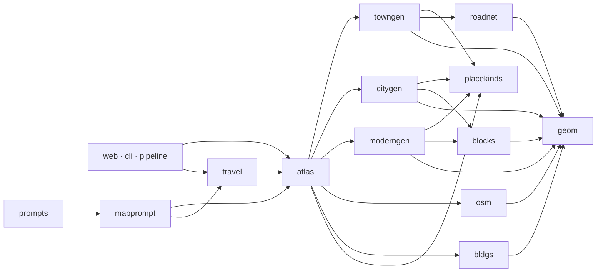
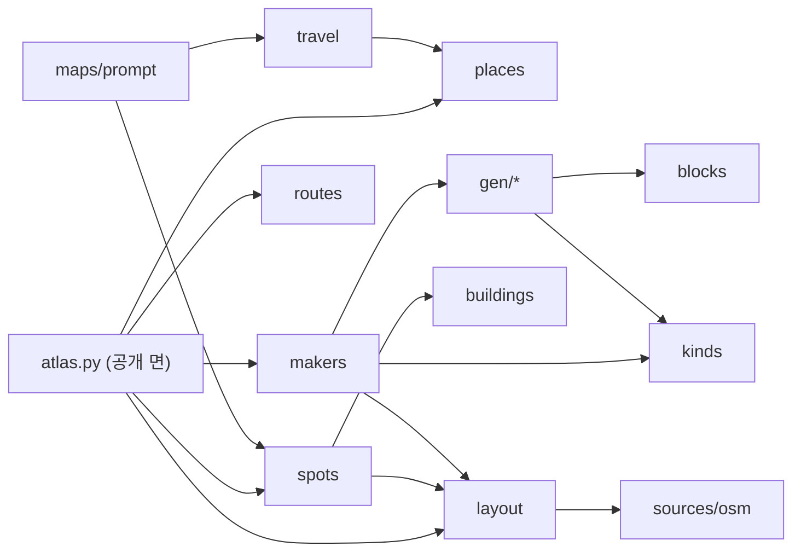

# 지도 모듈 구조

지도 코드는 지금 `canon/` 에 열두 파일(약 6,300줄)과 화면 파일 여섯(합쳐 2,607줄)으로 흩어져 있다. 이 문서는 그 경계를 세 단계로 정리하는 설계다.
1 · 2절은 단계 1([01-boundaries.md](specs/01-boundaries.md))과 단계 3([03-atlas-js.md](specs/03-atlas-js.md)) 뒤의 구조다. 3절의 문제와 줄 번호는 단계 1 전(main `d61a100` 에 #139 · #140 을 합친 것) 기준이다. 문제 1 · 2 · 3 · 5 · 6 은 단계 1 이, 문제 7 은 단계 3 이 풀었다.

## 1. 지금 구조

| 파일 | 줄 | 하는 일 | 가져오는 지도 모듈 |
|---|---:|---|---|
| `canon/atlas.py` | 1,049 | 장소 · 핀 · 위치 글 잇기, Watabou 읽기 · 지도 파일, 길찾기, 건물 고치기, 자리 찾기 · 건물 한 줄, 지도 만들기 조립(`MAKERS`), 위치 글 정리, 명령줄 출력 | bldgs, citygen, geom, moderngen, osm, placekinds, towngen (`atlas.py:23`) |
| `canon/travel.py` | 337 | 이동 시간 검사, 프롬프트 이동 거리의 줄 데이터(`episode_moves`) | atlas (`travel.py:23`) |
| `canon/mapprompt.py` | 55 | 쓰기 · 검수 프롬프트의 지도 블록 글과 예산: 이동 거리 · 검수 이동 줄 · 장소가 놓인 건물 | atlas, travel (`mapprompt.py:6`) |
| `canon/towngen.py` | 938 | 마을 생성기 | geom, roadnet, placekinds (`towngen.py:17`) |
| `canon/citygen.py` | 1,170 | 도시 생성기 | geom, blocks, placekinds (`citygen.py:20`) |
| `canon/moderngen.py` | 764 | 현대 동네 생성기 | geom, blocks, placekinds (`moderngen.py:23`) |
| `canon/blocks.py` | 129 | 블록 · 필지 쪼개기 공용 도구 (`citygen` 에서 옮김, 밑줄 없는 이름) | geom |
| `canon/placekinds.py` | 64 | 장소 종류 `CATEGORIES` · `classify` · `default_put` · `water_for` (`towngen` 에서 옮김) | 없음 |
| `canon/roadnet.py` | 432 | 길망 키우기 (Parish–Müller) | geom |
| `canon/osm.py` | 546 | OpenStreetMap 파일 → 지도 데이터 | geom |
| `canon/fill.py` | 253 | OpenStreetMap 지도의 빈 블록 채우기 ([04](specs/04-empty-blocks.md)) | blocks, geom, moderngen(수치만), osm |
| `canon/bldgs.py` | 512 | 건물 쓰임 · 층수 · 사람 · 거리 이름 | geom |
| `canon/geom.py` | 347 | 기하 도구. 지도를 모른다 | 없음 |
| `canon/static/atlas.js` | 1,924 | 지도 화면 뼈대 (상태 · 불러오기, 그림, 확대 · 이동 · 이름표, 옆 칸, 화면 조립, 저장, 되돌리기, 남은 동작 · CSS) | — |
| `canon/static/atlas-gen.js` · `atlas-travel.js` · `atlas-table.js` · `atlas-export.js` · `atlas-find.js` | 246 · 69 · 187 · 108 · 73 | 기능 파일: 지도 만들기, 이동 시간, 표, 내보내기, 이름으로 자리 찾기 | — |

줄 수는 `wc -l` 로 셌다. 가져오는 지도 모듈은 모듈 맨 위의 `from . import …` 줄이다. `travel.episode_block` · `atlas.episode_block` 은 시험이 부르는 옛 이름이라 함수 안에서 `mapprompt` 를 가져온다. `towngen` 은 `CATEGORIES` · `classify` · `water_for` 를 다시 내보낸다(시험이 읽는다). `tests/test_map_imports.py` 가 순환이 없고 생성기끼리 가져오지 않는지 본다.

지도 밖에서 지도 모듈을 부르는 곳:

- `web.py`: `atlas.*` 약 30개 이름. 지도 화면(`atlas_view`)은 `atlas.summary` 에 `travel.view` 를 붙인다. 웹 함수 이름은 Swift 앱의 연산 이름이다(`swift/Sources/CanonAPI/openapi.json`).
- `cli.py`: `atlas.*` (설정 칸은 `atlas.MAKERS`) · `placekinds.CATEGORIES` · `travel.*`.
- `pipeline.py`: `atlas.places` · `clean_sort` · `gen_places` · `MAKERS`, `placekinds.CATEGORIES` · `CATEGORY_IDS`, `moderngen.PLACE_KINDS`.
- `prompts.py`: `mapprompt.travel_block` · `travel_check_rule` · `spot_block`.
- 그 밖: `features.py`(`travel.delta_warnings`), `birth.py`(`atlas.places`), `mock.py`(`placekinds.classify` · `water_for`, `atlas.MAKERS`), `schema.py`(설명 글).

## 2. 의존 그림 (지금)



화살표는 모듈 맨 위의 `from . import …` 줄이다(1절 표의 줄 번호). 순환이 없다. `cli` · `pipeline` · `mock` 은 `placekinds` 도 바로 읽는다.

## 3. 문제

1. **생성기가 다른 생성기의 비공개 함수를 쓴다.** `moderngen.py:24` 가 `citygen` 의 `_cut` · `_inset` · `_parts` · `_scatter` · `_fit_rect` · `_crossings` · `_line_hit` · `_unit` 를 가져온다. `citygen` 을 고치면 `moderngen` 이 말없이 바뀐다. 빈 블록 채우기도 같은 블록 쪼개기가 필요하다.
2. **장소 종류가 마을 생성기 안에 있다.** `CATEGORIES` 는 `towngen.py:40` 에 있고 `citygen` · `moderngen` · `pipeline` · `cli` · `mock` 이 가져간다. 현대 장소 종류(편의점 · 역 · 학교)를 둘 자리가 없다.
3. **`atlas` 와 `travel` 이 서로 가져온다.** `atlas.summary` 가 `travel.view` 를 부르고(`atlas.py:141`), `travel` 은 `atlas` 의 장소 · 거리를 쓴다. 둘 다 모듈 맨 위에서 서로를 가져오고, 함수가 불릴 때 속성을 읽어서 지금은 돌아간다. 가져오는 순서나 `from … import 이름` 꼴이 바뀌면 깨진다.
4. **`atlas.py` 한 파일이 일곱 가지 일을 한다.** 섹션 주석 7개(`# ----------`)가 그 경계다. #140 이 자리 찾기 · 건물 한 줄 섹션 둘을 더해 9개, 1,054줄이 된다.
5. **프롬프트 글을 데이터 모듈이 만든다.** `travel.episode_block` · `check_rule` 과 #140 의 `atlas.episode_block` 이 데이터 계산과 프롬프트 문구를 함께 가진다. #140 은 그래서 `atlas` 가 `context` 를 가져온다.
6. **생성기 등록이 한 곳이 아니다.** `atlas.MAKERS`(`atlas.py:656`)가 있지만 `cli.py:1670` · `cli.py:2450` · `mock.py:604` 는 `towngen.OPTIONS` 를 바로 읽고, `atlas.gen_info` 는 `citygen.WARD_KINDS` · `moderngen.ZONES` 를 바로 읽는다. 생성기를 더하면 여러 곳을 고쳐야 한다.
7. **화면 파일 하나가 2,454줄이다(#140 뒤 2,554줄).** 섹션 주석 13개가 있다. 다른 화면은 기능마다 파일을 나눈다(`AGENTS.md` 의 화면 파일 표).

## 4. 목표 구조

```text
canon/atlas.py            공개 면: 지금 이름을 그대로 내보낸다 (web · cli · pipeline · prompts 는 고치지 않는다)
canon/maps/
  places.py               장소 · 핀 · 위치 글 잇기 · frames · match · 위치 글 정리   (atlas 에서)
  layout.py               지도 데이터 형식: 읽기(Watabou) · 파일 · parse_upload · layout_info · enrich   (atlas 에서)
  routes.py               road_graph · route · 길 밖 걷기 · add_routes   (atlas 에서)
  buildings.py            bldgs 전부 + building · set_building · building_counts   (bldgs, atlas 에서)
  spots.py                find_spots · spot_line · fill_spots   (#140 의 atlas 에서)
  kinds.py                장소 종류 CATEGORIES · classify · water_for, 현대 장소 종류   (towngen 에서)
  blocks.py               블록 · 필지 쪼개기 공용 함수 (밑줄 없는 이름)   (citygen 에서)
  makers.py               생성기 등록 MAKERS · OPTIONS · VERSION · 구역 이름 · gen_places · generate · apply_generated   (atlas 에서)
  gen/towngen.py · citygen.py · moderngen.py · roadnet.py
  sources/osm.py
  geom.py
  travel.py               이동 시간 계산 (프롬프트 문구 빼고)
  prompt.py               프롬프트 블록: 이동 거리 · 장소가 놓인 건물 · 검수 규칙 줄
```



`geom` 은 맨 아래층이라 그림에서 뺐다. `routes` · `buildings` · `blocks` · `sources` · `gen` 이 가져온다.

의존 방향 규칙:

- 아래층은 위층을 가져오지 않는다. 아래에서 위로 `geom` → `blocks` · `kinds` · `sources` → `gen` · `layout` → `buildings` · `routes` → `places` · `spots` · `makers` · `travel` → `prompt` → `atlas.py`.
- 생성기끼리 서로 가져오지 않는다. 함께 쓰는 것은 `blocks` · `kinds` 에 둔다.
- `schema.py` 는 어디서든 가져와도 된다. `context` 는 `prompt` 만 가져온다.
- 화면 · 명령줄 · 파이프라인은 `atlas.py` 만 부른다. 지금 `towngen.OPTIONS` 를 바로 읽는 곳은 `atlas.MAKERS` 를 거친다.

## 5. 단계

각 단계는 PR 하나다. 단계마다 동작은 바뀌지 않는다. 작업 명세서는 [specs/](specs/) 에 있다.

| 단계 | 내용 | 명세서 | 시작 조건 |
|---|---|---|---|
| 0 | 이 문서들 | — | 지금 |
| 1 | 경계 정리, 파일은 그대로: 문제 1 · 2 · 3 · 5 · 6 | [01-boundaries.md](specs/01-boundaries.md) | #139 · #140 머지 뒤 |
| 2 | `canon/maps/` 로 옮기기, `atlas.py` 는 공개 면 | [02-package.md](specs/02-package.md) | 단계 1 머지, 열린 지도 PR 없음 |
| 3 | `atlas.js` 나누기 | [03-atlas-js.md](specs/03-atlas-js.md) | 단계 2 와 따로 해도 된다 |

모든 단계의 받아들이는 조건:

1. 전체 시험이 통과한다(`CANON_HOME=$(mktemp -d) python -m pytest -q tests`).
2. 생성기 스냅샷 시험이 그대로다: `tests/test_mapgen.py`, `tests/test_citygen.py`, `tests/test_moderngen.py`. 생성기 `VERSION` 과 `bldgs.VERSION` 을 올리지 않는다.
3. `python scripts/make_openapi.py` 뒤 `swift/Sources/CanonAPI/openapi.json` 에 바뀐 곳이 없다. 웹 함수 이름을 바꾸지 않는다.
4. 같은 시드 · 같은 입력의 지도 데이터가 바이트까지 같다.

## 6. 위험

- **열린 PR 과 부딪힌다.** #139 · #140 이 `schema.py` · `prompts.py` · `atlas.py` · 문서를 고친다. 단계 1 · 3 은 두 PR 을 합친 브랜치 `claude/map-stack` 위에 쌓았다. 그래서 두 PR 이 먼저 머지되어야 한다.
- **화면 시험이 섹션 주석으로 자른다.** `tests/test_atlas_js.py:16` 은 `const atlasTextW` ~ `// ----- 옆 칸 -----` 를, `tests/test_atlas_js.py:27` 은 `// ----- 되돌리기 · 따라가기 계산` ~ `// ----- 확대 · 이동, 이름표 -----` 를 잘라 돌린다. 단계 3 은 두 구간을 `atlas.js` 에 남겨 시험을 고치지 않았다.
- **`mock.py` 가 생성기 안쪽을 읽는다.** `towngen.classify` · `water_for` · `OPTIONS` 를 쓴다(`mock.py:604` 등). 단계 1 에서 `placekinds` · `MAKERS` 를 거치게 고쳤다.
- **옛 지도 파일.** 지도 파일은 `map/` 에 JSON 으로 남아 있다. 형식(키)을 바꾸지 않는 한 옮기기는 옛 파일에 영향이 없다. 형식을 바꾸면 [layout.md](layout.md) 의 판 규칙을 따른다.
